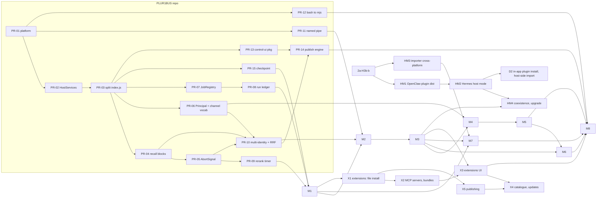

# Milestones — PLUR1BUS Harness (Variant B)

**Status:** Phase 0 deliverable, awaiting owner approval; **amended 2026-10-15 (D111 remainder on branch `grok/d111-remainder`, not on `main`: M1b-2b D111 status paragraph names the live-level RPC, exec wrap, RPC traceparent and `plur1bus logs` tests; no scope, effort, date or acceptance criterion changed)**; **amended 2026-10-14 (status reconciliation against `origin/main` @ `823c0a58`: status paragraphs for M1, M1b-2b/2c/3, M2, M3, M4, M5, M6, M7, M8, Track D, Track X and HM, a status vocabulary under the §2 table and the new §8 progress estimate; no scope, effort, date or acceptance criterion changed)**; **amended 2026-10-07 (status reconciliation against `origin/main` @ `809f2d5`: status paragraphs for M1b-2b/2c/3, M2, M3, M4, M6, M8, Track X and HM; no scope, effort, date or acceptance criterion changed)**; **amended 2026-10-06 (§2 table reconciled with the section ranges, D109/D106 priced, total 343–527; see the note under the table)**; **amended 2026-10-03 (D112 model discovery, D42 in detail: M2 scope, acceptance 18, effort, §2 table)**; **amended 2026-10-02 (owner design decisions C8, C9, C12: track D paragraph and D2 row, M3 remote access and first-run wizard, M3 blocking questions)**; **amended 2026-10-02 (owner design decisions C13–C17 and C19–C22: track D paragraph, X3 row, M3 responsive targets)**; **amended 2026-10-01 (D111 logging and diagnostics: foundation first in M1b-2b, later parts in M2, M3, M8, D2; §2 table M1b row and total)**; **amended 2026-10-01 (owner design decisions C1, C2, C4, C18 and the regrouped design canvas: track D paragraph)**; **amended 2026-09-30 (D109 permission and approval model: M1b-2b, before D106)**; **amended 2026-09-28 (owner requirements on host-mode plugin packages and cross-platform migration, D86–D91: §2 table, track HM, M7 effort, M8 host adapters, D2, §3 graph)**; amended 2026-09-27 (track D, owner decisions D77 and D78: §2 track D, M8, §6.2 row 14, §6.3, §7); **amended again 2026-09-27, closing desktop spec §11: D1 now gates v0.1.0** (§2, Track D, M8, §7); **amended 2026-09-27 for the extensions ecosystem (core spec D79–D85): track X in §2, M6 scope and effort, §3**; **amended 2026-09-28 for the basics quality bar (D94–D108): M2 scope, acceptance 12–14 and effort, M5, M6, M8 acceptance 8, track D D1/D3, §6.1**; **amended 2026-09-30 for OpenAI auth (D110): M2 scope, policy catalogue, acceptance 15–17, effort, §2 table**; **amended 2026-09-28 for the design canvas page `v2 · Desktop & responsive`: Track D UI source, M3 scope and acceptance 9 (binding responsive rules, `V2Search`), X3 row** · **Date:** 2026-09-22 · **Owner:** Christian (Cyb3rb1ade)
**Re-cut of** `docs/phase0/auftrag-original-2026-09-21.md` §12 (M0–M8) for **Variant B** per `docs/phase0/brief.md` D1–D11 and ADR-001 (K4 tripped, K3 red on Windows arm64). Every §12 acceptance criterion reappears below, re-cut; the 16 operational criteria of `docs/learnings-hermes-openclaw.md` §3 are mapped as **L1–L16**; ADR-001's targets T1–T7, ADR-009's A1–A8 and ADR-010's B1–B10 are milestone exit criteria. Engine work is PRs in the **PLUR1BUS repo** (`docs/engine-extraction.md` §c, PR-01…PR-15; ADR-002's P0–P10 is the same plan at coarser grain).

---

## 1. Principles

| # | Principle | Source |
|---|---|---|
| P1 | **CLI before GUI.** Every capability is usable from `plur1bus-harness` before it gets a screen. M1/M2 ship no UI; M3 is the first UI milestone. | brief §1 D1; ADR-004 (CLI and UI are peer clients of one API) |
| P2 | **Two repos, interleaved.** Engine PRs land in `Cyb3rb1ade/PLUR1BUS`; harness milestones consume the engine by pinned version. During M1 the harness consumes CI prereleases `0.x-<sha>`; from M2 semver ranges. | D3; ADR-002 §"Two repos vs monorepo"; `engine-extraction.md` §e.4 |
| P3 | **Each milestone ends with: demo guide + test report + open points + owner approval.** No milestone starts before the previous is approved; §12's closing rule, kept verbatim. | original §12 |
| P4 | **Small, topical commits** (Conventional Commits), CHANGELOG entry per milestone, no secrets or real user data anywhere. | original §0; brief §3 |
| P5 | **Subagent-driven implementation, model matched to task:** Haiku for mechanical extraction/port and fixture generation, Sonnet for code reading, adapters, matrices and tests, Opus for API/contract design, security review and ADR amendments. | D11 |
| P6 | **One independent reviewer per milestone** — a subagent that did not write the code, running the milestone's own acceptance list plus the DoD in §6, reporting to the owner. Engine PRs additionally carry the behaviour-neutrality gate. | D11; `engine-extraction.md` §c |
| P7 | **No product code on a criterion without a test.** Acceptance criteria below are written as executable tests (§5); a milestone is not done because a demo worked once. | original §11 |

**Effort convention.** All estimates are **agent-days (ad)**: one focused subagent working day including its own unit and contract tests and the doc page for that surface, with **one human owner** reviewing. Ranges are low = everything verified in Phase 0 holds; high = one named risk in §4 materialises. **Excluded:** owner review latency, upstream PLUR1BUS review latency (P2), and spikes already itemised in the ADRs (ADR-011 §"Verification spike list" ≈ 10 ad; ADR-004 framework spike 2 ad; ADR-008 A2A-0.3 spike 0.5 ad) — those are added per milestone where they block.

---

## 2. Milestones

**M1 is split in two, per owner decision 2026-09-22 (B15, "yes"):** M1a ends in an **owner gate** before M1b starts, so a mis-drawn extraction boundary is caught after three PRs rather than after ten.

| M | Title | Engine PRs | Effort (ad) | Blocking questions |
|---|---|---|---|---|
| M0 | Phase 0 — analysis, ADR-001…011, matrices | — | done | Q1 (answered: B) |
| M1a ✅ **done 2026-09-23** — merged as [openclaw-plur1bus-memory#184](https://github.com/Cyb3rb1ade/openclaw-plur1bus-memory/pull/184) (`main` @ `01861add`); suite 5225/5222/0/3; contract 1.2.0; owner gate open (see `docs/superpowers/sdd-archive-m1a/whole-branch-review.md` §Owner-gate notes) | Engine extraction: platform, HostServices, index.js split · `Host` interface · golden-prefix corpus — **owner gate** | PR-01…PR-03 | **~14–20** (part of the 49–76 below) | ADR-002 Q1/Q2 (both answered 2026-09-22 — package names confirmed, recall budget "40/60" interpreted as 400/600 ms pending confirmation), **before PR-01** |
| M1b | Recall/capture/jobs · core daemon · IPC · session store · in-process embedding · dreaming scheduler · CLI | PR-04…PR-09, PR-15 | **~35–56** (part of the 49–76 below: 31–50 + 4–6 logging foundation D111, 2026-10-01) | Q8 (answered: keep `SOUL.md`, D14), Q9 (answered), Q10 (answered: four files, D15), Q11 (answered: measure first); ADR-009 Q1–Q7; ADR-010 Q6/Q7 |
| M1b-2b additions | D109 permission model + D106 host toolset (+ D109 later surfaces), priced here for the first time | M1b | **16–24** (D109 6–9, D109 later surfaces 3–4 across M2/M3/M4/D2/D4, D106 7–11; all counted here) | ADR-014 |
| M2 | Models, providers, auth, caching, budgets · CLI direct chat (D92) | PR-10, PR-11 | **67–103** (was 37–57 in this table; the section range already held +4–6 direct chat, 2026-09-28; +8–12 OpenAI auth D110, 2026-09-30; +2–3 provider/model logging, usage table, payload capture D111, 2026-10-01; +3–5 model discovery D112, 2026-10-03) | Q3; ADR-006 Q1–Q5; ADR-005 Q1–Q5; ADR-010 Q1–Q5 |
| M3 | Harness API · users/roles · agents · web UI skeleton · web direct chat as first screen (D92/D93) | PR-06 follow-up (`subject`/v2) | **40–60** (+6–9 direct chat; +2–3 log viewer, activity feed D111) | Q5; ADR-004 Q1–Q5; ADR-007 Q1–Q6 |
| M4 | Channels: Telegram, Discord, Matrix, Buzz · `/web` chat handoff (D93) | PR-06 channel vocabulary (**M4 blocker**) | **23–36** (+1–2 handoff) | Q4; ADR-003 Q1–Q3 |
| M5 | Collaboration: projects, consult/delegate, guardrails, trace · promote a chat to card/project (D92) | — | **24–38** (+1–2 promotion) | ADR-003 Q4/Q5 |
| M6 | MCP/ACP/A2A · external coding agents · skills · plugins | — | **32–48** (skills/plugins UI moved to X3) | Q7; ADR-008 Q1–Q6; ADR-011 Q1–Q6 |
| M7 | Importers: OpenClaw, Hermes (cross-platform sources: WSL discovery, snapshot producer, D90/D91) | PR-10 (identity migration path) | **17–27** (+3–5 for D90/D91, 2026-09-28) | ADR-007 Q4 (beantwortet 2026-10-05); plugin-distribution spec C7, C8, C12 |
| M8 | Platform hardening · installers · services · release v0.1.0 | PR-12, PR-13, PR-14 | **21–34** (+1–2 `1staid bundle`, OTLP export D111) | Q2; ADR-001 Q3/Q5 |
| D1 | **Part of v0.1.0** (desktop spec §11 Q5, decided 2026-09-27): container bundle + thin shell, after M3 | M3; M2 | **22–33** (in the total; +2–3 installer shortcuts D101, see Track D) |
| D2–D4 | Track D remainder: native integration + OS-signed releases, browser container/CEF panel, computer use + WebMCP — after D1, beside M4–M8 | D1 | **31–48** (10–15 + 15–23 + 6–10 per Track D; not in the total) | — |
| X1–X3 | **Extensions, part of v0.1.0** (D79–D85): file install, enable/disable, uninstall for skills and plugins (X1, after 2a-H3b-b), MCP servers and bundles (X2, with 2b), web UI + D1 hooks (X3, with M3) | 2a-H3b-b; 2b; M3 | **15–22** (in the total; 4–6 of X3 moved from M6) | extensions spec §13 Q1–Q17 |
| HM1–HM3 | **Host-mode plugins** (D86–D91, owner 2026-09-28): OpenClaw plugin distribution on five targets + installers (HM1, after 2a-H3b-b), Hermes host-mode adapter (HM2, beside 2b; moved from M8), importer cross-platform fixes now (HM3) | 2a-H3b-b; 2a RPC | **17–26** (in the total) | plugin-distribution spec §C C1–C6, C11 |
| HM4 | Host-mode remainder: coexistence guards, Hermes on an existing harness, host → harness upgrade, Hermes catalogue listing | HM2; M3 | **2–3** (not in the total) | spec §C C4, C9 |
| X4–X5 | Extensions remainder: signed web catalogue + per-item updates + revocation (X4, target v0.2), publishing tooling + first packages (X5) | X1–X3 | **8–13** (not in the total) | extensions spec §13 Q2–Q4, Q11–Q13 |
| | **Total** | | **343–527** (was 294–451, which did not equal its own rows; sum of the in-total rows: M1 49–76 + M1b-2b additions 16–24 + M2 67–103 + M3 40–60 + M4 23–36 + M5 24–38 + M6 32–48 + M7 17–27 + M8 21–34 + D1 22–33 + X1–X3 15–22 + HM1–HM3 17–26; history of the older total: was 242–370; +17–26 track HM, +3–5 M7, +12–19 direct chat D92/D93, 2026-09-28; +8–12 OpenAI auth D110, 2026-09-30; +9–14 logging and diagnostics D111, 2026-10-01; +3–5 model discovery D112, 2026-10-03; reconciled 2026-10-06) | |

**Amended 2026-10-06 (numbers only, no scope changed).** The §2 table rows did not add up to the stated total (294–451) because several rows were older than their own sections and three decisions were never priced in. Changes: M1 row 45–70 → 49–76 (the D111 foundation 4–6 was already in the old total but not in the section; M1b 31–50 → 35–56); M2 37–57 → 67–103; M3 38–57 → 40–60; M5 19–30 → 24–38; M6 26–38 → 32–48; M8 20–32 → 21–34 (all to their section ranges); D1 20–30 → 22–33 (the Track D table, +2–3 D101); D2–D4 26–40 → 31–48 (their Track D rows, not in the total); new row M1b-2b additions 16–24 (D109 6–9 and its later surfaces 3–4, D106 7–11, none priced before). **Total 294–451 → 343–527.** Open point: of D109's 3–4 later-surface ad, the share that falls on D2 and D4 is outside the total by the table's own rule; all 3–4 are counted in the total here (conservative) until the owner splits them.

**Status vocabulary (2026-10-14).** In the status paragraphs, each acceptance criterion carries one of four values. **erfüllt**: a named test on `main` covers it (the test path or PR is given). **gebaut, aber nicht abgenommen**: code and tests exist, but only against fakes, fixtures or a stub, on one platform, or in a suite that CI skips; no real-platform or owner acceptance. **teilweise**: part of the criterion is covered, the rest is named. **offen**: not built, or no test. "Built" always means code on `main` plus tests. Nothing is ticked in the criteria lists themselves, and no scope, effort or criterion text was changed. No CI result was consulted: statements about CI mean what the workflow files run.

### M0 — Phase 0 (done, awaiting approval)

Delivered: `brief.md`, `host-contract.md`, `engine-extraction.md`, `learnings-hermes-openclaw.md`, `provider-matrix.md`, `platform-matrix.md`, `import.md`, ADR-001…011, `assumptions.md`, this file. **Exit:** owner approves B (Q1), the ADR set moves Proposed → Accepted, and the blocking questions for M1 are answered. **Effort:** spent.

### M1 — Engine extraction, core daemon, CLI skeleton (split into M1a + M1b, owner decision 2026-09-22, B15)

**M1a/M1b boundary.** Per the owner's "yes" to B15, M1 is split at the point where a mis-drawn extraction boundary would otherwise surface three PRs later: **M1a** = PR-01 (`lib/platform.js`) → PR-02 (`HostServices` injection) → PR-03 (split `index.js` into engine + adapter) plus the frozen `Host`/`Engine`/`Principal`/`TurnOrigin` `.d.ts` and the golden-prefix corpus, gated by an **owner review** before M1b starts. **M1b** = everything else below (PR-04…PR-09, PR-15, the core daemon, IPC, session store, in-process embedding, dreaming scheduler, CLI skeleton, benchmarks). The scope, acceptance and exit criteria below are written for the combined M1; the per-PR grouping into M1a/M1b is given in the scope bullets and the table row above.

**Goal.** PLUR1BUS is a host-neutral engine; the harness is its native host; a fact said in session 1 is recalled in session 2 from the CLI, with rerank, and a killed engine never blocks a turn.

**Scope**
- **Engine (PLUR1BUS repo):** PR-01 `lib/platform.js` (`securePath`/`ipcAddress`/`isUnsafeLink`/`canonicalIdentityPath`, `HOME`→`homedir()`) · PR-02 `HostServices` injection (341 `api.logger` sites) · PR-03 split `index.js` into engine + `adapter/openclaw` · PR-04 `recall()` → `ContextBlock[]` with the six named blocks and the 17 000-char budget preserved · PR-05 **mandatory `AbortSignal`** through recall (fixes `memory-host-runtime.js:170-171`) · PR-06 typed `Principal`/`TurnOrigin` + open channel vocabulary · PR-07 `JobRegistry` for all 18 job names · PR-08 **run ledger written before any early return** (behaviour-changing, owner decision) · PR-09 single rerank timeout owner · PR-15 `checkpoint()`. `engine-extraction.md` §c.
- **Core daemon:** exactly one resident process per installation, multi-tenant by `agentId`; JSON-RPC 2.0 over UDS / named pipe with `timingSafeEqual` token, `0o600`/pipe-ACL; submit/event turn loop; `node:sqlite`+FTS5 session store (V1/V2); supervisor with backoff and health. ADR-001 §"Process model"; ADR-010 L2.
- **In-process embedding + reranking**, one load per model, warm-up in background, in-process owner replacing the loopback claim listener on the harness path (ADR-001 conflict C1). ADR-006 Option A; D9.
- **CLI `plur1bus-harness`:** `setup`, `doctor`, `agent`, `memory`, `dreams` (+ stubs for `user`, `model`, `login`, `channel`, `project`, `import`, `service`, `update`, `uninstall`). Bundled, lazy `import()` for every native/provider dependency, `NODE_COMPILE_CACHE`. ADR-004 §"Harness API" CLI row; `platform-matrix.md` §5.
- **Recall/capture/tools/commands:** 5 tools, the `/state|/memory|/forget|/correct|/mf|/share` command set, deny-by-classification tables kept engine-side; harness budgets soft 400 ms / hard 600 ms (re-answered 2026-09-22, "40/60" — interpretation pending confirmation; was 1 200 ms hard), reactivation race 50 ms unchanged. ADR-002 §"Time budgets"; Q8 keeps `SOUL.md` unchanged (owner decision D14, 2026-09-22 — reverses the earlier planned rename to `persona.md`; ADR-003).
- **Dreaming scheduler** in the core: three phases with own cron+timezone+enable+stagger, `dream_run`/`dream_schedule`/`dream_candidate` tables, all guards (breaker, dedupe, staleness, min corpus, utility gate, bounded prior-entry loss, model-emits-operations, fresh context, budget, concurrency 3), idempotency key over transcript digest, diary, `dreams status|run|log|diary`, doctor check. **Never a host cron.** ADR-009.
- **Fail-soft + degraded mode** as a first-class state visible in CLI, API and (later) UI. ADR-002 §"Degraded mode".
- **Benchmarks from day one:** B1–B10 harness with mock provider; B1/B6/B9 as build gates (ADR-010 Q7 may relax to advisory until M3).

**Acceptance** (§12 M1 re-cut, plus operational criteria)
1. Fact stated in session 1 is correctly recalled in session 2 **with rerank** (§12 M1).
2. `/forget` is archive-first; tombstone written; source row recoverable (§12 M1).
3. **Core kill blocks no turn:** 1 000-turn soak with the engine killed at random — 0 blocked turns, degraded state visible in CLI and `doctor` (§12 M1; T5).
4. No second memory loop: the OpenClaw memory slot and any host dreaming are not reachable on the harness path; one engine owns `rem-dream`/`consolidate-daily`/`classify-recent` (§12 M1 re-cut of "Hermes memory loop off"; D4).
5. **T7:** exactly one resident core process; no second LanceDB/ONNX handle.
6. **A1–A8** (ADR-009) pass with a virtual clock for A1/A8 — these carry **L4** (dedupe + circuit breaker + spend cap, A3), **L5** (never promote `recalls = 0`, A5) and **L6** (importance-triggered with cron only as a floor, subject to ADR-009 Q2).
7. **L15:** every job run, including every skip, has a ledger row written before the body. **L16:** no phase is disabled by a side effect of another switch; the probe may degrade, never disable.
8. **L1/L2/L14:** compaction summariser bound proven by property test over sessions 1×–10× the window; a single tool result is truncated-with-pointer at the boundary; compaction thresholds computed from measured token counts.
9. **L3:** a clipped or dropped injection block emits a typed event and a deferral record — no silent truncation anywhere (engine PR-04 + ADR-002).
10. **L12:** capability detection follows memory → 24 h disk → permissive default + background refresh; **B9/T3** assert 0 socket and 0 spawn syscalls during prompt assembly.
11. **B1 < 100 ms p95** for `--help` on macOS arm64 and Windows x64; **B8 < 3 s** daemon ready without local models, **< 15 s** with the default model warmed in background.
12. Every engine PR green under both adapters: full PLUR1BUS suite (502 files / 109 502 lines) + the per-PR gate, incl. the golden-prefix byte-identity corpus (PR-04).

**Blocking questions:** Q8 (persona file name), Q9 (default embedding model — needed for warm-up and store creation), Q10 (promotion target `KNOWLEDGE.md`), Q11 (cost cap); ADR-002 Q1 (package names) and Q2 (400/1 200 budget) **before PR-01**; ADR-009 Q1–Q7; ADR-010 Q6 (pre-warm) and Q7 (gate strictness). ADR-009 action item 1 (does anything read REM trends?) is **blocking for giving REM a schedule**.

**Effort 45–70 ad** for the engine, daemon, scheduler and CLI lines below, **49–76 ad with the D111 logging foundation** (+4–6, M1b-2b, amended 2026-10-01; reconciled 2026-10-06 — the lines below do not include it). D109 and D106 are priced in the §2 row `M1b-2b additions` (16–24 ad), not in this range. Engine PR-01…09+15 28–42 (PR-02/03/06/10 are L, 4 × L in the plan), core daemon + IPC + session store 8–12, scheduler + guards + ledger 6–10, CLI skeleton + bundling 3–6. High end assumes boundary rework in PR-03 (risk R1 §4).

**Exit:** demo guide (two-session recall, kill-the-engine, `dreams run deep`), test report incl. B1–B10 baseline, CI matrix skeleton green on five targets with the three named degradations, open-points list, CHANGELOG, `docs/embedding-identity.md`.

**Status — M1b-2a-H1 (harness foundation) — done 2026-09-25:** acceptance 1 (two-session recall via the CLI with a core SIGKILL and journal replay, `tests/system/two-session-recall.test.ts`; rerank asserted in the nightly real-model run, `.github/workflows/nightly.yml`), spec criteria 6, 7, 8 (B1 `--help` p95 < 100 ms and B11 `core.status` p95 < 5 ms as gates in `pnpm bench`, B8 advisory; B9 in `packages/core/test/b9-no-syscalls.test.ts`), 10 (docs half); H2 carries 2, 3, 4, 5, 9, 11, 12.

**Status — M1b-2a — done 2026-09-28** (H1 → H2 → H3a → H3b-a → H3b-b, PRs #1–#40; Task 8 of H3b-b, the riskier
`1staid repair` steps, was in flight in a parallel worktree when this was written and is on `main` since PR #45, merged 2026-09-28: `crates/plur1bus/src/repair/risky.rs`). All twelve §10 acceptance
criteria are met on this codebase:

1. Two-session recall with rerank — done (H1).
2. Kill soak (1 000 turns, `tests/system/kill-soak.test.ts`) — done (H3a).
3. Reconnect not respawn (`tests/system/reconnect.test.ts`) — done (H3a).
4. Config restart classes (`tests/system/config-restart.test.ts`) — done (H3b-a).
5. Module isolation (`tests/system/modules.test.ts`) — done (H3b-a).
6. No OpenClaw object in the core (`scripts/lint-hygiene.mjs`) — done (H1, extended each batch).
7. Contract fixtures (Rust/TypeScript `rpc-schema` parity) — done (H1).
8. **Benchmarks** — B1/B9/B11 gates green, B8 advisory; see `docs/reports/2026-m1b-2a-baseline.md` for the
   sandbox numbers and what still needs the owner's reference hardware (O6, open).
9. Service install/status/uninstall on five targets — done (H3a; native binaries for all five built by
   H3b-b Task 10's `harness-release.yml`, Windows OS-restart-after-kill still pending PR-11 per the spec).
10. Skill freshness test (`skills/plur1bus-ops`) — done (H3b-b Task 9).
11. **Engine side E1–E6:** E1 (`MemoryOps`), E2 (`admin.*`), E3 (`embedding.probe`/`serve`), E4 (`status()`
    health) and E5 (host-neutral `engine-config.schema.json`) are merged; the engine is pinned at `6868b7b1`
    (plugin origin/main after PR #237; `memory.rebind`/`memory.unbind` from PR #219 on top of PR #217 and the lock-ownership and log-redaction fixes), contract **1.12.0**. **E6** (`HostServices` neutralised, contract 2.0, observable/breaking) is **not
    yet started** — it is scheduled before M4 per the spec, and this milestone does not depend on it.
12. Fixture module, zero-edit install (`packages/module-fixture`, `module list`/`module graph`) — done (H3b-a).

**Logging and diagnostics foundation (D111, owner 2026-10-01) lands first in M1b-2b, before D109 and D106:** the shared `log-schema` (record schema, event catalogue, levels, redaction data, Rust/TS parity); writers that emit `ts, level, source{kind,id,version}, event, msg, trace_id, …` with per-source live levels (`logs.levels`, time-limited `trace`), writer-side redaction, truncation, dedup and retention by days; third-party stdout/stderr wrapped, sanitised, redacted and rate-limited with levels from hard signals only; `logs/audit.log` extended (v2 optional fields, `config.set`); trace context over RPC `_meta.traceparent`; `plur1bus logs`. Acceptance: spec §8 tests 1–10 and 12–15 on five targets, including the redaction test over every foundation output (+4–6 ad; provider/model/usage/payload with M2 +2–3, viewer and activity feed with M3 +2–3, `1staid bundle` and OTLP with M8 +1–2, desktop viewer with D2 +1). Spec: `docs/superpowers/specs/2026-10-01-logging-and-diagnostics-design.md`.

**Permission and approval model (D109, owner 2026-09-29) lands with M1b-2b, before D106:** one `policy.decide` in the tool dispatcher (allowed / approval / never) for every tool, MCP, ACP and host-bridge call; capability taxonomy with one effect axis (maps D103 `sideEffects`, extension tool effects, ADR-008 modes); roots with approval outside them, deny-list precedence and per-OS path canonicalisation; grants once/task/session/always; the approval store (HMAC-chained, replay-bound, `approvalsHeld` verified for D104); `grant`/`approval` RPC and CLI, refused to agents; surface trust levels with channel nonces; headless jobs on job-scoped standing grants only; no password route for the agent. Acceptance: per-OS path conformance, store tamper/replay tests, surface-trust matrix, `permission-eval` with zero escapes (+6–9 ad; later surfaces with M2, M3, M4, D2, D4, +3–4 ad). Spec: `docs/superpowers/specs/2026-09-28-basics-quality-bar-design.md` §D109.

**Host toolset (D106, owner 2026-09-28) lands with M1b-2b, on the D109 model:** first-party `fs.*`, `shell.*`, `proc.*`, `sys.*`, `pkg.*`, `apps.*`, `clipboard.*`, `notify` under a principal, with roots, credential deny-list, risk classes and D38 approvals as defined by D109, audit, OS sandbox per spike, a per-OS conformance suite on the five CI targets plus the Windows 11 VM, and host scenarios in `tool-eval`; nothing hosted remotely, Desktop Commander not bundled (+7–11 ad).

**Status — M1 acceptance 1–12 (reconciled 2026-10-14 against `origin/main` @ `823c0a58`).** 1 **erfüllt**: `tests/system/two-session-recall.test.ts` (flat embedder in CI; the real-model rerank leg runs only in `.github/workflows/nightly.yml` with `PLUR1BUS_REAL_MODELS=1`, whose result is not visible from the repository). 2 **erfüllt**: `packages/core/test/memory-ops.test.ts` ("forget archives; a second forget answers alreadyForgotten") and `tests/system/memory-ops.test.ts`. 3 **erfüllt**: `tests/system/kill-soak.test.ts` (200 turns per PR, 1 000 nightly). 4 **erfüllt**: `packages/core/test/dreams-no-host-cron.test.ts` and `crates/plur1bus/tests/coexistence.rs`. 5 **teilweise**: one resident core by supervisor lock and adoption (`crates/plur1bus/tests/adoption.rs`, `supervisor.rs`); no test asserts the absence of a second LanceDB or ONNX handle. 6 **erfüllt**: A1–A8 on a virtual clock in `packages/core/test/dreams-acceptance.test.ts` and `dreams-candidates.test.ts` (A5); caveat: the engine-side candidate producer is still missing, so the candidate gates run on injected candidates only (`docs/dreams.md`). 7 **erfüllt**: ledger row before the body, `packages/core/test/dreams-scheduler.test.ts` ("the ledger (L15, L16)"). 8 **erfüllt**: `packages/core/test/session/compaction.test.ts` (L14 property over 1×–10× the window), `compaction-m2.test.ts`, `compaction-measured-hide.test.ts`. 9 **teilweise**: zone clipping emits `prompt.zone-clipped` (`packages/core/test/prompt/clip-events.test.ts`); the engine-side injection-block deferral record (PR-04) cannot be checked in this repository. 10 **teilweise**: B9/T3 as a JavaScript-level proxy, not a kernel trace (`packages/core/test/b9-no-syscalls.test.ts`); no test for the L12 order memory → 24 h disk → permissive default. 11 **teilweise**: B1 and B11 are gates in `pnpm bench`, run by the `system` job on Linux and macOS (`.github/workflows/ci.yml`); no Windows x64 B1 figure, B8 stays advisory and was above 3 s in the sandbox (`docs/reports/2026-m1b-2a-baseline.md`), and owner decision O6 (reference hardware) is open. 12 **offen**: the engine suites run in the engine repository; the harness only pins `6868b7b1` (contract 1.12.0, unchanged since 2026-10-07), with no contract 2.0 (E6) and no multi-identity contract on the pin.

**Status — M1 criterion 11 follow-up (2026-10-16, performance package #537/#538; acceptance remains teilweise).** The separate five-target `perf-startup` job and reproducible O6 collector are proposed in #537/#538; they are not yet merged or accepted. Local macOS arm64 release measurements (30 starts, declared warmups, all outliers retained): B1 p95 5.68 ms cold-process / 5.05 ms warm-process; B8 healthy Core p95 537.68 ms without local models and 6745.70 ms with default embedder/reranker background warming. Named evidence: `docs/reports/2026-10-16-perf-p1.md` in #537, `scripts/bench/startup.mjs`, help-isolation system test. These are developer-machine figures, **not O6 reference hardware**. Windows x64/ARM and Linux target artifacts, three consecutive green runs and the separate B1 gate-promotion commit are pending; no CI was polled. Owner-designated reference roles: Apple Silicon owner Mac; Windows 11 x64 NAS VM; Windows 11 arm64 Parallels VM on the owner Mac (external drive required); Ubuntu x64 NAS VM. Hardware/model/CPU, cores, RAM, OS version and runtime come only from the generated device reports; all reports/results remain **wartet auf Owner-Messung**. VM results must identify their host role and guest vCPU/RAM and explicitly distinguish comparisons with bare-metal budgets. The one-command-per-device instructions are in performance PR #538. The B1–B11 catalogue/collector in #538 records B5's synthetic mock target miss and B10's missing ceiling/LRU soak explicitly. No budget is relaxed; criterion 11 is not marked erfüllt.

**Status — M1b-2b, M1b-2c and M1b-3 (reconciled 2026-10-14 against `origin/main` @ `823c0a58`; D111 remainder named on branch `grok/d111-remainder` 2026-10-15, not on `main`).** **D111 foundation:** `log-schema` with Rust/TypeScript parity (PR #123); audit hash chain and verification (#179, hardened in #449); `logs.query|tail` (#180); the Core diagnostic writer with redaction, truncation, dedup, rotation and per-source live levels inside the process (#206, #458; `docs/logging.md`). On `main` still missing: the `logs.levels` RPC and its config keys (`updateLevels` is only the internal attachment point), wrapping of third-party stdout and stderr, trace context over RPC `_meta.traceparent`, the top-level `plur1bus logs` command (`plur1bus container logs` streams a container service and is unrelated), supervisor-side writers, and spec §8 tests 1–10 and 12–15 on five targets; D111 is **teilweise** on `main`. **D111 remainder (this branch, not claimed on `main`):** four items have named tests here and are **erfüllt** on this branch only: `logs.levels` live snapshot RPC, Owner/Admin, not persisted (`packages/core/test/logs/methods.test.ts` "level change takes effect immediately and only for that component"); `exec.run` stdout/stderr wrapped as `process.output.line` (`packages/core/test/tools/exec/exec.test.ts` "foreign output is bounded and redacted"; MCP-stdio spawn remains a KNOWN GAP because `mcp/` is out of this remainder's allowed paths); authenticated RPC handlers adopt `_meta.traceparent` (`packages/core/test/logs/rpc-trace.test.ts` "trace-id from RPC to log record", "invalid trace-id is replaced, not adopted"); `plur1bus logs query|tail` (`crates/plur1bus/src/commands/logs.rs`: filter mapping, `E_INVALID_PARAMS` exit 2, signal exit 130). Persistent `logs.levels.*` config keys, supervisor-side writers, MCP-stdio wrapping, and spec §8 tests 1–10 and 12–15 on five targets remain missing; D111 stays **teilweise** as a whole. **D109:** per-OS path canonicalisation and decision evaluator (#120, #121); approval store, grants, `grant.*` and `approval.*` RPC and CLI, dispatcher chokepoint (#190, #433, #448); the OS-confirmation attestation helper that lifts an unattested local connection to T2 (#330, #292). The dispatcher is now constructed in the per-turn tool composition (`packages/core/src/composition/tools.ts`, #293), so agent tool calls reach `decide()` in a running core; `tests/system/turn-pipeline.test.ts` asserts a `policy.decision` audit line. The four D109 acceptance items each have a test and are **erfüllt**: per-OS path conformance (`packages/core/test/policy/paths.test.ts`, three-OS unit matrix), store tamper and replay (`approvals/chain.test.ts`, `grants/integrity.test.ts`), surface-trust matrix (`rbac/surface.test.ts`, `rbac/connection-surface.test.ts`), `permission-eval` (`policy/permission-eval-e2e.test.ts`). D109 is nevertheless not accepted as a whole: `docs/approvals.md` §9 still lists open follow-ups (no T3 attestation supplier, WebMCP `FORBIDDEN_PREFIX` does not name `grant.`/`approval.`, notification delivery still withholds from everyone when any subscriber is not the affected person, taint has no producer, parking of the whole task, fatigue extras in 3.4, privilege-escalation handling for host tools, Settings/`V2Approvals`, D108 remote-control approvals). On this branch (`grok/d109-followups`) the following §9 items have named tests and are closed in `docs/approvals.md`: dispatcher constructed (#293, `tests/system/turn-pipeline.test.ts` `policy.decision`); registry name protection (`packages/core/test/tools/registry-reserved.test.ts`); `exec.run` consumes a `once` grant (`packages/core/test/tools/exec/replay.test.ts`); Ed25519-signed decisions and `approvals.integrity` (`packages/core/test/approvals/signing.test.ts`, `integrity-job.test.ts`, `crates/plur1bus/src/commands/firstaid.rs`); task/session grant end (`packages/core/test/grants/lifetime-core.test.ts`); `grant show`/`grant.get`, `approval show`, `approval audit`, `approval.parked`, `grant.changed` used/expired/suspended, 90-day always-grant inbox nudge, model reason and diff (`packages/core/test/approvals/rpc-grants.test.ts`, `rpc-approvals.test.ts`, `notify.test.ts`, `packages/core/test/inbox/producers.test.ts`). These tests are on this branch, not yet on `main`, so they are not counted as **erfüllt** under the 2026-10-14 vocabulary. **D106:** `fs.*` (`file.read|write|list|stat`), `exec.run`, the `proc.*`, `sys.*`, `pkg.*`, `apps.open`, `clipboard.*` and `notify` library (#264, #434) and the hostctl pool (#300) are registered in the per-turn tool composition. The per-OS conformance suite exists (`packages/core/test/host-tools/conformance.test.ts`, three-OS unit matrix; the Windows 11 VM run is not evidenced), so that item is **teilweise**; the OS sandbox for `shell.*` and `exec.run` and the host scenarios in `tool-eval` are **offen**, as are the remaining D106 names (`sys.memory|startupItems|services|updates`, `apps.focus|quit`, `pkg.upgrade`; `docs/host-tools.md`). **MCP client** (#130, #212, #430): both MCP generations, registry, schema cache, egress pinning, bridge into the dispatcher; ADR-014 is still *Proposed*, so its acceptance is **offen**. **M1b-2c:** the session store, turn loop and `session.*` RPC (#129) now run real provider adapters through the composition root (#293); `plur1bus chat` end to end is in `tests/system/turn-pipeline.test.ts`. **M1b-3 dreaming scheduler (#134):** audited and hardened; `docs/dreams.md` "Open points" lists known defects (`runPhase` ignores the registry, `*/n` day-field semantics, no retry of a crashed window). Still missing: the engine-side candidate producer and guaranteed diary entry, the REM trends reader, a `doctor` check and `plur1bus dreams diary`; the owner has not confirmed the M1 dreaming acceptance as a whole.

**Status — M1b-3 dreaming leftovers (this branch `grok/dreaming-leftovers`, not on `main`).** Candidate producer **erfüllt** on this branch: `packages/core/test/dreams/producer.test.ts` "Producer yields candidates against a fake engine." (pinned engine 1.12.0 still has no recall/query stats API — KNOWN GAP; production maps `Engine.memory.list` content + optional score and does not invent scoring). Doctor check **erfüllt** on this branch: `doctor_reports_a_missed_window` in `crates/plur1bus/src/commands/firstaid.rs`. Diary CLI/RPC **erfüllt** on this branch: `packages/core/test/dreams/methods.test.ts` "Diary only with the right (viewer sees nothing foreign)." Crash-window retry **erfüllt** (already on `main` with `RETRY_CAP = 1`; age bound `RETRY_MAX_AGE_MS` = 24 h added here): `packages/core/test/dreams/scheduler-time.test.ts` "a crashed window is retried once at the next start..." and "a crashed window older than RETRY_MAX_AGE_MS is not retried". Clock is injected throughout (no sleeps). Still open on this branch: `forgetAgent` composition-root wiring; a dedicated retry trigger value (needs a schema change); engine-side recall/query stats.

**Still open in M1b-2b:** on `main`, the D111 remainder (live-level RPC, third-party output wrapping, trace over RPC, `plur1bus logs`); on this branch those four have named tests and are **erfüllt** here (KNOWN GAP: MCP-stdio wrapping). D109's remaining follow-ups (T3 supplier, WebMCP name forbid, mixed-audience withhold, taint producer, task parking, fatigue extras, privilege escalation, Settings/`V2Approvals`, D108), the D106 OS sandbox, host scenarios in `tool-eval` and the remaining D106 names, the dreaming leftovers listed above, and the owner's acceptance of ADR-014. **Open elsewhere:** decision O6 (reference hardware for the HB4 real-model timing and the Windows module-ready figure); the desktop-canvas and extensions-ecosystem design conflicts tracked separately in this document's own tracks (D, X). See `CHANGELOG.md` `[0.1.0]` (last updated for PR #193) and `docs/demo-guide.md` (the M1b-2a demos) for what a person can run today.

### M2 — Models, providers, auth, caching, budgets

**Goal.** Three chat wire formats, remote embedding/rerank, a data-driven auth engine that ships no `prohibited` profile, and a cache-stable prompt layout that is CI-enforced.

**Scope**
- **Chat:** `chat_completions`, `codex_responses`, `anthropic_messages` behind generic OpenAI-/Anthropic-compatible templates; streaming, tool calls, typed error taxonomy. ADR-001 Option B; original §6.1.
- **Embedding/rerank remote adapters:** OpenAI, Google, Cohere, Jina, Voyage, OpenRouter pass-through, Ollama, TEI, vLLM, llama.cpp, oMLX; the five unverified rerank response shapes closed by live smoke test before the mapping table freezes (ADR-006 action 3, §"Rerankers" table).
- **Auth engine:** four kinds (API key, OAuth PKCE loopback, device code, ADC), **declarative profiles as data**, headless ladder (device code → loopback with `ssh -L` hint → `--paste-callback`), one `canOpenGraphicalBrowser()`/`isRemoteSession()` pair, proactive refresh with a single refresh owner, credential pools with ambiguous-vs-confirmed cooldown classification, one cooldown authority shared with cron. ADR-005.
- **OpenAI auth (D110, amended 2026-09-30):** registration mode `dynamic_on_authorize` with a persisted per-install `ext_agent_host_id` (RFC 9278) for **Sign in with ChatGPT** (`openai:chatgpt-plan`: `siwc` wire profile — Responses only, `store:false`/`stream:true`, unsupported fields refused, models via `/v1/models`, loopback `127.0.0.1` only, rotating refresh, typed `subscription_sharing_*` errors, OpenAI's UI texts); kind **`federated_token`** (`openai:workload-identity`); derived **`minted_ephemeral`** Realtime secrets (TTL 60 s, one session, T2+ surfaces, server sideband); the core **session broker** `voice.session.create` for `openai:realtime` and `openai:gpt-live` (client delegation by default, no credential on any client); key expiry, region `global|us|eu`, `billing_path`-aware failover (never silent between plan and paid key), per-agent voice budgets; Codex CLI labelled personal/local only; Codex/OpenClaw/Hermes credential paths on the D109 deny-list. SIP transports and the desktop's direct WebRTC client ride with M3/D1. Spec `docs/superpowers/specs/2026-09-30-openai-auth-design.md`.
- **Model discovery (D112, D42 in detail, owner 2026-10-03):** periodic and on-demand model scan for configured providers as a core **system job** (`models.scan`, a new non-agent kind in the `jobs.*` registry, additive RPC): scanners for OpenAI-compatible `/v1/models` (incl. the ChatGPT-plan token), Anthropic, Google and Ollama `/api/tags` (Nous Portal and llama.cpp stay manual), each pinned to its own endpoint and credential, strictly validated, size-capped, no redirect with a credential; metadata from the API enriched from a shipped table (`packages/core/catalog/model-metadata.json`), unknown stays `unknown`, user overrides win; core-owned runtime catalog `catalog/models.json` (`plur1bus.model-catalog/1`) in which new models are `available` at once with a notice, missing ones `unavailable` and never deleted, zero-model answers change nothing, and `modelRoles` are never written; daily with jitter plus a start catch-up after 24 h (live keys `models.scan.*`); `models.*` RPC, `plur1bus model list|scan|override`, `models.changed` and D111 events. GUI button and badge ride with M3. Spec `docs/superpowers/specs/2026-10-03-model-discovery-design.md`.
- **Secret store** on `@napi-rs/keyring` (prebuilds confirmed on all six targets) with encrypted-file fallback and short-lived leases to the engine; keytar rejected. ADR-005 §"Secret storage"; `platform-matrix.md` §2.
- **Policy catalogue:** every profile carries `policy_status`/`policy_source`/`policy_checked`. **Anthropic ships three routes (D12, 2026-09-22):** **Claude Code / Agent SDK** as the default, `allowed` (spawns the unmodified binary/SDK under the user's own login, never a harness-native Claude.ai login); **setup-token** (OpenClaw-style), new, `restricted`, opt-in with a visible risk notice, narrowing §6.3's no-client-imitation rule for tokens the user obtained themselves; and **API key**, `allowed`, unchanged. A harness-native Anthropic OAuth stays absent. **OpenAI and xAI OAuth ship `restricted`, opt-in with a risk notice** (moved from "not shipped" by D12, imported from OpenClaw as disabled-until-opted-in). *Amended 2026-09-30 (D110): superseded for both — xAI OAuth was already dropped by ADR-005 amendment D13; OpenAI's plan usage ships as the documented `openai:chatgpt-plan` (`allowed`, owner's own agents), and the D13 "at your own risk" route is imported disabled.* **Google subscription OAuth stays `prohibited` and unshipped**, rendered as a visible **disabled** entry with the reason and the ACP alternative. `provider-matrix.md` §4; ADR-005 §"Conflicts", "Amendment D12".
- **Prompt-cache-aware layout:** four zones (tools → system → frozen memory snapshot → conversation) with the six engine blocks delivered **after** the last breakpoint; R1–R8 incl. per-model minimum table, per-(agent,model) prefixes, sticky `session_id` on OpenRouter, TTL awareness, telemetry. ADR-010 §1; D7.
- **Budgets:** per agent / project / user, per-zone allocation, typed retry budgets, subagent return cap ~2 000 tokens. ADR-010 §4.
- **Engine PRs:** PR-10 multi-identity recall (per-route dimension, one query vector per identity, RRF fusion, share re-embeds into the **target** identity, identity in the cache key) — behaviour-changing, owner decision; PR-11 Windows named-pipe embedding IPC.
- **Direct chat, CLI half (D92/D93, 2026-09-28):** direct-session attributes in the 2c store (owner, title, pin, archive, memory mode, model override, links, fork, usage; FTS5 over titles), the `session.*` additions except promote/handoff, core-derived `TurnRecord.incognito`, auto-title on the `summarize` role, export md/json; **`plur1bus chat`** (REPL with streaming, single turn `--json`/`--stream`, `--new|--continue|--session`, `--no-memory`, `--model`, `--attach`) and `plur1bus chats`. Spec `docs/superpowers/specs/2026-09-28-direct-chat-design.md`.
- **Web and tool basics (D94, D95, D97, 2026-09-28):** `web.fetch` (egress + SSRF guard, cache, Readability → Markdown, PDF/Office, headless render fallback, sections + cursor, typed failures, provenance envelope), `web.search` (SearXNG/Brave/Tavily/Exa/native, per agent), tool-call validation with one repair round, per-provider schema dialects, the capability index with category routing and `capabilities.search` (D103), message triage — tasks per message, category and model-class distribution in one decision call, class table per provider, escalation one class up (D105), structured and capped results, parallel/idempotent calls, the per-model quirks table and the `tool-eval` suite (fixtures per PR, live nightly). Spec `docs/superpowers/specs/2026-09-28-basics-quality-bar-design.md`.
- Compatibility probe, calibration run, re-embedding migration driven from the CLI (`plan/apply/resume/rollback/status/switch`), model preparation with SHA-256-pinned artefacts and an offline mirror bundle. ADR-006 §"Embedding identity", actions 6/7/10.

**Acceptance** (§12 M2 re-cut)
1. **Device-code login headless over SSH** succeeds for a profile that documents one; where none exists, the loopback+`ssh -L` and paste-callback paths succeed instead and the CLI says which was used (§12 M2, re-cut because no frontier vendor documents a usable device code — ADR-005). For the **Anthropic via Claude Code / Agent SDK** profile there is no harness-managed login step to test headless at all: the user runs the vendor's own `claude setup-token` (or interactive `claude login`) themselves over their own SSH session, and the harness backend only then spawns the already-authenticated binary/SDK — the CLI surfaces this as "run `claude setup-token`, then attach" rather than as a harness-driven flow.
2. Refresh survives a daemon restart; rotating refresh tokens are single-use with exactly one refresh owner (§12 M2).
3. One turn **with a tool call** over each of the three chat wire formats against recorded fixtures (§12 M2) — **run through `plur1bus chat --json`** end to end (principal → session → recall → zones → provider → tool call → capture), D92.
3a. **Direct-chat recall:** a fact stated in one direct chat is recalled in a new one with a real model (fixture and live smoke); a fact stated in an incognito chat is not captured and not recalled (D93).
4. Embedding over one remote endpoint and two local servers; rerank locally (BGE or Qwen3) and over one remote adapter (§12 M2).
5. **Two agents with different embedding identities in parallel; `/share` into a pool re-embeds in the target identity** (§12 M2; PR-10 gate).
6. Model change by migration with rollback; **compatibility probe refuses a wrong model** and says why (§12 M2).
7. No profile with `policy_status: prohibited` is loadable — asserted in CI (ADR-005 action 3).
8. Secret redaction test over logs, API responses, exports, backups and import reports finds no known test token (ADR-005 action 8).
9. **L7/L9:** memory is live within a session without breaking the cache (frozen snapshot in zone 3, recall as `tool_result` in the tail); a model switch warns and confirms, per-model prefixes preserved. **B5 ≥ 0.90** cache-read share from turn 3, **B6** zone hashes byte-identical across two renders and two process starts.
10. **L8:** budget checked before every model call; a breach refuses rather than truncates silently.
11. PR-10 single-identity configuration produces byte-identical recall order on the frozen corpus (RRF over one list = original order).
12. **`web.fetch` (D94):** the fixture corpus (≥ 60 pages incl. SPA, PDF, scanned PDF, DOCX, 500-page manual, paywall, cookie wall, redirect chain) keeps ≥ 95 % of each golden's main-text tokens and every heading and table; every typed failure is produced by a fixture; the SSRF suite refuses private, loopback, link-local and metadata addresses on direct and redirected requests.
13. **`web.search` (D95):** each provider against a recorded fixture, normalised results, `no-provider` path; SearXNG live in the nightly run.
14. **Tool use (D97):** an invalid-argument call is repaired in one round on each wire format and a second failure yields `tool-call-invalid`; `tool-eval` fixture scenarios green per PR; live pass rates per default model published nightly; **routing recall ≥ 95 %** on the `tool-eval` scenarios and a newly installed skill routable without a restart (D103). **Triage (D105):** segmentation F1 ≥ 0.9 and under-provisioning ≤ 5 % on the triage eval set; a class change happens only at a task boundary.
15. **Sign in with ChatGPT (D110), against recorded fixtures only:** first authorize with `dynamic_agent_client` persists an issued client ID per account and reuses it; ID-token validation (iss/aud/exp/nonce) and the `chatgpt.tokens.use.direct` scope gate hold; the PKCE loopback test uses `127.0.0.1` only and refuses a `state` mismatch; refresh rotation refuses a reused refresh token and runs one refresh for two concurrent turns; every `/v1/responses` request carries `store:false`/`stream:true` and no unsupported field; `subscription_sharing_usage_limit_exceeded` does not fail over to a key.
16. **Voice (D110):** `voice.session.create` for GPT-Live returns an SDP answer and no credential; a Realtime `minted_ephemeral` has TTL ≤ 600 s (default 60 s) and is refused for a T1 surface; a sideband tool call runs through the D109 policy; the voice budget closes a session at its ceiling; the ephemeral secret, tokens and issued client ID never appear in logs, `--json`, audit, exports or fixtures.
17. **Never list (D110):** the source contains no other app's client ID; the Codex/OpenClaw/Hermes credential paths are refused by the deny-list suite on every OS; an imported D13 route-3 profile is disabled. No live OpenAI call runs in CI except in a gated job with an owner-provided secret.
18. **Model discovery (D112), against synthetic fixtures only:** a contract test per scanner (OpenAI-compatible, Anthropic, Google, Ollama) pins the request and refuses oversized, malformed and mistyped answers; reconcile makes a new model `available` with a notice, a missing one `unavailable` (never deleted), a returning one `available`, keeps user overrides, ignores `manual` entries, leaves `modelRoles` byte-identical (a role at an unavailable model only warns) and, for a zero-model answer, marks nothing `unavailable`; a fake-clock test covers jitter and the catch-up scan at start; no credential reaches a host other than its profile's, including after a redirect; every metadata-table pattern matches a fixture id and none is duplicated; an end-to-end test drives a local mock provider through RPC and CLI. No live provider call in CI.

**Blocking questions:** Q3 (confirm ADR-005's replacement of the opt-in default), ADR-006 Q1 (default embedding model) and Q2 (default reranker) and Q4 (multi-identity in v0.1 — if deferred, PR-10 moves to post-v0.1 and §12 M2 criterion 5 moves with it), ADR-005 Q3 (encrypted-file key), Q5 (per-user credentials), ADR-010 Q1–Q3.

**Effort 67–103 ad** (64–98 before D112, 62–95 before D111, 54–83 before D110). Model discovery 3–5 (D112: four scanners, catalog and reconcile, system job kind and scheduler trigger, metadata table, RPC/CLI/events). D111 provider/model/CLI log events, the usage table for budgets, payload capture and HTTP/env trace propagation 2–3. OpenAI auth 8–12 (D110), web fetch 5–8 and web search 2–3 (D94, D95), tool-use reliability 4–6 + `tool-eval` 3–4 (D97), capability index and routing 4–6 (D103), message triage 2–4 (D105), direct chat CLI + store additions 4–6 (D92), three wire formats 7–10, embedding/rerank adapters + live smoke 5–8, auth engine + pools + secret store 8–12, prompt builder + zone tests + budgets 5–8, PR-10 5–8 (L, ranking-affecting).

**Status — M2 (reconciled 2026-10-14 against `origin/main` @ `823c0a58`; M2 is not done).** Built since 2026-10-07: `anthropic_messages` and `codex_responses` (#194) with a tool-call round trip per wire format and mixed-profile routing; the provider router wired into the turn pipeline with tool dispatch (#293), so `tests/system/turn-pipeline.test.ts` drives `plur1bus chat --json` through four wire formats (the three plus Gemini) against local stub servers; generic OAuth loopback, paste and device ladders with HTTP refresh (#208), the `auth.*` RPC and a real `plur1bus login` (#311); D110 OpenAI auth, wiring and the voice session broker (#288, #302); secrets hardening (#450); prompt builder and cache layout, audited (#436); L8 budgets with reservations (#237, #441); `tool-eval`, capability index, triage and repair libraries (#261); M2 compaction with routed summaries (#335); D112 real adapters wired (#329, #431); EmbeddingGemma 2 as the local default (#294, ADR-006 amendment); re-embedding migration hardened (#440). The remote embedding and rerank adapters (#191) are **still not wired** into the core or engine, and no live smoke has run for them. Acceptance: 1 **erfüllt** (`packages/core/test/auth/login-flows.test.ts`: device, loopback with `ssh -L` hint and paste-callback ladders against a mock IdP). 2 **erfüllt** (`auth/refresh.test.ts`: one refresh for N callers, a new owner continues with the rotated token). 3 **erfüllt** (`tests/system/turn-pipeline.test.ts`). 3a **teilweise** (incognito and recall in `session/turn-loop.test.ts` and `integration/core-pipeline.test.ts` with fake providers; no real-model smoke). 4 **gebaut, aber nicht abgenommen** (`packages/embedding-adapters` fixture tests; not wired, live suite gated). 5 **offen** (engine PR-10 is not on the pin). 6 **teilweise** (the probe refuses a wrong model, `embedding-migrate/probe.test.ts`; the real switch and rollback stop at `validating`, `docs/embedding-migration.md`). 7 **erfüllt** (`auth/profile.test.ts`). 8 **teilweise** (`packages/api/test/secrets-never-leave.test.ts`, log and bundle redaction tests; no combined test over exports, backups and import reports). 9 **teilweise** (B6 in `prompt/b6-determinism.test.ts`; B5 ≥ 0.90 is asserted on synthetic usage rows in `prompt/telemetry.test.ts`, not on a provider run; no model-switch confirmation in the UI). 10 **erfüllt** (`budget/l8.test.ts`). 11 **offen** (engine PR-10). 12 **teilweise** (updated 2026-10-16: the golden corpus exists, 127 fixtures — 70 extraction goldens and 57 typed failures — under `packages/core/test/fixtures/web-fetch/`, gated by `packages/core/test/tools/web/corpus/corpus.test.ts` at ≥ 95 % main-text tokens plus every heading and table, with an enum coverage test over the typed failures; the SSRF suite is `packages/core/test/tools/web/corpus/ssrf-suite.test.ts` plus the existing `ssrf-matrix.test.ts`; details in `docs/web-fetch.md`. Not yet **erfüllt**: the PDF, scanned-PDF and DOCX fixtures can only pin a typed `unsupported-type` because the core has no PDF, OCR or Office extraction dependency, and the client-rendered fixtures pin `needs-render` because no render fallback is built; both are owner questions in `docs/web-fetch.md`). 13 **teilweise** (only the SearXNG provider exists; Brave, Tavily, Exa and native search are not built). 14 **teilweise** (`toolcall/eval.test.ts`: ≥ 60 fixture scenarios with routing recall ≥ 0.95, segmentation F1 ≥ 0.9, under-provisioning ≤ 0.05; no live nightly pass rates, no "limited tool use" label). 15 **erfüllt** (`openai-auth/` against a local OAuth and Responses server). 16 **teilweise** (`voice/broker.test.ts`: TTL default 60 s and cap 600 s, T1 refusal, single-use sideband, policy-gated tool calls; there is no `voice.session.create` RPC, the broker is a core library). 17 **teilweise** (the deny-list covers the Codex path, `host-tools/denylist.test.ts`; no source scan for foreign client IDs and no test that an imported D13 profile is disabled). 18 **erfüllt** (`packages/core/test/discovery/` and `tests/system/model-discovery.test.ts`).
**Status — M2 (reconciled 2026-10-14 against `origin/main` @ `823c0a58`; M2 is not done).** Built since 2026-10-07: `anthropic_messages` and `codex_responses` (#194) with a tool-call round trip per wire format and mixed-profile routing; the provider router wired into the turn pipeline with tool dispatch (#293), so `tests/system/turn-pipeline.test.ts` drives `plur1bus chat --json` through four wire formats (the three plus Gemini) against local stub servers; generic OAuth loopback, paste and device ladders with HTTP refresh (#208), the `auth.*` RPC and a real `plur1bus login` (#311); D110 OpenAI auth, wiring and the voice session broker (#288, #302); secrets hardening (#450); prompt builder and cache layout, audited (#436); L8 budgets with reservations (#237, #441); `tool-eval`, capability index, triage and repair libraries (#261); M2 compaction with routed summaries (#335); D112 real adapters wired (#329, #431); EmbeddingGemma 2 as the local default (#294, ADR-006 amendment); re-embedding migration hardened (#440). The remote embedding and rerank adapters (#191) are **still not wired** into the core or engine, and no live smoke has run for them. Acceptance: 1 **erfüllt** (`packages/core/test/auth/login-flows.test.ts`: device, loopback with `ssh -L` hint and paste-callback ladders against a mock IdP). 2 **erfüllt** (`auth/refresh.test.ts`: one refresh for N callers, a new owner continues with the rotated token). 3 **erfüllt** (`tests/system/turn-pipeline.test.ts`). 3a **teilweise** (incognito and recall in `session/turn-loop.test.ts` and `integration/core-pipeline.test.ts` with fake providers; no real-model smoke). 4 **gebaut, aber nicht abgenommen** (`packages/embedding-adapters` fixture tests; not wired, live suite gated). 5 **offen** (engine PR-10 is not on the pin). 6 **teilweise** (the probe refuses a wrong model, `embedding-migrate/probe.test.ts`; the real switch and rollback stop at `validating`, `docs/embedding-migration.md`). 7 **erfüllt** (`auth/profile.test.ts`). 8 **teilweise** (`packages/api/test/secrets-never-leave.test.ts`, log and bundle redaction tests; no combined test over exports, backups and import reports). 9 **teilweise** (B6 in `prompt/b6-determinism.test.ts`; B5 ≥ 0.90 is asserted on synthetic usage rows in `prompt/telemetry.test.ts`, not on a provider run; no model-switch confirmation in the UI). 10 **erfüllt** (`budget/l8.test.ts`). 11 **offen** (engine PR-10). 12 **teilweise** (SSRF matrix and typed failures in `tools/web/`; the ≥ 60-page golden corpus does not exist). 13 **teilweise** (SearXNG, Brave, Tavily and Exa are built and selected per agent from `modules.web-search`: recorded-fixture tests for normalisation, 401, 429 with Retry-After, 5xx, broken JSON, empty answers and key redaction in `tools/web/search-providers.test.ts`, per-agent selection, fallback and the `no-provider` path in `sidecars/web-search-router.test.ts`, egress in `tools/web/search-http.test.ts`; the SearXNG live check `test/live/web-search-searxng.test.ts` runs in the nightly workflow only when `PLUR1BUS_SEARXNG_LIVE_URL` is set; the fixtures are hand-written, no live smoke has run for the three keyed APIs, and native search is not built, `docs/web-search.md`). 14 **teilweise** (`toolcall/eval.test.ts`: ≥ 60 fixture scenarios with routing recall ≥ 0.95, segmentation F1 ≥ 0.9, under-provisioning ≤ 0.05; no live nightly pass rates, no "limited tool use" label). 15 **erfüllt** (`openai-auth/` against a local OAuth and Responses server). 16 **teilweise** (`voice/broker.test.ts`: TTL default 60 s and cap 600 s, T1 refusal, single-use sideband, policy-gated tool calls; there is no `voice.session.create` RPC, the broker is a core library). 17 **teilweise** (the deny-list covers the Codex path, `host-tools/denylist.test.ts`; no source scan for foreign client IDs and no test that an imported D13 profile is disabled). 18 **erfüllt** (`packages/core/test/discovery/` and `tests/system/model-discovery.test.ts`).

**M2 follow-up — 2026-10-15, work branches based on `4557176c` (not merged; M2 remains incomplete).** Cloud/unknown provider selection and silent substitution are refused (`core/test/engine-config.test.ts`); source generation and migration id are bound at switch (`embedding-migrate/driver.test.ts`). The public `voice.session.create` broker RPC is built with person/agent-use/T2+ checks, explicit billing/region and credential-free output (`voice/session-surface.test.ts`); trusted ephemeral delivery remains **offen**. Production adapter injection and generation validation are blocked by the pinned engine's public contract, so 4 and 6 remain **teilweise**, with no live switch/rollback claim. For 3a, `tests/nightly/m2-direct-chat.test.ts` builds the real-provider/new-session recall proof; `tests/nightly/m2-adapters.test.ts` builds self-hosted-only embedding/rerank smoke. Both are **gebaut, aber nicht abgenommen** until the owner has reviewed a configured Nightly run; skips are not evidence. The existing Models GUI covers scan, badges, overrides and keyboard/DE/EN (`web/test/models*.test.ts`); its scan/acknowledge API transport is still **offen** in the parallel M3-owned allow-list. Engine PR-10 remains a KNOWN GAP. Per-phase inventory, threat tables and limitations: `docs/handoffs/2026-10-15-m2-p{1,2,3,4}.md`.

**Status supplement — M2 criteria 8, 9, 17 (2026-10-16; implementation base `origin/main` @ `3859b949`, three independent open PRs; not merged acceptance).** 8 **teilweise**: the shared output sweep and schema-drift guard are built in [#534](https://github.com/Cyb3rb1ade/PLUR1BUS-Harness/pull/534), named `tests/system/redaction-everywhere.test.ts`; vault/reference configuration, both actual apply importers, signed agent export, backup entries, bundle entries, logs and metadata pass. **Release P3 handoff:** inline `channels.telegram.webhook.secret` still leaks through verbatim backup config; the base already has an ignored security regression. Do not mark 8 fulfilled until that leak is fixed. 9 **gebaut, aber nicht abgenommen**: `session/model-switch.test.ts` and `integration/core-pipeline.test.ts` prove preview without mutation, revision-bound confirmation, durable selection and real-router changes; `tests/system/model-switch.test.ts` covers CLI `--model`/`--yes`. `session/role-routing.test.ts` proves return-to-model stable hashes and fresh recall outside zone 3; `prompt/session.test.ts` covers tool-invoked recall as a tail `tool_result`; B6 remains in `prompt/b6-determinism.test.ts`. The additive DE/EN Web control is built, but **KNOWN GAP:** the parallel API transport allowlist does not yet expose `session.model.set`; its authenticated caller/CSRF/ownership integration and browser acceptance remain with M3. Automatic recall in the existing composition still uses context in the tail, so this is not evidence that every production recall is a tool result. The independent nightly `b5-provider-cache` uses six real Anthropic turns and writes `artifacts/b5-provider.json`, failing below 0.90 on any turn from 3; no credential/model means an explicit skip. **No live run was made or owner-reviewed; B5 is not accepted.** 17 **erfüllt durch benannte Offline-Tests, Merge ausstehend** in [#535](https://github.com/Cyb3rb1ade/PLUR1BUS-Harness/pull/535): `scripts/never-list.test.mjs` and `scripts/lint-hygiene.test.mjs` cover source and gated-workflow scans, `host-tools/denylist.test.ts` covers the five CLI families on all OS spellings, and `import/route3-disabled.test.ts` drives the actual import and persists disabled Route-3 metadata with reason and supported alternatives. Source signatures and OpenAI-named workflow secrets are an enumerated policy check, not proof against arbitrary obfuscation. M2 remains incomplete.

**Exit:** demo guide (login headless, three wire formats, migrate a store), test report incl. B5/B6/B7, frozen rerank field-mapping table, `docs/provider-matrix.md` updated with the cache-capability columns, first dated policy re-check scheduled (2026-12-21).

### M3 — Harness API, users/roles, agent management, web UI skeleton

**Goal.** One deny-by-default authorization chokepoint, and the first screens: Memory (incl. Dreams) and Models, in PLUR1BUS optics.

**Scope**
- **Remote access (D35 as amended 2026-10-02, desktop spec §13.5 C8 and §6.2):** exposure `remote.publish` = `local | tailnet | network`, default `tailnet` (tsnet or `tailscale serve`, valid certificate, tailnet only); `network` for organisations without Tailscale (LAN, MPLS, VPN) with mandatory TLS, `remote.tls` = `self-signed` (default; the harness generates the certificate) or `company-ca` (certificate and key uploaded to the harness, the root CA held there and handed to devices with the pairing, 2026-10-02), the certificate's SHA-256 fingerprint in the pairing payload (QR code, deep link) so every client pins it with no manual check, `POST /api/v1/devices/pair-proof` for typed codes (owner decision 2026-10-02), the SPA's pairing card hidden at `local`, certificate changes staged and announced to paired devices over their trusted connection before the switch (trust rollover, `devices.trust.next`, 2026-10-02) — only devices that missed it pair again, optional client-subnet allow-list, a security notice with explicit confirmation and a `1staid check` `warn`; the API is never public (no Funnel), public sharing stays per output (D72, `outputs.publicSharing`). *Effort not re-estimated* (falls under API + authN and pairing).
- **Harness API** as the only listening TCP surface, loopback by default: `/api/v1/**` REST, `/rpc` JSON-RPC, `/events` SSE, `/ws` for PTY/approvals; session cookie + CSRF one-time token; personal API tokens (prefix+hash, scopes narrow only); Argon2id, optional OIDC, TOTP/WebAuthn; CSP with per-response nonce; rate limits per identity and route class; audit over the §11 event list. ADR-004; ADR-007 §"Authentication".
- **RBAC:** capability enum + five role presets (Owner/Admin/Operator/Member/Viewer) with "simple mode", object rights per agent (`use`/`manage`) and project (`member`/`lead`), one `authorize(principal, action, object)`. ADR-007 §"Roles", §"Enforcement".
- **Identity:** `user:v2:sha256(harnessUserId)` derived engine-side from a host-supplied `subject`; regex widened to `^user:v(1|2):`; union recall over v2 ∪ linked v1 principals; pairing store (pending ephemeral / approved durable / declined / rate limits); metadata-only back-fill, never via `/share`. ADR-007 §"Identity linking"; engine follow-up to PR-06.
- **Agent management:** create saga engine-first with per-step compensation and idempotency key, pause, archive, archive-first delete with identity-bound confirmation, export/import bundle **without secrets**; `AgentScope` on `AsyncLocalStorage` with a fail-closed test for a worker started without scope; the per-agent vs process-global table published in the UI. ADR-003 §"Lifecycle", §"Isolation".
- **Web UI skeleton** (framework decided by the 2-day spike): Memory area first (health, cards, search-with-explain, reviews, conflicts, migration, compact) with **Dreams** sub-area, then Models, then Agents/Users/My area/Doctor/Settings. Theme from the own Glow tokens (desktop spec §13.1; no OpenClaw-derived tokens, ADR-004 amendment 2026-10-01), following the OS with dark as the fallback and a system/light/dark override, `data-density` comfortable, **settings search** over label/key/help/value, routed pages instead of one long page. ADR-004 §"Theme", §"Pages".
- **Responsive layout (binding, desktop spec §13.7, canvas `RspRules`, 2026-09-28):** compact < 1024 / normal 1024–1600 / wide > 1600 by content width in CSS px; minimums text 12 px, targets 44 px in compact and 24 px at normal and wide (WCAG 2.2 SC 2.5.8 AA; desktop shell pages 44 px at every width; C22 decided 2026-10-02), window 800 × 600; compact works down to 400 CSS px (200 % text zoom); per-pattern layouts for kanban, chat, list + detail, settings (nav 224, content ≤ 880), graph, wizard and the browser panel; collapse order right panel → sheet, sidebar 256 → rail 64 (overlay 288), list + detail → push, browser split → overlay, kanban → snap scroll, header actions → More; max widths (reading ≤ 72ch, transcript ≤ 820, dialogs ≤ 680); inline SVG icons, rasters 1×/2×/3×. Example boards `RspB-*` per page (desktop spec §13.6). *Effort not re-estimated:* the example boards add compact/wide work to every M3 page; the owner may want the UI shell line (6–10 ad) revisited.
- **Search everything (`V2Search`, ⌘K / Ctrl+K):** the ADR-004 settings search and palette, extended on the canvas to agents, Switchboard, memories, tasks & sessions (tasks with M5) and actions, filtered by what the caller may see, with voice input. The cross-entity part is **new scope** with no spec or RPC today (desktop spec §13.3 B11): a harness search endpoint or a client fan-out — owner call.
- **Direct chat (D92/D93, 2026-09-28) — the first screen built and the default landing route (owner call O2):** Chat page (history, transcript, context), empty state, agent picker, incognito state, fork, sidebar *Chat* entry + recents, ⌘K sessions scope, REST `/api/v1/chats` + SSE with `chat:*` token scopes, direct chats as metadata only in the Operator sessions view, transcripts by break-glass only. Spec `docs/superpowers/specs/2026-09-28-direct-chat-design.md` §6.1, §6.5, §8.
- **First-run wizard** (order decided 2026-10-02, desktop spec §13.5 C12; canvas `V2Setup*`): *Your account* (owner bootstrap one-time token; native and VPS only, `V2SetupAccount` and `V2SetupRail mode="native"` — the desktop installer creates the owner of a bundled harness, C13) → *Name & persona* (first agent) → *Main model* (first provider login) → *Switchboard* → *Memory*: embedding/reranker choice **with licence gate** inside the step (NC only by explicit owner confirmation, audit-logged; non-interactive falls back to E5-small, never a silent acceptance) → *Backups* → optional *Import*. 7 steps native/VPS, 6 bundled. ADR-004 §"First-run wizard"; ADR-006 §"Installer default".

**Acceptance** (§12 M3 re-cut)
1. Wizard including the **licence query** completes end to end, and the confirmation records who/when/which licence/which model+revision (§12 M3).
2. Two agents created, operated and deleted through the UI; delete is archive-first with export offer and identity-bound confirmation (§12 M3).
3. A **Member sees only shared agents and only their own `user`-scope memories** (§12 M3).
4. **Break-glass produces an audit entry**, requires a reason, is time-boxed, and notifies the affected user (§12 M3; ADR-007).
5. Deny-by-default suite: every endpoint rejects unauthenticated; every endpoint rejects a Viewer write; an API token cannot exceed its user's role (§11).
6. A linked user's recall returns the union of v2 and linked v1 rows without any vector being rewritten.
7. a11y gate: axe-core WCAG 2.1 AA clean on shipped pages, full keyboard traversal, 4.5:1 contrast on both themes.
8. **L16 (UI half):** every provisioning outcome is machine-readable and surfaced by `doctor`.
9. **Responsive (desktop spec §13.7):** every shipped page passes at 400, 960, 1440 and 2560 CSS px and at 200 % text zoom of a 1440 window — no horizontal scroll of text, the pattern's compact/normal/wide layout as drawn on its `RspB-*` board, text ≥ 12 px, targets ≥ 44 px in compact and ≥ 24 px at normal and wide (C22, decided 2026-10-02).

**Blocking questions:** Q5 (five roles vs slim), ADR-004 Q1 (framework, after the spike), Q2 (density default), Q3 (built-in TLS in v0.1 — answered 2026-10-02 by C8: yes, self-signed by default with pinning through pairing, or a company CA), Q5 (logo package scope), ADR-007 Q2–Q6.

**Effort 40–60 ad** (38–57 before D111; +2–3 D111 log viewer, activity feed, `logs.tail`). Web direct chat 6–9 (D92), API + authN/RBAC/audit 10–14, identity linking + pairing + engine follow-up 5–8, agent lifecycle saga + AgentScope 5–7, UI framework spike 2, UI shell + theme + settings search 6–10, Memory/Dreams/Models pages 4–7.

**Status — M3 (reconciled 2026-10-14 against `origin/main` @ `823c0a58`; M3 is not done).** The decisive gap: `packages/api` serves 19 routes (session, CSRF, health, whoami, `agents.list`, tokens, TOTP, break-glass, notices) and **no `/rpc`, `/events`, `/ws` or chat routes**; the transport PR (#468) is open. The web UI therefore runs end to end only against its typed mock server. Built: the Harness API with owner-token and password login, session rotation, personal API tokens with narrowing scopes, Argon2id, TOTP, CSRF, Referer check, rate classes, CSP nonce per response, buffered audit sink and break-glass endpoints (#136, #153, #154, #210); RBAC and break-glass (#144); identity v2, pairing, invitations (#143, #259, #394); admin backends for agent lifecycle (pause, archive, export, delete), users, roles, rights, sessions of other people and devices (#337, #352), `agent.create|validate|import` (#400); the remote-access library with exposure planning, self-signed and company-CA TLS, pinning, pair-proof, trust rollover and allow-list (#291), which opens no listener in `packages/api`; the web shell and Chat, Memories/Dreams, Models, Usage and Doctor pages (#139, #189), part 2 with log viewer, activity feed, settings, users, secrets, devices, agents, first-run wizard and command palette (#207), login and switchboard pages (#344), Projects board (#372, #382), Inbox, Home, Help, Library, Skills & Plugins, Approvals, Recurring, Budget, Break-glass, Voice and Media pages, Settings → Modules & Updates (#399) and the de/en completeness check (#178). Agent delete fails closed because the pinned engine has no erasure API. Acceptance: 1 **teilweise** (wizard with NC-licence gate, `packages/web/test/setup-wizard.test.ts`, `setup-licence.test.ts`; who, licence and revision are not persisted, F35; no served transport). 2 **teilweise** (create and delete flows tested against the mock, `agents-create.test.ts`, `agents-delete.test.ts`; the backend refuses delete without an erasure API; no create saga with per-step compensation and idempotency key). 3 **erfüllt** (`packages/core/test/rbac/authorize.test.ts`, `matrix.test.ts`, `guard.test.ts`; at library and RPC-guard level, not through an HTTP path). 4 **erfüllt** (`packages/api/test/breakglass.test.ts`, `packages/core/test/rbac/break-glass.test.ts`: reason, window, audit-first grant, notice). 5 **erfüllt** for the 19 served routes (`packages/api/test/redteam.test.ts`, `auth.test.ts`, `tokens-api.test.ts`) and for every RPC method at the guard (`packages/webmcp/test/rbac-matrix.test.ts`), but not for the unserved transport. 6 **teilweise** (`identity/v2.test.ts`, `identity/backfill-recall.test.ts` with a scripted engine; the core does not call the engine's `memory.rebind`). 7 **gebaut, aber nicht abgenommen** (axe suites exist per page, but the browser suites skip when no Chromium is found and CI installs none, F21 in `docs/web-ui.md`). 8 **teilweise** (`doctor.report` with a provisioning group; container, secret-presence, certificate, port and disk categories are skipped for lack of authoritative checks). 9 **gebaut, aber nicht abgenommen** (`packages/web/test/patterns-responsive.test.ts`, `responsive.test.ts`, browser-only; the validation of PR #426 listed two unresolved failures of `patterns-responsive` at 1440 and 2560 px, not re-run here). **Not on `main`:** the `/rpc`, `/events` and `/ws` transport, OIDC and WebAuthn, the remote-access listener and TLS in the API, the owner bootstrap token (F31), a persona-text RPC (F32), backup schedule and list (F36), a process-wide `AgentScope`, and a server-side cross-entity search (the palette fans out on the client).

**Exit:** demo guide (wizard, two agents, Member isolation, break-glass), test report, `docs/api-surface.md` frozen, `docs/ui/reference/*.png` pipeline with visual diff, theme file generated from desktop spec §13.1.

**M3 browser follow-up — 2026-10-15, Phase 5.** `ci.yml` now contains the Linux `web-browser` job: frozen dependencies, package-local lockfile-matched Chromium installation, required-browser mode, and the complete web suite. `packages/web/test/shipped-conformance.test.ts` derives its pages from the shipped registry and checks both themes at 400/960/1440/2560 CSS px, the 720 CSS-pixel reflow of a 1440-pixel window at 200% browser zoom, and enlarged text under CSS zoom. The existing axe, keyboard, contrast and pattern suites remain. The loaded Security and Remote/Devices matrix adds EN/DE controls, company-certificate upload, staged trust and an issued pairing QR across the same widths and zoom cases. This is evidence for browser-fixture UI behavior; served HTTP authorization and provisioning require the Phase 1–4 integration evidence. No hosted CI result or native screen-reader acceptance is inferred from local tests. Record the final test report and gate activation in [the Phase 5 handoff](handoff/2026-10-15-m3-p5-browser-ci.md). The [M3 demo guide](demos/m3.md) contains the served-stack walkthrough and an evidence ledger. M3 remains incomplete until each acceptance criterion has its integrated named test. In the integrated Phase 1–4 stack, criterion 1 remains **teilweise**: F35 licence persistence is covered by `m3-agent-licences-e2e.test.ts` and `licences/ledger.test.ts`, but selected Gemma/Jina model validation cannot complete through the pinned public engine API. Criterion 2 retains the explicit physical-erasure limitation; criterion 6 still needs the engine-side linked-recall evidence and criterion 8 authoritative provisioning checks. OIDC remains deferred. Browser gate activation and the final counts are recorded only after the last predecessor update is tested. Criterion 9 is assessed **im dokumentierten Messprofil; WCAG-Inline-Ausnahme für Links im Fließtext, keine Ausnahme für Navigation/Steuerung**. If the owner requires the literal numeric minimum on every prose link too, that stricter target remains a documented Owner question rather than an unqualified completed criterion.

**Integrated M3 acceptance evidence — 2026-10-15, Draft stack #493–#497.** The required pinned-Chromium web suite passed 1,994 cases: 1,988 passed, zero failed/skipped and six explicit TODO. The late additive budget authorization rule, promoted web case and genuine HTTP/Core/browser regressions passed separately (79 total, 78 passed, zero failed/skipped, one physical-authenticator TODO), with identical frontend production trees; five web TODOs remain. Linux CI now treats browser failure as a job failure in a separate gate commit. Hosted CI and native screen-reader/hardware acceptance were not polled or inferred. Final Core: 8,619 passed / zero failed; final API: 787 passed / zero failed. Commands, counts, exceptions and open points are in the Phase 5 handoff and demo ledger.

| Criterion | Integrated status and exact evidence |
| --- | --- |
| 1 | **teilweise**: real bootstrap and durable F35 actor/time/licence/model/revision evidence pass; actual selected Gemma/Jina migration still lacks supported public engine validation. |
| 2 | **teilweise**: saga/idempotency/recovery/compensation, scope, UI archive/export and identity-bound refusal pass; physical hard-delete erasure remains unavailable. |
| 3 | **erfüllt**: `m3-member-isolation-http.test.ts`, “M3 K3 real HTTP Member sees only shared agents and their own user-memory; caller spoof, foreign card and private agent are denied”, plus real HTTP chat isolation. |
| 4 | **erfüllt**: reason/audit-first/window/notice/expiry in `breakglass.test.ts`, and real HTTP direct-chat access with immediate target notice in `chats-core.test.ts`. |
| 5 | **erfüllt** for the integrated exposed surface: `routes-deny-default.test.ts` inventory/Viewer/token matrix and `m3-budget-authorization-http.test.ts` prove the final additive budget write policy. |
| 6 | **teilweise**: engine-side linked-v1/v2 recall and metadata-backfill evidence remains required; this stack changes no engine. |
| 7 | **erfüllt for the automated browser gate**: shipped-page axe, both-theme contrast and existing keyboard suites pass with Chromium required; no missing-browser skip is allowed. |
| 8 | **teilweise**: remote exposure/diagnostic contracts are covered; the remaining authoritative provisioning categories are not declared complete. |
| 9 | **erfüllt im dokumentierten Messprofil; WCAG-Inline-Ausnahme für Links im Fließtext, keine Ausnahme für Navigation/Steuerung**. Four widths, browser reflow and enlarged-text matrices pass. A literal numeric minimum for every prose link remains the documented Owner question. |

### M4 — Channels: Telegram, Discord, Matrix, Buzz

**Scope.** Four adapters behind one interface — grammY, discord.js, matrix-js-sdk + `@matrix-org/matrix-sdk-crypto-wasm` 18.9.0 (**WASM, not the NAPI package** — `platform-matrix.md` §3), nostr-tools for Buzz. Chat commands in every channel; cron/feature delivery only to **validated** targets; identity linking via pairing codes (8 chars, unambiguous alphabet, 1 h, max 3 pending, `0600`, pending never exported); behaviour profiles `direct`/`group` with the four-level monotonic merge (deny-union, scope-intersection) and the shipped group defaults (`on-mention`, `provenance-only`, no `captureOtherSpeakers`). ADR-003 §"Behaviour profiles"; ADR-007 §"Pairing flow". **Engine blocker:** PR-06's host-declared `SUPPORTED_ROUTE_PROVIDERS` and trusted-command list — without it Matrix and Buzz users get no principal and their commands are refused (ADR-007 Finding 1); it is the **first** of the principal PRs.

**Acceptance** (§12 M4 re-cut)
1. **The same agent with the same persona on all four channels** (§12 M4).
2. **A linked user is remembered as the same principal on two channels; an unlinked one is not** (§12 M4; fail-closed per ADR-007).
3. **A feature cron delivers to a validated target** and refuses an unvalidated one (§12 M4; ADR-009 §"Delivery").
4. Behaviour-merge matrix green: 4 layers × {direct,dm,group,channel} × 4 channel kinds, with the deny-union and scope-intersection invariants (ADR-003 action 2).
5. Matrix E2EE device verification works on all five targets from one WASM artefact.
6. An inbound event matching no route is dropped and logged, never broadcast (deny by default).

**Blocking questions:** Q4 — confirm "one agent, many bot connections" for M4 and mention routing no earlier than M6; ADR-003 Q2 (fifth per-chat layer), Q3 (group capture default).

**Direct-chat continuity (D93, 2026-09-28):** a channel DM and a web chat stay separate threads sharing the agent's memory; `/web` returns a single-use handoff link for a linked person (new web chat seeded with the channel summary), and the person's channel DMs appear read-only in the web chat history with *Continue in web*.

**Effort 23–36 ad.** Direct-chat handoff 1–2, Telegram 3–4, Discord 3–5, Matrix incl. E2EE and verification 7–11, Buzz/Nostr 4–6, identity linking + commands + delivery 5–8.

**Status — M4 (reconciled 2026-10-14 against `origin/main` @ `823c0a58`; M4 is not done).** Merged: the channel registry, manifest and lifecycle framework (#161); the switchboard host in the core with `channel.*` RPC, `plur1bus channel` and secret confinement (#312, #313, #333; `docs/switchboard.md`); Telegram with production transports, rich turns and approvals (#157, #211, #354); Discord and Matrix adapters with hosted end-to-end tests against fakes (`packages/core/test/channels/e2e-*.test.ts`) and per-channel contract suites; and, beyond the M4 scope, Slack, Signal and E-mail adapters. **Matrix is plaintext-only: encrypted rooms are refused** (`docs/channels/matrix.md` §5). **No Buzz/Nostr adapter exists.** Acceptance: 1 **teilweise** (the same agent runs on Telegram, Discord and Matrix against fakes; Buzz is missing; no cross-channel persona test). 2 **teilweise** (N:1 identity linking and `/link` pairing per channel, `identity/linking.test.ts`, `channels/router.test.ts`; no test that one linked person is the same principal on two channels). 3 **teilweise** (`channel.test --send-owner` delivers to the resolved owner target and refuses a linked user off the allowlist, `channels/e2e-telegram.test.ts`; no cron or feature delivery to validated targets). 4 **offen** (no four-layer behaviour-profile merge exists). 5 **offen** (no E2EE). 6 **erfüllt** (`channels/router.test.ts`: an unknown sender is dropped without a session; `channels/registry.test.ts`: an undeclared chat kind is dropped). Not built: the `/web` handoff and the read-only channel DM history in the web chat (D93).

**Exit:** demo guide (one agent on four channels, pairing, cron delivery), test report incl. channel E2E against fakes, per-channel setup docs.

### M5 — Collaboration: projects, consult/delegate, guardrails, trace

**Scope.** Project = one PLUR1BUS workspace + per-agent git worktree + task board + note board + workspace pool + roles lead/worker/reviewer + budget. Six tools (`consult_agent`, `delegate_task`, `post_to_project`, `read_project_board`, `request_review`, `handoff`) over one uniform target surface. Typed delegation contract (objective, scope, forbidden actions, output schema, citation requirement, ≤2 k token cap, model tier, deadline). Guardrails enforced in code: depth 1, cycle/self-call blocked, 3 calls per turn / 2 per pair, 25 turns / 5 min, budget checked before every call, user abort propagates, partial success representable. Peer output enters as `tool_result` with a provenance envelope — never as system or assistant text. Optional mirroring into Buzz/Matrix. ADR-003 §"Collaboration".

**Acceptance** (§12 M5 re-cut)
1. **Agent A solves a task with advice from agent B** (§12 M5).
2. **A cycle attempt is blocked** (§12 M5).
3. **The trace is complete** — who asked whom, cost, result, replayable session per delegation (§12 M5; **L13**).
4. **No unwanted leak of private memories:** the consulted agent's `agent-private` and any `user`-scope content never reaches the caller's store, the workspace pool or a remote agent (§12 M5).
5. Budget refusal and timeout→partial-result tested (ADR-003 action 7).
6. **L10:** success is decided by external verifiers (typecheck/test/lint gates), not by the delegate's self-report.
7. **L8 (project half):** per-project budget enforced before every fan-out.
8. Fan-out eval: ≥20 cases, single agent vs peer collaboration at **equal token budget**, results recorded here before any fan-out default is enabled (ADR-003 action 8).

**Blocking questions:** ADR-003 Q4 (own store for external agents), Q5 (depth 1 vs two-level chain).

**Coding and documentation standards gate (D98, 2026-09-28):** project conventions first, shipped `coding-standards`/`documentation-standards` skills otherwise; `task.complete` of a coding task refused until the project's formatter, linter, type checker and tests ran green in the worktree (override leaves a note); doc gaps listed; reviewer pass above 200 changed lines. Acceptance: refusal and override on a fixture repo; command detection over five toolchains.

**Direct chat promotion (D92, 2026-09-28):** promote a direct chat to a card (as soon as D36 `tasks.*` exists, possibly M3) or to a new project, or link it to an existing one; the chat stays private, content moves only by explicit choice (summary / selected / transcript).

**Hand-off format (D104, 2026-09-28):** `plur1bus.handoff/1` / `plur1bus.return/1` replace the typed delegation contract's field list (all its fields are contained); `ack` before work; schema validation with sender-side repair; `approvalsHeld` verified against the approval store; card rendering in feed and board. Acceptance: a forged approval reference is refused; a hand-off over 2 k tokens is sent back for repair.

**Effort 24–38 ad.** Hand-off format 2–3 (D104), coding gate 3–5 (D98), chat promotion 1–2, projects + board + worktrees 6–9, six tools + contract + provenance 5–8, guardrails + budget gate 3–5, trace UI + mirroring 3–5, fan-out eval 1–2.

**Status — M5 (reconciled 2026-10-14 against `origin/main` @ `823c0a58`; M5 is not done).** `packages/core/src/collab/` (#238, #298, audited in #439): projects with member and lead roles and archive-first semantics; a project board with columns, WIP limits, cards and activity (#372, #380); `consult` and `delegate` with provenance, capped results and artifact pointers; guardrails (self-call, cycle, depth 1, fan-out, pair, repeat, chain token budget, timeout decision); W3C trace ids and a redacted trace export; `project.*` and `collab.trace.*` RPC; a collab-local `AgentScope` that fails closed. None of the six agent tools (`consult_agent`, `delegate_task`, `post_to_project`, `read_project_board`, `request_review`, `handoff`) is registered in the tool composition, so no model can call them. Acceptance: 1 **gebaut, aber nicht abgenommen** (`collab/e2e.test.ts` with a fake runner). 2 **erfüllt** (`collab/guardrails.test.ts`, "blocks a cycle A→B→A"). 3 **teilweise** (`collab/trace.test.ts`; no replayable session per delegation, not wired to the session store). 4 **teilweise** (the callee sees only the passed context, `collab/consult.test.ts`; no test over agent-private and user-scope stores, because collab has no memory access yet). 5 **teilweise** (token-budget refusal is tested; the timeout is a guardrail decision, there is no partial-result representation). 6 **offen** (no coding gate, no verifier run). 7 **teilweise** (chain token budget only; the per-project budget of M2 is not wired to fan-out). 8 **offen** (no fan-out eval). Not built: the D104 hand-off format `plur1bus.handoff/1`, the D98 coding and documentation standards gate, D92 chat promotion, git worktrees and workspace pool, the note board, Buzz/Matrix mirroring and the trace UI.

**Exit:** demo guide, test report incl. guardrail suite and the fan-out eval numbers, `docs/architecture.md` isolation table updated.

### M6 — MCP / ACP / A2A, external coding agents, skills, plugins

**Scope.** Official TS SDKs, pinned: `@modelcontextprotocol/sdk ^1.30` (spec 2026-07-28), `@agentclientprotocol/sdk 1.5.0` (**schema v1 only**, v2 alpha excluded), `@a2a-js/sdk 1.2.0` (spec 1.0.0, **JSON-RPC+SSE as the single declared interface**, server off by default, push notifications off, card JWS/JCS-signed and content-free). **Never** MCP Sampling, Roots, Logging or Dynamic Client Registration. MCP client with per-agent allowlist, per-tool approval, lazy connect and a **visible per-server token cost** (13.7k–18k tokens/server); MCP server with deny-by-default exposure behind `authorize()`. ACP agent side (`plur1bus-harness acp`, stdout is JSON-RPC only) and client side. **External coding agents** as three tiers: Tier 1 ACP (M6 set: Claude Code, Codex, Goose gated; Gemini CLI (now Antigravity CLI `agy`, D40) best-effort), Tier 2 headless JSON (`claude -p --output-format stream-json`, `codex exec --json`), Tier 3 PTY opt-in and labelled unsupported. Discovery probes **existence only** of credential paths — never reads, copies, parses, logs or forwards their contents. Skills (install, preview before activation, versions, proposal queue) and plugins (source/version pinning, permission display, per-agent disable) in the UI — **now delivered by track X** (X1 core and CLI, X2 MCP servers and bundles, X3 UI; D79–D85, `docs/superpowers/specs/2026-09-27-extensions-ecosystem-design.md`); M6 keeps the protocol work and consumes X's install path. ADR-008; ADR-011; original §8. The M6 screens (`V2Topology`, `V2Plugins`, `V2PluginsServer`, `V2Library`, `V2Skills`, `V2AgentPersona`, `V2McpApp`) follow the binding responsive rules of desktop spec §13.7; the graph pattern is drawn as `RspB-Topology-960` (fit-to-width, zoom +/−/Fit, legend in a bottom sheet) and `RspB-Topology-2560` (+ *Inspector* 400).

**Acceptance** (§12 M6 re-cut)
1. **Add an MCP server through the UI and use it** (§12 M6).
2. **PLUR1BUS tools reachable from a foreign MCP host**, ACL-bound (read-only memory tools in v0.1 unless ADR-008 Q4 says otherwise) (§12 M6).
3. **Drive the harness from Zed** over ACP (§12 M6).
4. **An external ACP agent as a team member:** attach each of the four M6 CLIs by discovery, run one `delegate_task` per CLI against a fixture repo in a worktree, a permission request reached the approval policy, a write outside the worktree was refused, the transcript replays (§12 M6; ADR-011).
5. **A foreign A2A client finds the Agent Card, sends a task and receives a streamed result**; events are delivered in generation order (§12 M6).
6. **A harness agent consults a remote A2A agent** (§12 M6).
7. Negative-capability test: a fixture MCP server offering Sampling/Roots/Logging — we negotiate none and still work.
8. Cross-protocol test: **no memory content** in any generated Agent Card, MCP tool schema or ACP capability payload.
9. Credential-probe audit: a test plus a lint rule prove no code path reads a credential file's contents (ADR-011 spike 11).
10. Worktree containment red-team green: symlink, `..`, absolute path, `$HOME` write, `git config core.hooksPath`.
11. **L11:** mined skills are inactive until reviewed; self-improvement never overwrites human-authored artifacts (`write_approval`-equivalent on by default for self-knowledge).

**Blocking questions:** Q7 (minimum CLI set), ADR-008 Q1 (drop A2A 0.3), Q2 (push notifications off), Q3 (MCP default exposure), Q4 (memory tools read-only), Q5 (ACP v2), ADR-011 Q1–Q6. Prerequisite spikes: ADR-008 action 10 (0.5 d) and action 11 (Windows stdio audit), ADR-011 spikes 1–11 (≈10 ad, counted below).

**Agency-grade documents (D100, 2026-09-28):** `document-design` skill (OFL type system, WCAG-AA tokens, templates, charts in style), HTML/CSS + Paged.js → Chromium `printToPDF`, Typst second engine, mandatory visual review (automatic page checks + vision model, ≤ 3 rounds), brand kit; golden set with visual diff in CI from here. Acceptance: seeded overflow, contrast and widow defects are caught by the automatic checks; golden set within the diff threshold.

**Effort 32–48 ad.** Documents 6–10 (D100), MCP client+server 6–9, ACP both directions 5–7, A2A server+client+TCK 6–9, external-agent tiers + descriptors + nightly matrix 8–12, spikes 1–2 (rest absorbed). The former "skills + plugins UI 4–6" line moved to track X3 (D85).

**Status — M6 (reconciled 2026-10-14 against `origin/main` @ `823c0a58`; M6 is not done).** Merged: the MCP client for both protocol generations with registry, schema cache, egress pinning, redaction and Windows launcher handling (#130, #212, #430) and its bridge into the dispatcher (`tools/mcp-bridge.ts`); the ACP agent side over stdio with `plur1bus acp serve` (#174, #429), without `session/request_permission`, `fs/*` or `terminal/*` (`docs/acp.md`); an inbound A2A server, loopback and off by default, that **implements A2A 0.3.0 with its dotted method names, not the 1.0.0 binding named in this scope**, and without the official SDK (#172, #209, #428; `docs/a2a.md`); the egress policy (#175, #432); the tool registry, file and exec tools and host tools (see M1b-2b). Acceptance: 1 **teilweise** (MCP servers can be configured and their tools reach the dispatcher, `packages/core/test/mcp/` with fixture servers; no UI add-server flow, X2 is not wired to RPC). 2 **offen** (no MCP server exposure). 3 **gebaut, aber nicht abgenommen** (`packages/core/test/acp/` over stdio; never driven from Zed). 4 **offen** (no ACP client side, no external-agent tiers). 5 **gebaut, aber nicht abgenommen** (card, `message/send`, `message/stream`, ordering and cancel in `packages/core/test/a2a/`; 0.3.0 only, no `a2a-tck` or `a2a-itk`). 6 **offen** (no outbound A2A). 7 **erfüllt** (`mcp/capabilities.test.ts`). 8 **teilweise** (`a2a/card.test.ts`, "content-free"; no equivalent for MCP tool schemas and ACP payloads). 9 **offen**. 10 **offen**. 11 **offen**. D100 documents are delivered as open PRs — #529 (`document-design` skill, templates, HTML→PDF over Chromium `Page.printToPDF`, `document.render`), #530 (mandatory visual review) and #532 (brand kit + kit-palette charts), plus a golden-set PR — so M6 D100 stays **offen** until the controller merges them. On those branches the criteria are proven by name: WCAG-AA contrast is computed per token pair (`packages/documents/test/tokens.test.ts`); templates are self-contained with no script/external resource (`test/templates.test.ts`); the seeded overflow/contrast/widow/empty-page/low-dpi/missing-font defects are caught (`test/checks.test.ts`, `test/review-e2e.test.ts`); the brand kit overlay and SVG logo sanitise/reject are tested (`test/brand.test.ts`); and the golden set renders one document per template and diffs against references (`packages/documents/scripts/golden.ts`, threshold `sha256-exact`). Not built: skills mining and proposal queue, the `agent-bridge` Drive role.

**Exit:** demo guide (Zed, foreign A2A client, four CLIs), test report incl. TCK/ITK results, nightly per-CLI integration matrix live with the auto-degrade rule.

**Agent Bridge (owner 2026-10-07):** the external-coding-agent tiers are built as the *Drive* role of `agent-bridge` connectors (module at Orchestration · 420, core spec §4.1, ADR-011 amendment 2026-10-07); their *Attach* role is the host-adapter tiers (`docs/host-adapters.md`) and follows the 2b MCP server and the M3 memory proxy.

### M7 — Importers: OpenClaw and Hermes

**Scope.** `plur1bus-harness import <openclaw|hermes>` plus a UI wizard; dry-run default, copy-never-move, idempotent and resumable, snapshot before, rollback, source-version detection, conflict strategy, report (JSON + readable) **without content or secrets**; secrets opt-in and allowlist-based, straight into the secret store, never in the report. OpenClaw: agents, persona (`SOUL.md` accepted on import, `SOUL.md` written — kept unchanged by owner decision D14, 2026-09-22), curated files (`memory/YYYY-MM-DD.md` → `DailyNote_*`, `MEMORY.md` → `memories.md`, `KNOWLEDGE.md` → `knowledgepool.md`, `DREAMS.md` → `dreaming.md`, per owner decision D15, 2026-09-22), skills, cron, channel config and allowlists, and the **PLUR1BUS stores in full** — take-over without re-embedding when the embedding identity is preserved, otherwise the guided re-embedding migration. Hermes: profiles → agents, `SOUL.md`, `MEMORY.md`/`USER.md` → cards with provenance `imported` (`MEMORY.md` → `memories.md`, D15), skills, cron, platform config, **approved pairing lists imported / pending codes excluded**. original §4.2; `docs/import.md`.

**Acceptance** (§12 M7 re-cut, = `import.md` §6.3)
1. Dry-run against the OpenClaw fixture matches the report schema with **zero writes** to source or target.
2. Apply on the matching-identity store: take-over **without re-embedding**, old memories are recalled, and the source directory is **byte-identical** before and after.
3. Hermes fixture: soul, skills and cron imported; `MEMORY.md`/`USER.md` entries land as cards with provenance.
4. **A second run is idempotent** — zero new writes, every entity reported `matched-existing`.
5. The mismatched-identity store is routed into re-embedding migration, **never silently mixed** into another vector space.
6. Rollback restores the pre-apply state exactly.
7. Fixtures are hand-authored and synthetic; a grep for known fixture tokens finds nothing in any report.

**Pulled forward (owner, 2026-09-27):** `import --detect` (read-only) and `import --skills` (dry-run/apply/rollback) ship before M7 (`import.md` §8, §9); the rest of this scope stays here.

**Blocking questions:** Keine mehr — ADR-007 Q4 beantwortet (Owner-Entscheidung 2026-10-05: manuelles Linking mit Metadaten-Backfill, fail-closed bei heuristischer Zuordnung, N:1-Kardinalität).

**Effort 17–27 ad.** Fixture generation (both sources, two embedding identities) 3–5, OpenClaw importer 5–8, Hermes importer 4–6, wizard + report + rollback 2–3, **cross-platform sources 3–5** (2026-09-28, D90/D91: WSL discovery and probe, snapshot producer incl. the WSL `tar` stream, LanceDB copy-by-manifest and the running-source rule, the WSL CI job made required; plan tasks 6–7 of `docs/superpowers/specs/2026-09-28-plugin-distribution-and-migration-design.md` §B.9). The small fixes to the shipped `detect`/`skills` code (per-OS roots, path mapper, case/unportable-name checks, SQLite copy verification, per-OS layout fixtures) are track HM3, not M7.

**Status — M7 (reconciled 2026-10-14 against `origin/main` @ `823c0a58`).** The exit report of 2026-10-06 stands (`docs/import.md` §11: 9 of 12 plan items ticked, 3 open: OpenClaw store take-over, routing a mismatched store into guided re-embedding, a test for `provenance: "imported"`). Added since: cross-platform source work, i.e. HM3 hardening, source snapshots for native, mounted and WSL trees with verified manifests, credential omission and SQLite backup copies, and the WSL tar drain fix (#195; `docs/import.md` §12). The host-to-container transport (`host.importSnapshot`, D91/D2) is not built. Acceptance: 1 **erfüllt** (`packages/core/test/import/openclaw-import.test.ts`, dry run writes nothing). 2 **teilweise** (source byte-identity proven; take-over without re-embedding exists for the Hermes store only, the OpenClaw store take-over `openclaw-stores.ts` is not built). 3 **teilweise** (soul, skills, cards and approved pairings are imported; cron is reported, not imported; no test asserts `provenance: "imported"`). 4 **erfüllt** (idempotency tests in `openclaw-import.test.ts`, `hermes-batch3.test.ts`). 5 **teilweise** (a mismatched store aborts and is never mixed, `hermes-batch3-takeover.test.ts`; it is not routed into the re-embedding migration). 6 **erfüllt** (`pipeline-batch4.test.ts`, rollback restores the digest). 7 **erfüllt** (leak tests over report JSON and rendering). Identity linking and back-fill (plan Task 2.5) is not built; cron import and `--migrate-secrets` stay deferred; the UI wizard belongs to M3.

**Status — M7 (this branch `agy/m7-p2-provenance-backfill`, 2026-10-16; builds on PR #543 `agy/m7-p1-openclaw-store`; neither is on `main`).** Where the 14.10. paragraph above says "teilweise" or leaves an item open, this branch adds named tests; "erfüllt on this branch" becomes "erfüllt" once both PRs are merged. Acceptance 1 **erfüllt** (unchanged). 2 **erfüllt on this branch**: `packages/core/test/import/openclaw-store-takeover.test.ts` "P1.1: a store with the harness identity is taken over without re-embedding, recall finds the old memories, the source is byte-identical" (#543). 3 **teilweise**: soul, skills and cards are imported and the cards carry provenance (`hermes-acceptance3.test.ts` "soul and skills are imported, cards carry provenance, cron is reported as deferred and writes nothing"; `provenance-imported.test.ts` "every imported Hermes card (MEMORY.md and USER.md) carries provenance, source, import run and time"); **cron is reported, not imported** (KNOWN GAP with its reason and an owner question in `docs/import.md` §11.3). 4 **erfüllt** (unchanged, plus "P1.4" for the OpenClaw stores). 5 **erfüllt on this branch** for OpenClaw: "P1.2: 768-d and same-dimension foreign-model stores go to the re-embedding migration and never reach state/lancedb" (#543); the Hermes `--adopt-store` path still aborts instead of routing. 6 **erfüllt** (unchanged). 7 **erfüllt on this branch**: `leak-sweep.test.ts` scans the whole `imports/` tree, every log, every returned report and rendering and the run's printed output for the fixture tokens, and checks that the sweep itself catches a planted token. Known limits, all in `docs/import.md` §11.3: rollback cannot remove imported cards (the engine has no undo; a tombstone would block re-import), an edited card loses its `imported` marker (engine change needed), OpenClaw has no card path, cron import is not built. Identity back-fill (plan Task 2.5): the engine port `src/identity/engine-rebind.ts` is built and proven on a real engine by `packages/core/test/identity/engine-rebind.test.ts` (metadata only, dry run, reversible, exclusive per channel identity); no RPC or CLI triggers it yet. Demo: `docs/demos/m7.md`.

**Exit:** demo guide, test report against both fixtures, import guide in the docs.

### M8 — Platform hardening and release v0.1.0

**Host adapters (D28, `docs/host-adapters.md`), scheduled after M3 and ordered by demand:** the client kits `@plur1bus/memory-client` (TS) and `plur1bus-memory-client` (Python) and the memory proxy belong to M3's HTTP API; then the thin OpenClaw plugin (also NemoClaw), ~~the Hermes `MemoryProvider`~~ (moved to track HM2 on 2026-09-28 as a host-mode adapter on the 2a RPC, D88; M8 keeps only its thin-client variant against a remote harness), the Open WebUI filter, and a ZeroClaw provider once its WASM question is answered. Each adapter ships with a conformance run against the ADR-016 kit.

**Scope.** `install.sh` / `install.ps1` without admin rights (user-writable Node, no system package manager), non-interactive mode with explicit flags, owner bootstrap token printed, import offered, embedding/reranker choice with licence notice; `doctor`, `update` with rollback, `uninstall`; services via launchd user agent, `systemd --user` (+ documented `loginctl enable-linger`), Windows Task Scheduler; the harness container image (linux/amd64, linux/arm64) built, signed and size-gated by desktop D1's pipeline and published with `deploy/compose.yaml` (D77); `update` per D78 (§6.3). Engine PR-12 (four bash scripts → `.mjs`), PR-13 (extract control-UI package with a `tokens` module), PR-14 (publish `@cyb3rb1ade/plur1bus-engine`; the plugin is **not** repointed — per D28 it keeps its own separate memory or becomes a thin client of the harness, at the owner's choice). Backup/restore with dry-run, **stores first** then config, users, sessions, then the dream ledger. Documented degradations: darwin-x64 LanceDB (source build or Rosetta), Linux node-pty source build (toolchain prerequisite check), named-namespace routing POSIX-only, Linux-arm64 SEAs never built in Docker. `platform-matrix.md` §3, §6, §7; original §10.

**Acceptance** (§12 M8 re-cut)
1. **CI matrix green on all five targets** for the §10 smoke E2E (see §5.3) (§12 M8; **T6**).
2. Installers complete without admin rights on macOS arm64, Windows x64 and Linux x64/arm64; non-interactive mode reproduces the same result.
3. Service registration and survival of a reboot verified per OS; `update` follows D78 (signed feed, notes shown, snapshot → migrate → health gate) and rolls back automatically on an injected failure; `uninstall` leaves no daemon and no service unit.
4. Backup → restore round-trip restores stores, vault, config, users, sessions and the dream ledger; dry-run reports the same plan.
5. Docs complete: README, per-platform quickstart, admin and user handbook, provider/model/channel guides, import guide, architecture, ADRs (original §11).
6. `npm audit` clean at the agreed severity, TypeScript strict, lint clean, licence attribution (Apache-2.0 for Buzz/A2A SDKs) present; the UI carries no OpenClaw-derived tokens (ADR-004 amendment 2026-10-01).
7. Release checklist §6.2 fully ticked; v0.1.0 tagged.
8. **Basics (D94, D97, D100):** `web.fetch` corpus gate green on the release build; `tool-eval` ≥ 95 % for every shipped default model (a model below is labelled "limited tool use"); the document rubric rated by the owner on the golden set.

**Status — backup/restore (acceptance 4, partly) — built, 2026-10-06** (plan `docs/superpowers/plans/2026-10-06-m8-backup-restore.md`). `plur1bus backup create|verify|restore` over a checksummed `plur1bus.backup/1` archive: the engine's store snapshot and SQLite databases are staged by the core (`admin.backup.snapshot`), config, agents, skills, modules, extensions, catalog, the journal and the system-job ledger are copied; a restore verifies, extracts to a staging directory, swaps each unit by rename, keeps what it replaced in `backups/pre-restore-<id>/` and rolls back on failure; `--dry-run` reports the plan. The macOS snapshot timeout fix (#159) and WAL-safe snapshot correction (#185) are merged. **Not yet in the archive:** the Obsidian vault and the encrypted secret-fallback file (secrets stay in the keyring and are never archived). Users and sessions now exist as SQLite databases (`state/identity.sqlite` since PR #143, `state/sessions.sqlite` since PR #129); the generic `state/**/*.sqlite` rule of `admin.backup.snapshot` covers them, but no backup test names them, so acceptance 4 stays open for them. Not built: an offline `create` (it needs a running core), encryption/signing of the archive, retention, scheduled backups, and the `1staid` check for an interrupted restore.

**Blocking questions:** Q2 (macOS x64 required or best-effort — decides whether we own a Rust source build in CI), ADR-001 Q3 (non-PTY degradation on win32-arm64, now largely moot since the prebuild is confirmed), Q5 (built-in TLS vs reverse proxy only).

**Effort 21–34 ad** (20–32 before D111; +1–2 D111 `1staid bundle` and OTLP export). Installers + non-interactive 5–8, services three OSes 3–5, CI matrix hardening + smoke E2E per target 5–8, PR-12/13/14 4–7, backup/restore 2–3, docs 3–5 (written incrementally from M1 and consolidated here).

**Status — `update` (2026-10-06):** native `plur1bus update` per D78 is built (verified feed, snapshot, swap, health gate, automatic rollback, persistent state machine, `--rollback`, `update status`); see ADR-012 §11 and `docs/superpowers/plans/2026-10-06-m8-update-snapshot-gate-rollback.md`. Acceptance 3's "rolls back automatically on an injected failure" is covered by `crates/plur1bus/tests/update_apply.rs`; reboot survival remains (the manual protocol in `docs/reboot-survival.md`); the harness container image and `deploy/compose.yaml` are built (PR #127), with reproducible-build follow-up PR #151.

**Exit:** signed release, demo guide, full test report, known-issues list, `UPSTREAM.md`-equivalent compatibility matrix (harness × engine × OpenClaw).

**Status — `1staid bundle` and reboot survival (2026-10-06):** `plur1bus 1staid bundle` (redacted diagnostic zip, spec §2.9) and the simulated-reboot integration tests (`crates/plur1bus/tests/reboot.rs`) are in; acceptance 3's "survival of a reboot per OS" is split into those tests and the manual protocol in `docs/reboot-survival.md`, which stays open per OS until it has been run on real machines. Plan: `docs/superpowers/plans/2026-10-06-m8-reboot-and-bundle.md`.

**Status — M8 (reconciled 2026-10-14 against `origin/main` @ `823c0a58`; M8 is not done).** Since 2026-10-07: a real `plur1bus uninstall` with tiers and a `--purge` backup (#308); completions, man pages and documented exit codes (#310, #423); fuzz targets (#309); the signed update path with add-on compatibility, offline bundles, key rotation and a downgrade and replay guard (#314; `docs/updates.md`); container distribution with signed image updates (#338); the release pipeline with fixtures and the attestation helper (#299, #376); Prometheus metrics and a Zabbix template (#176); operations runbooks (`docs/ops/`); de/en user handbooks (#170, #334, #365); and a link checker in `docs:check`. Acceptance: 1 **teilweise** (`harness-release.yml` builds the five payloads and binaries per runner; unit tests run on Linux, macOS and Windows, the `system` jobs on Linux and macOS only; there is no five-target smoke E2E, T6). 2 **gebaut, aber nicht abgenommen** (`scripts/install/install.sh|ps1` with `tests/system/install-scripts.test.ts`; not run admin-free on real macOS, Windows and Linux arm64 machines). 3 **teilweise** (update with automatic rollback on an injected failure and uninstall are tested, `crates/plur1bus/tests/update_apply.rs`, `uninstall.rs`; reboot survival is simulated in `reboot.rs`, the per-OS manual protocol in `docs/reboot-survival.md` has not been run). 4 **teilweise** (`tests/system/backup.test.ts` round trip; the vault and the encrypted-secret fallback file are not archived, and no test names users, sessions or the dream ledger). 5 **teilweise** (README, de/en quickstart and handbooks, runbooks and the ADR index exist; the admin handbook and provider, model and channel guides are incomplete, ADR-014 is not accepted). 6 **teilweise** (`scripts/audit-deps.mjs` with policy, typecheck and hygiene lint; no recorded `npm audit` gate; Buzz attribution not applicable yet). 7 **offen** (the §6.2 checklist has not been run, no `v0.1.0` tag). 8 **teilweise** (`tool-eval` fixture gate ≥ 95 % in `toolcall/eval.test.ts`; the `web.fetch` corpus gate exists (`packages/core/test/tools/web/corpus/`) but has not run on a release build; no document rubric).

---

### Track D — Desktop app and container bundle (D1 gates v0.1.0, after M3; D2–D4 beside M4–M8; D74, D77, D78)

The desktop app (Tauri) ships the harness as containers: one `plur1bus-harness` container (supervisor, core, modules — never split, ADR-012 §11), from D3 a separate `plur1bus-browser` container for windowless browser tasks (the in-app panel is native: WebView2 on Windows, CEF on macOS/Linux — desktop spec DS37, 2026-09-27), optional sidecars. It detects and supports Apple `container` (macOS 26+, Apple silicon) and Docker-compatible runtimes (Docker Desktop, Docker Engine rootful/rootless, Podman, OrbStack, Colima), never bundles Docker Desktop, and updates only through D78 releases. **D1 is now part of the v0.1.0 critical path** (owner 2026-09-27, desktop spec §11 Q5, DS29): container distribution is the primary desktop path, so v0.1.0's release checklist (§6.2 item 13) is incomplete without it. Spec: `docs/superpowers/specs/2026-09-27-desktop-app-design.md`; plan: `docs/superpowers/plans/2026-09-27-desktop-app-d1.md`. **UI source of truth:** the owner's design canvas (https://claude.ai/artifact/CRjk86mofQ9vqhb2twu8wS), reconciled in desktop spec §13. Since 2026-10-01 the launch page `v3 · Glow` (119 boards, in labelled sections) holds everything that stays in the design: the 55 `V2*` boards of the M2–M6 SPA and the 64 desktop boards, which draw **every D1 shell page** — install wizard, update dialog, app settings, connections, tray — on macOS 15, Windows 11, GNOME 47 and KDE Plasma 6, light and dark, at normal, compact 960 and wide 2560, the app and tray icon sets (`DskIcons`, `DskTrayIcons`), and the **responsive rules**, binding (desktop spec §13.7); page `Building blocks & open` holds the component files (and held `V2Sidecars` under C20 until it was redrawn and moved back to `v3 · Glow` on 2026-10-02). Board names are unchanged from the former pages `v2 · Glow` and `v2 · Desktop & responsive`. Desktop spec §13.6 maps each board to its D1 task (or D2, D3, X3); the D1 plan's tasks reference them. Of the §13.5 conflicts, C3, C5–C7, C10, C11 are settled in the redrawn boards, C8, C9, C12 partly; **C1, C2, C4 are decided by the owner (2026-10-01, ADR-004 amendment):** the own Glow tokens of desktop spec §13.1 are the only token source and nothing in the UI derives from OpenClaw, the theme follows the OS with dark as the fallback, and the morph wordmark extends deviation 4; **C18 is settled** by the owner's icon decision (red `1` tray icon with four badge classes, desktop spec §13.8). **C13–C17 and C19–C22 are decided by the owner (2026-10-02)**, five of them in D1: the wizard is *Welcome → Licences → Runtime → Install runtime* (only when none is found) *→ Installing → Done* with no *Resources* step (C13); there is no offline/online question, the installer variant decides (C14); the app checks digests against `bundle.json` only, "Checksums verified" (C15); uninstall is one tiered choice with a typed `plur1bus-state` for *Everything* (C16); GNOME without a tray gets a banner per state change and the *Background Apps* entry, so `tauri-plugin-notification` and the XDG Background portal move into D1 (C17, effort not re-estimated). Beyond D1: the `.p1x` dialog keeps D80's *installed (disabled)* plus *Install and enable for …* (C19, X3); the shell's *Sidecars & Folders* page edits and `V2Sidecars` hands over through a D2 `shell_*` command (C20); the container browser is one *Agent browser* with no in-app streamed view (C21, desktop spec §11 Q9 (a)); web UI targets are 44 px in compact and 24 px at normal and wide (C22, M3). **The residuals of C8, C9 and C12 are decided too (2026-10-02), so every C1–C22 is decided or settled:** the harness API gets the exposure levels `local | tailnet | network` (default `tailnet`; `network` with mandatory TLS, self-signed by default and pinned through the pairing payload, never public), which lands in M3 (D35) and, for the bundled harness, in D2 (TLS port on a host interface, container recreate), while D1's client accepts a pinned self-signed remote, with the SPA served through the app's Rust proxy so the webview never opens TLS to a harness (C8 and the owner's same-day follow-up); `V2Devices` drops the per-row *Switch* for one *Manage in the app* through the C20 handover command (C9, D2); the canvas setup order stands and native/VPS installations get a first step *Your account* (C12, M3).

**Status — Track D (reconciled 2026-10-14 against `origin/main` @ `823c0a58`; D1 is not done).** On `main`: WP1 to WP6 as before (#59, #60, #63, #64, #65, #87); WP7 local runtime adapters and detection; WP8 bundled controller (#305); WP9 host bridge, helper and approvals frame, WP10 signed update feed, policy and app updater, WP11 crash-safe harness upgrade and rollback (#367, #368, #375); WP14 container CI with Docker rootful, Docker rootless and Podman legs and an advisory Apple scaffold, and WP15 accessibility, shared i18n and the final acceptance report (#377); crash reporting, general settings and wizard error mapping (#389, #425, #398); plus the harness container image and compose file (#127, #338). **Not on `main`:** WP12 deep links (`plur1bus://`); WP13 packaging, installers, uninstall wizard, host CLI shim, signing channels (SignPath, MSIX, Flatpak, notarisation) and installer shortcuts (D101). The desktop is tested against a stub image and a mock harness: real harness image and store-migration acceptance, Apple `container` hardware, spoken screen-reader passes and genuine signed updates are open (`docs/desktop.md`, "Accessibility and known limits").

| M | Content | Depends on | Effort (ad) |
|---|---|---|---|
| **D1** (v0.1.0) | Container bundle + thin shell: harness image, **two installer variants per OS (complete offline, small online, desktop spec DS30)**, runtime detection and both adapters, wizard, start/stop/status, auto-pair, tray, host CLI shim, host bridge (`host.keyUnlock`), D78 update flow with snapshot, health gate and automatic rollback (patch updates **on** by default, desktop spec §11 Q8), release gate, **the signed `updates.plur1bus.app` manifest indirecting to GitHub Releases/GHCR (desktop spec DS28)**, **SignPath Foundation signing (submitted, pending) plus a Microsoft Store MSIX channel (desktop spec DS31, DS32)**, **a Flathub Flatpak on Linux (desktop spec DS34)**, domain `app.plur1bus.desktop`/`plur1bus://`/`plur1bus.app` (desktop spec DS33), **installer shortcuts and autostart opt-out on every channel (D101, 2026-09-28: NSIS *Options* page with desktop icon, Start menu, start with Windows all ticked; MSIX `desktop7:Shortcut` + `StartupTask`; first-run toggles on macOS/Linux; Flatpak Background portal; updates never re-create a deleted icon; +2–3)** | M3; M2 secret store | 22–33 (was 20–30) |
| D2 | Native integration + OS-signed `beta`/`stable` on the direct channel; **plus (2026-10-02, C8/C9/C20):** the `shell_*` handover command (*Sidecars & Folders*, *Connections*) and `remote.publish` = `network` for the bundled harness (TLS-only listener published on a host interface, container recreate, security notice in the app; not re-estimated); **plus (2026-09-28, D107):** the signed `PLUR1BUS Host` helper holding the OS permissions and serving the ecosystem capabilities over the host bridge — macOS Shortcuts/App Intents, AppleScript/JXA, EventKit/Contacts/PhotoKit/ScreenCaptureKit; Windows COM/WinRT/PowerShell; Linux D-Bus/portals/EDS-Akonadi; UI fallback via D62; Permissions page, just-in-time grants, no Input Monitoring (+10–15, not in the total); **plus (2026-09-28, D87/D90):** host-bridge `host.importSnapshot` and WSL enumeration so the container bundle can import host-side sources, and "Install PLUR1BUS into my OpenClaw/Hermes" driving the D87 scripts; **plus (2026-09-28, D92):** a quick-chat window on the global shortcut, push-to-talk into Talk (+1–2, not in the total; D1 gets the tray *New chat* item and `plur1bus://chat/*` deep links, absorbed) | D1; HM1–HM2 | 10–15 (was 8–12) |
| D3 | Browser tools with a fixed contract incl. `browser.scroll {untilStable}` and handover (D96, +3–5, 2026-09-28); browser container (windowless cases only), native panel — WebView2 on Windows, CEF on macOS/Linux — and egress (owner 2026-09-27, desktop spec DS37–DS39, §11 Q4 re-decided; was: Windows keeps a container-browser panel, DS35) | D2; Tauri 3 gate; D72–D74 | 15–23 (was 12–18) |
| D4 | Computer use + WebMCP bridge; the D1 Flatpak's CEF sandbox work; **remote desktop control by the person's own harness (D108, 2026-09-29): desktop dials out over the person's network, per-harness scopes, session consent, indicator and stop, dual audit (+4–6)** | D3; D62 | 6–10 |

### Track X — Extensions: skills and plugins (D79–D85; X1–X3 in v0.1.0, X4–X5 after)

One package format (`.p1x`: ZIP + `p1x.json` manifest with per-file SHA-256 + optional minisign signature) for skills and every plugin kind (D14 module, channel, MCP server, bundle); install, enable/disable and uninstall buttons first from a file, then from the signed catalogue at `https://extensions.plur1bus.app/v1/index.json` whose packages live on GitHub Releases; a first-party extension key separate from the updater keys; per-item updates with the D78 model, independent of the harness version (conflict C6, add-on half). Spec: `docs/superpowers/specs/2026-09-27-extensions-ecosystem-design.md` (§12 has the X1 acceptance list, §13 the owner decisions).

| M | Content | Depends on | Effort (ad) |
|---|---|---|---|
| **X1** (v0.1.0) — directly after 2a-H3b-b, before 2b | `crates/plur1bus-ext` (strict ZIP parser, verifier, minisign trust store, script derivation, fuzzed); `p1x`/`state.json` schemas; `ext.*` RPC (supervisor) + `ext.changed`; CLI `skill`/`plugin`/`ext` incl. offline mode; skills (folder, `.zip`, `.skill`, `.p1x`; the `feat/import-detect` `skills/index.json` contract adopted); module and channel packages over D14 install; hot enable/disable; uninstall/purge/restore with trash; `ext pack`/`verify` (`ext lint` moved to X5, X1-R24); `1staid` checks `extensions.integrity`, `extensions.consistency`, `extensions.revoked` | 2a-H3b-b | 7–10 |
| **X2** (v0.1.0) — with 2b | `mcp-server` kind (local MCPB tree incl. `.mcpb`/`.dxt`, D46 folded in; remote with D67 auth), tool-effect approval defaults, `bundle` kind and Claude Code plugin import, per-agent MCP enable lists | X1; 2b (D38) | 3–5 |
| **X3** (v0.1.0) — with M3 | Web UI on `V2SkillsLibrary`, `V2Plugins` (generic install panel), `V2Modules` (product update vs per-add-on updates), catalogue view; upload endpoint and confirm route; WebMCP deny list for the mutations; D1 `.p1x` file association and `plur1bus://install` (catalogue ids only; the install dialog is drawn as `DskB-P1x-*` in eight states, desktop spec §13.6 — C19 decided 2026-10-02 for D80: secondary *Install* ends installed (disabled), primary split button *Install and enable for <agent> ▾* with an agent picker (state `enable-picker`); the deep-link confirm page is undrawn) | X1, X2; M3; D1 | 5–7 (4–6 moved from M6) |
| X4 — after M3, target v0.2 | Signed catalogue client (serial, expires, host allow-list, egress, mirrors), search, install from catalogue, per-item updates with snapshot, health gate and rollback, pin/skip/auto-patch, revocation, extension check in the D78 harness pre-flight, key rotation | X1–X3; D78 pre-flight | 5–8 |
| X5 — after X1 freezes the format, before X4 ships | `Cyb3rb1ade/plur1bus-extensions` repository, lint/release/catalog/re-sign workflows, `REVIEW.md`, GitHub Pages + DNS for `extensions.plur1bus.app` (owner), first 1–3 packages | X1; owner keys and DNS | 3–5 (+0.5–2 per package) |

**Status — X1 (extensions from file) — built; merged as PR #52 on 2026-09-29** (the plan is `docs/superpowers/plans/2026-09-28-x1-extensions-from-file.md`, the user-facing description is `docs/extensions.md`, the decisions are ADR-012 §10.14 and ADR-016's X1 record). Built: `crates/plur1bus-ext` (strict ZIP audit, ordered verifier, minisign trust store, script derivation, `pack`, fuzz corpus), the `p1x` and `ext-state` schemas, RPC 1.4.0 (`ext.list|show|inspect|install|uninstall|restore|enable|disable|watch` and `ext.changed`), the package worker process (the supervisor never parses package bytes), the CLI groups `skill`, `plugin` and `ext inspect|pack|verify` with offline mode and the disclosure flow, skills from `.p1x`, folder, `.zip` and `.skill`, module and channel packages over the D14 install, hot enable/disable, uninstall/purge/restore with the 14-day trash, and the `1staid` checks `extensions.integrity|consistency|revoked`. **Deliberately not in X1:** `ext lint` (X5), `mcp-server` and `bundle` kinds (X2), the catalogue verbs, update/pin/skip and `--force-revoked` (X4), the upload endpoint and UI (X3), a secret store (an item that needs a secret installs and shows `needs-setup`), `ctx.dataDir`/`P1X_DATA` (X2), and the pinned first-party keys, which ship **empty** until X5 (no package is `first-party` in production yet). Bundled-skill hiding is recorded but `setup` honouring it waits for M8.

**Status — Track X (reconciled 2026-10-14 against `origin/main` @ `823c0a58`; X is not done).** X1 is unchanged (merged). X2: per-kind manifest and risk checks and a worker-side package store for `mcp-server` and `provider` kinds (#177) exist as a library, not wired into `ext.*` RPC or CLI, listing, enablement or runtime; `bundle`, `.mcpb`/`.dxt`, Claude Code plugin import, `ctx.dataDir`/`P1X_DATA` and per-agent MCP lists are open. X3: the Skills & Plugins page (list, detail, enable and disable, uninstall with purge, restore, file install, requested-rights display) is built against the mock server; the upload endpoint, the served transport, the D1 `.p1x` file association and `plur1bus://install` are not. X4 groundwork: the signed catalogue index client with offline cache, key rotation and rollback guard (#162, #260; `packages/core/src/catalog/`); search, install from the catalogue, per-item updates, pin and skip and revocation lists are not built. X5: the pinned first-party keys still ship empty, so no production package can be `first-party`, and there is no publishing repository.

M4's channel modules (D60) and M7's importer use X1's install path; M7 needs no skill writer beyond the `feat/import-detect` contract.

### Track HM — Host-mode plugins for OpenClaw and Hermes (D86–D91; HM1–HM3 in the total, HM4 after)

Owner 2026-09-28: the plugin for people who do not want the standalone harness needs installation packages for Linux, macOS and Windows, and the migration assistant must work on all platforms. Host mode = PLUR1BUS memory inside OpenClaw or Hermes without harness channels, UI or agents. Spec: `docs/superpowers/specs/2026-09-28-plugin-distribution-and-migration-design.md` (§A distribution, §B migration, §C owner decisions C1–C12).

| M | Content | Depends on | Effort (ad) |
|---|---|---|---|
| **HM1** — directly after 2a-H3b-b | OpenClaw plugin distribution: `plugin-dist.yml` (since 2026-10-02 in PLUR1BUS-Host-Addons, with the installers and the feed tooling; the plugin repo keeps the engine and the plugin) (pack once, install into real OpenClaw minimum + latest on `ubuntu-24.04`, `ubuntu-24.04-arm`, `macos-15`, `windows-2025`, `windows-11-arm`, WSL leg non-blocking; full suite on Windows and macOS); new `openclaw plur1bus selftest`; `install-plugin.sh`/`.ps1` (detect incl. WSL delegation, compatibility, ClawHub install, postinstall step, licence gate, verify, update with store snapshot and rollback, uninstall); Node port of the bash installer's snapshot step; README install fixes; plugin feed with minisign, npm provenance, attestations. Plan: `docs/superpowers/plans/2026-09-28-hm1-openclaw-plugin-distribution.md` (9.5 ad against the 6–9 share: the first npm publish with provenance, legacy-deploy adoption with its guard and the bundled Node installer with an inline feed verifier were not priced, HM1-R23, O3); release steps: `docs/manual-release.md` §6 (add-on release in PLUR1BUS-Host-Addons) | H3b-b release pipeline (`harness-release.yml`, `install.sh`/`.ps1`) | 6–9 (plan 9.5) |
| **HM2** — after HM1, beside 2b | Hermes host-mode adapter: Python IPC client (`plur1bus-memory-client`, socket + named pipe), directory provider `$HERMES_HOME/plugins/plur1bus/` with `plugin.yaml`/`cli.py`, `plur1bus setup --profile host` (supervisor + core only), `install-plugin --host hermes` (PLUR1BUS-Host-Addons) on Linux, macOS, Windows native and WSL, RPC conformance run, CI on three OSes. Plan: `docs/superpowers/plans/2026-09-29-hm2-hermes-host-mode-adapter.md` (12.5 ad against the 8–12 share: the overlapped Windows pipe client HM2-R11, the pinned-Node bootstrap HM2-R16 and sidecar update with snapshot and binary rollback were not priced, HM2-R20; owner question Q1 offers two trims, −0.5 ad, to reach 12; accepted by default); guide: `docs/hermes-host-mode.md`; status: the harness side is merged (PR #55, 2026-10-02; follow-ups PRs #135, #137, #150), installer moved to PLUR1BUS-Host-Addons (add-on 0.1.0, unreleased; was plugin repository PR #204), release steps `docs/manual-release.md` §7 | 2a RPC (`memory.*`, `agent.*`); HM1 | 8–12 (plan 12.5) |
| **HM3** — with HM1 | Importer cross-platform fixes on the shipped `detect`/`skills` code: per-OS roots (Hermes `%LOCALAPPDATA%\hermes`, OpenClaw `HOME`/legacy), `SourcePathMapper`, case-collision and unportable-name checks, `textHash`, SQLite copy verification + retry, rename retry, per-OS layout fixtures incl. Windows symlinks, long paths, non-ASCII homes (spec §B.9 G1–G4, G7–G12) | `feat/import-detect` code | 3–5 |
| HM4 — after HM2 | Coexistence guards, Hermes bound to an existing harness as tier-1 client, host → harness upgrade (`setup --profile full`), Hermes catalogue submission (no updater in the catalogue build) | HM2; M3 (thin-client option) | 2–3 |

M7 carries the WSL discovery, the snapshot producer and the WSL CI job (+3–5); D2 carries the host-side import for the container bundle and the in-app plugin install (+2–3).

**Status — HM (reconciled 2026-10-14 against `origin/main` @ `823c0a58`).** HM2's harness side (client, directory provider, `setup --profile host`, CI `hermes-host.yml`) is merged and unchanged; Python lint and strict typing and CLI compatibility fixtures were added, and the installer-lock transcription test was hardened (#183). HM3 is done: per-OS roots, path mapper, hazard checks, WSL discovery and verified source snapshots (`docs/import.md` §12; #195). HM1 (plugin distribution, `plugin-dist.yml`, installers, feed) and the HM2 installer live in `Cyb3rb1ade/PLUR1BUS-Host-Addons` and were not inspected for this reconciliation; their state is **unverified** here (add-on 0.1.0 was unreleased on 2026-10-07). HM4: the coexistence guard (`setup` refuses a store path inside an OpenClaw state directory, `1staid check` reports separate memories; PR #84, `crates/plur1bus/tests/coexistence.rs`) is on `main`; the existing-harness client, host-to-harness upgrade and catalogue submission are not.

**Status — HM4 follow-up (2026-10-16, this proposal; gebaut, aber nicht abgenommen).** Existing-Harness attachment uses `hermes plur1bus bind --existing` and a separate, per-agent, revocable personal token, with every-call authorization and no core-token fallback for a full profile. Named tests: `packages/core/test/hermes/scoped-client.test.ts` (includes Python client against a running Core with its core-token file removed, refusal/cross-agent and live revocation); `crates/plur1bus/tests/setup_profile.rs` (successful in-place upgrade, injected-failure rollback, dry-run unchanged); `crates/plur1bus/tests/hm4.rs`; `install::profile_upgrade` unit tests (store bytes/inode retained). The additive `hm4-contract` job in `hermes-host.yml` covers three OS; results are pending actual CI runs, with no polling. Native service-manager/device acceptance, automatic daemon-start crash recovery and release packaging remain open; interrupted transactions have explicit `setup --recover-profile` recovery. Catalog manifest/listing preparation is under `hosts/hermes/catalog/`, **not submitted**; the owner supplies a stable 40-character SHA/artifact hash, chooses the catalog-compatible vendored layout and submits. HM1/HM2 installer changes needed in Host-Addons remain an owner task; that repository was not changed. HM4 stays outside the total and is not accepted by these local tests.

## 3. Dependency graph

| Can run in parallel | Condition |
|---|---|
| PR-04/05, PR-06, PR-07/08, PR-11, PR-12, PR-13, PR-15 | all after PR-03; PR-10 is last of the behaviour-affecting set |
| Core daemon + CLI skeleton ‖ engine PR-04…PR-09 | harness consumes `0.x-<sha>` prereleases (P2) |
| M2 provider adapters ‖ M2 auth engine ‖ M2 prompt builder | three independent packages |
| **M7 ‖ M5 and M6** | M7 needs only M1 (stores) + M3 (wizard); it is off the critical path |
| **X5 ‖ everything after X1** | the publishing repository and first packages need only X1's frozen format and the owner's keys and DNS |
| M4 Telegram/Discord ‖ Matrix ‖ Buzz | one adapter interface, three workstreams |
| Docs, CI matrix hardening, benchmark upkeep | continuous from M1, consolidated in M8 |

**Critical path:** PR-01 → PR-02 → PR-03 → PR-04/05/06 → **M1** → PR-10 → **M2** → **M3** → **M4** → **M5** → **M6** → **M8**. M7 and the four Windows-port PRs are the only substantial off-path work.

---

## 4. Risk register (top 12)

L = likelihood, I = impact (1 low – 5 high). Owner is the accountable role, not a second person — the single human owner holds all of them; the column names who *acts*.

| # | Risk | L | I | Mitigation | Owner | Trigger (what makes it real) |
|---|---|---|---|---|---|---|
| R1 | **Engine extraction behaviour drift** — PR-03 moves the recall assembly out of a 13 496-line `index.js`; a mis-drawn boundary shows three PRs later | 3 | 5 | Golden-prefix corpus asserted byte-identical (PR-04 gate); full suite green under **both** adapters in CI; ACL reason codes frozen as an enum; boundary drawn from the measured inventory in `host-contract.md` §10. The two deliberately **behaviour-changing** PRs (PR-08 run state, PR-10 ranking) are owner decisions, not drift: PR-10 additionally gated on single-identity byte-identity plus a recorded A/B on a frozen corpus before the default flips | Engine workstream | Any PR-0x needs a test-expectation edit that is not explicitly declared behaviour-changing; or either behaviour-changing PR reaches review without a signed owner decision |
| R2 | **Windows port slips** — IPC, ACLs, PID-reuse lock, argv byte-comparison, case/separator hashing, four bash scripts | 3 | 5 | Tier-1 items are PR-01/PR-09/PR-11/PR-12, scheduled in M1/M2/M8 not M8 alone; Windows CI job from M1; `directory-capability` already self-disables and ships as a documented Tier-2 degradation | Engine workstream | Windows CI red for two consecutive weeks, or a Tier-1 item still open at M2 exit |
| R3 | **ACP/MCP/A2A spec and SDK churn** — MCP revises annually with four features on a removal clock; ACP TS SDK already churned its API; `@a2a-js/sdk` is young | 4 | 3 | Exact pins for ACP/A2A, `^1.30` for MCP; only non-deprecated surfaces used; conformance suite (a2a-tck/itk, schema validation) is a required check on every bump; ACP v2 alpha excluded | Protocols workstream | Any SDK bump fails the conformance gate, or a spec revision removes a surface we use |
| R4 | **Vendor policy changes** — a harness-native Anthropic login and Google's subscription login stay `prohibited`, but the Anthropic-via-Claude-Code/Agent-SDK backend is now `allowed` after moving three times in 2026 (April ban, May credit announcement, June pause); OpenAI ambiguous, xAI unverified | 3 | 4 | Policy is **data**: `policy_status`/`policy_source`/`policy_checked` per profile; CI refuses to load a `prohibited` profile; dated re-check every 90 days (first 2026-12-21), sooner for Anthropic on any announcement; compliant substitutes (API keys, vendor CLI over ACP) shipped for Google/OpenAI/xAI | Owner | A vendor announcement, or a re-check finding a changed status |
| R5 | **Jina CC BY-NC-4.0 licence** default would block every commercial user of an MIT repo | 2 | 3 | Default moves to Apache-2.0 Qwen3-Embedding-0.6B with MIT E5-small as keyless fallback; Jina stays behind the owner-only audited gate; non-interactive never auto-accepts | Owner (ADR-006 Q1) | Owner chooses §6.2's original Jina default, or a model relicenses |
| R6 | **Multi-identity recall complexity** — the `vectorDim` scalar is load-bearing in pools, `MemoryDB`, zero-vector placeholders, share width check and the single-`queryVector` path; thresholds (0.3 default "never filters") must be recalibrated | 3 | 4 | PR-10 is its own PR with its own acceptance test and three gates; calibration run after every identity change; fusion by rank, not score | Engine workstream | PR-10 exceeds 8 ad, or the single-identity byte-identity gate fails |
| R7 | **Dreaming cost runaway** — the #65550 shape: 94 sessions / 65 min / $4.35 / 100 % zero-confidence output | 2 | 5 | Mandatory guards: circuit breaker (3 sessions, $0.25/agent/day default), content-hash dedupe, 72 h staleness, min corpus, utility gate, concurrency 3, budget checked by the scheduler; **A3 is the regression test** | Core workstream | A3 fails, or any agent's sweep exceeds its cap in a soak |
| R8 | **UI framework spike contradicts the recommendation** or the density/search deviations drift from PLUR1BUS optics | 3 | 2 | 2-day spike builds the Models page twice, measured on bundle size, axe-core AA, keyboard traversal; deviation list frozen to four items, any further one needs a new ADR; reference-image pipeline doubles as a visual-diff gate | UI workstream | Spike shows Preact loses on a measured axis, or a review question "does it still look like PLUR1BUS?" has no diff to answer it |
| R9 | **Native binaries in CI** — darwin-x64 LanceDB has no package at all; node-pty source-builds on both Linux arches; Linux-arm64 SEA built in Docker produces a broken ELF hash table | 3 | 3 | Five-target matrix from M1 with the degradations as **named jobs**; toolchain prerequisite check in the Linux installer; SEA built only on bare-metal/VM arm64; WASM Matrix crypto everywhere | CI workstream | Any target's smoke E2E red at a milestone exit, or Q2 answered "required" without funding the source build |
| R10 | **Scope creep** — nine subsystems, four channels, three protocols, fourteen attachable CLIs | 4 | 4 | Milestone-scoped delivery with owner approval between milestones; §7 out-of-scope list is binding; support promise narrowed to four coding CLIs; MCP servers lazily connected with a visible token cost; one well-tested channel beats four half-tested ones | Owner | A milestone's scope table grows after approval, or an acceptance criterion is renegotiated mid-milestone |
| R11 | **Single-owner bandwidth** — review is the only serialisation point, and upstream PR latency sits on the critical path | 4 | 4 | Independent reviewer subagent per milestone (P6) so the owner reviews a *report*, not a diff; engine prereleases from CI so the harness never waits on a merge; **trigger to flip to a monorepo: three consecutive blocked milestones, or >1 coordinated two-repo PR per week during M1** | Owner | Either trigger fires, or a milestone's calendar time exceeds 2× its agent-day estimate |
| R12 | **Import fidelity** — a wrong take-over mixes vector spaces or mutates the source | 2 | 4 | Dry-run default, copy-never-move, byte-identity assertion on the source fixture, mismatched identity always routed to migration, idempotency as an acceptance criterion, snapshot + rollback | Importers workstream | Any apply run writes to the source, or acceptance criterion 5 fails |

---

## 5. Test plan

### 5.1 By layer

| Layer | Content | Gate |
|---|---|---|
| **Unit** | Every package; TypeScript **strict**, lint, `npm audit` in CI (original §11) | every PR |
| **Contract — chat wire formats** | `chat_completions`, `codex_responses`, `anthropic_messages` against **recorded fixtures**: streaming, tool calls, error cases | every PR from M2 |
| **Contract — embedding** | Dimension, batch behaviour, prefix/task schemes per model; bounded per-text fallback loop inside the 15 s budget | M2 |
| **Contract — rerank** | All adapters (Cohere, Voyage, Jina, TEI, vLLM, llama.cpp, oMLX, local BGE/Qwen3); field-mapping table frozen only after live smoke capture | M2 |
| **Engine contract** | Time budgets (soft 400/hard 1 200/reactivation 50 ms/embed 800/rerank 300), fail-soft, ACL reason codes as a frozen enum, `Principal`/`TurnOrigin`, compatibility probe, **no vector-space mixing**, `/share` re-embeds into the **target** identity, multi-identity recall with RRF | M1, extended M2 |
| **RBAC and privacy** | Unauthenticated denied on **every** endpoint; Viewer write denied on every endpoint; Member cannot read another user's `user` scope; API-token scopes narrow only; break-glass audited and notified | M3, re-run every milestone |
| **Retrieval benchmark** | `bench/` extended into a CI regression gate over a 20-query golden set; fails on nDCG/recall@k drop beyond tolerance; also the UI decision aid before a migration | M2 onward |
| **Channel E2E** | Against fakes for all four channels: commands, delivery, pairing, group vs 1:1 behaviour merge | M4 |
| **OAuth** | Every flow against a **mock IdP**: PKCE loopback, device code, paste-callback, refresh across restart, rotating single-use refresh, pool cooldown classification | M2 |
| **Protocol conformance** | MCP: SDK reference stdio + Streamable HTTP counterparts, negative-capability test (Sampling/Roots/Logging declined). ACP: outbound schema validation against pinned `schema/v1/schema.json`, SDK `client()` smoke, nightly Zed. A2A: `a2a-tck` + `a2a-itk`, card JCS/JWS, event ordering, `PushNotificationNotSupportedError`. Cross-protocol: **no memory content in any outbound descriptor** | M6 |
| **Importers** | Against hand-authored synthetic fixtures for both sources, incl. a two-embedding-identity store; the six acceptance tests of `import.md` §6.3 | M7 |
| **Collaboration guardrails** | Cycle attempt, depth limit, per-turn/per-pair caps, budget refusal, timeout → partial result, no private-memory leak, provenance-only ingestion | M5 |
| **Dreaming acceptance** | **A1–A8** (ADR-009) with a virtual clock; A1 (fresh install produces three phase runs and a diary in 24 h) and A3 (cost cap trips) are the two that would have caught the historical failures | M1, re-run every milestone |
| **Latency and cost benchmarks** | **B1–B10** (ADR-010) against mock providers. **Hard gates: B1** (`--help` p95 < 100 ms), **B5** (cache-read share ≥ 0.90 from turn 3), **B6** (zone hashes byte-identical), **B9** (0 socket/spawn syscalls during prompt assembly). Tracked with regression alerts: B2, B3, B4, B7, B8, B10 | M1 onward (ADR-010 Q7 may make gates advisory until M3) |
| **Engine behaviour-neutrality** | Full PLUR1BUS suite (502 files / 109 502 lines, `--test-concurrency=1`) green under both adapters, plus the per-PR gate and the golden-prefix corpus | every engine PR |
| **Containment red-team** | Worktree escape via symlink, `..`, absolute path, `$HOME` write, `git config core.hooksPath`; credential-probe audit (no code path reads a credential file's contents) | M6 |
| **a11y** | axe-core WCAG 2.1 AA, keyboard traversal, focus visibility, live regions for SSE, 4.5:1 on both themes — automated, not a manual step | M3 onward |

### 5.2 CI matrix

Runner labels from `platform-matrix.md` §1. Node ≥ 24 on every target.

| Target | Runner label | Required | Named degradation job |
|---|---|---|---|
| macOS arm64 | `macos-15` / `macos-26` | yes | — |
| macOS x64 | `macos-15-intel` | **best-effort (Q2)** | LanceDB source build (Rust) or Rosetta; SEA untested by Node CI → non-SEA distribution |
| Windows x64 | `windows-2025` | yes | — |
| Windows arm64 | `windows-11-arm` (GA for private repos, confirmed) | yes — **weakest target** | Named-namespace routing POSIX-only; stdio subprocess audit before M6 |
| Linux x64 (glibc) | `ubuntu-24.04` | yes | node-pty source build → toolchain prerequisite |
| Linux arm64 (glibc) | `ubuntu-24.04-arm` | yes | node-pty source build; **SEA built bare-metal only, never in Docker** |
| Linux musl | Alpine container job | optional | CI coverage only; binaries exist |

Additional jobs: dual-adapter engine suite; nightly harness contract tests against the engine's `main`; nightly `openclaw@latest` deep-import resolution check; nightly per-CLI ACP integration matrix with auto-degrade after two failures; MCP token-cost budget check.

### 5.3 Per-target smoke E2E (original §10, unchanged)

Install → **load the local embedding and reranker model** → create owner → create agent → one turn against a mock provider → capture → **recall with rerank** → restart the core. Green on all five targets is **T6** and an M8 release gate; it runs from M1 with whatever subset exists, and the missing steps are explicit skips, never silent passes.

---

## 6. Definition of done and release checklist

### 6.1 Definition of done — applies to every milestone

1. Every acceptance criterion in that milestone's list is an **executable test**, and it passes in CI on every required target.
2. All four hard benchmark gates (B1, B5, B6, B9) and A1–A8 still pass — no milestone may regress an earlier one.
3. RBAC/privacy suite and the secret-redaction test re-run green (from M3 onward).
4. TypeScript strict, lint and `npm audit` clean; no `enum`/namespace/parameter-property on any path meant to run un-transpiled, or the path is always transpiled (`platform-matrix.md` §4).
5. No secrets, tokens or real user data in repo, logs, fixtures, reports or exports.
6. Every engine change shipped as a merged PLUR1BUS PR with its neutrality gate green under both adapters; the engine pin in the harness is an exact version.
7. **Demo guide** (reproducible, copy-pasteable), **test report** (what ran, what passed, what was skipped and why), **open points** list, CHANGELOG entry, and updated `docs/assumptions.md`.
8. An **independent reviewer subagent** (P6) has re-run the acceptance list and reported findings; findings are closed or explicitly deferred with an owner decision.
9. Documentation for every new surface exists (CLI help, API surface entry, UI page, or a docs page).
10. **Owner approval recorded** before the next milestone starts.
11. **Basics stay green (D94, D97, from M2):** the `web.fetch` corpus and the `tool-eval` fixture scenarios pass; no milestone may lower either (2026-09-28).

### 6.2 Release checklist — v0.1.0

| # | Item |
|---|---|
| 1 | All M1–M8 acceptance criteria green; every §12 criterion demonstrated; all 16 operational criteria (L1–L16) evidenced by a named test |
| 2 | CI matrix green on all five required targets for the §5.3 smoke E2E (**T6**); macOS x64 status recorded per Q2 |
| 3 | B1–B10 recorded with numbers in the release notes; four gates green; T1–T7 satisfied or explicitly waived by the owner |
| 4 | Installers verified admin-free on every target, interactive and non-interactive; `doctor` green after a clean install; `update` rollback and `uninstall` verified |
| 5 | Services verified on launchd, `systemd --user` (+ linger doc), Task Scheduler; reboot survival tested |
| 6 | Backup → restore round-trip verified (stores → vault → config → users → sessions → dream ledger), with dry-run |
| 7 | Auth policy table re-checked and dated within 90 days; CI proves no `prohibited` profile is loadable |
| 8 | Licences: MIT (harness, PLUR1BUS) with the verbatim OpenClaw token attribution header; Apache-2.0 attribution for Buzz and the A2A SDKs; any NC model gated and audit-logged |
| 9 | Security: CSP with nonces, deny-by-default on every endpoint, audit trail complete over the §11 event list, secret redaction test green, containment red-team green |
| 10 | Docs complete: README, per-platform quickstart, admin + user handbook, provider/model/channel guides, import guide, architecture, ADRs Accepted, known-issues list |
| 11 | Compatibility matrix published (harness × engine × OpenClaw); `docs/compatibility-openclaw.md` has its harness column filled |
| 12 | Engine published as `@cyb3rb1ade/plur1bus-engine` (PR-14) and the OpenClaw plugin installs and behaves identically at the same version |
| 13 | Tag `v0.1.0`, CHANGELOG, release notes naming every documented degradation and everything in §7 |
| 14 | D78 release gate green: upgrade test from the previous two tagged pre-releases on synthetic fixtures (for v0.1.0: from the last two `beta`s), German and English user release notes pass the lint, images cosign-signed with SBOM and provenance, `beta` canary period completed before `stable` |

---

### 6.3 Release and update policy (D78) — applies to every release after M8's first

1. Consumers receive only tagged releases from the release workflow on `stable` (default) or `beta` (opt-in); nothing is installed from `main`, a branch or a nightly.
2. SemVer with a product meaning: patch = fixes only and never a store or config migration; minor = features and forward migrations; major = the only place for a breaking change, with a migration note.
3. Every release has short German and English notes written for users (fixed headings, length caps, security releases marked), linted in CI; the commit changelog is for developers.
4. Every update — desktop, native `plur1bus update`, VPS script — is shown with its notes first, needs the person's *Jetzt* (or an allowed automatic patch), and runs snapshot → migrate → health gate (`1staid check`, `admin smoke`) → automatic rollback on failure.
5. Release gate: full five-target matrix, kill soak, upgrade tests from the previous two releases on synthetic data fixtures including an injected failing migration, the Apple `container` record, the notes lint; then a `beta` canary (7 days minor/major, 48 h patch) before promotion to `stable` by re-signing the identical artefacts.
6. Cadence: a stable minor every 4 weeks on a published calendar, patches when needed, security fixes out of band.
7. **Hosting (decided 2026-09-27, desktop spec DS28, §6.16.7):** app bundles and harness/browser images live on GitHub Releases and GHCR; the updater and `plur1bus update` read a small, signed manifest at `updates.plur1bus.app`, on the owner's own domain, that points at those artefacts — never a direct GitHub URL and never the owner's own webspace for the bytes. Patch-only automatic updates are **on** by default for new installs (§11 Q8), always through the same snapshot → health gate → automatic-rollback path as a manual approval.

Source: core spec D78; desktop spec DS24, DS28, §6.16, §6.16.7.

## 7. Explicitly out of scope for v0.1.0

| Item | Source of the exclusion |
|---|---|
| Interchangeable memory backends; any re-implementation of PLUR1BUS logic in another language; an own inference backend; a mobile client; any cloud/SaaS component; telemetry | original §1 Nicht-Ziele |
| **Hermes as a dependency, a fork, or any Hermes code** — Variant A rejected; Hermes is reachable only as an external ACP agent, and shipping that recipe is itself deferred (ADR-001 Q4) | ADR-001 |
| **Multi-agent mention routing** — one bot connection serving several agents; "one agent, many connections" only | Q4; ADR-003 §"Answer to Q4" (no earlier than M6, gated on `AgentScope`; deferred past v0.1) |
| **A2A 0.3 back-compat**, the gRPC and HTTP+JSON/REST bindings, and **push notifications** | ADR-008 §"Conflicts" Finding 1/2, §"A2A" |
| **MCP Sampling, Roots, Logging, Dynamic Client Registration, HTTP+SSE two-endpoint transport** — deprecated, never built | ADR-008 §"MCP" |
| **ACP schema v2** (alpha, wire-incompatible) | ADR-008 §"ACP" |
| **A harness-native subscription OAuth for Anthropic, Google, OpenAI, xAI** — not as opt-in, not behind a flag. **Amended 2026-09-22:** Anthropic subscription *use* is no longer out of scope — it ships via the "Anthropic via Claude Code / Agent SDK" backend profile (spawn the unmodified binary/SDK under the user's own login, `policy_status: allowed`); only a harness-implemented Claude.ai OAuth/PKCE/device-code flow, or reading `~/.claude/.credentials.json`/Keychain, stays out of scope. Google, OpenAI and xAI subscription logins remain fully out of scope: API keys and the vendor CLI over ACP instead | ADR-005 §"Conflicts"; `provider-matrix.md` §4 |
| **macOS x64 as a hard target** — best-effort; no `@lancedb/lancedb` package exists for it, and Node does not CI-test SEA there | Q2; `platform-matrix.md` §1, §3 |
| **Tier-3 PTY coding agents** beyond an opt-in, "unsupported"-labelled path; the ten registry-listed CLIs outside the M6 set ship attachable but "community-tested, unverified" | ADR-011 Q2, §"Minimum set for M6" |
| ~~**Desktop shell**~~ → **D1 is now required for v0.1.0** (owner 2026-09-27, desktop spec §11 Q5, decided: yes); D2–D4 stay track D, beside M4–M8 (ADR-004 amendment 2026-09-27; D77 container bundle, D78 update policy). Any **second UI shell** beyond it stays out of scope | ADR-004 §"Web UI — framework"; core spec D74, D77, D78 |
| **Fan-out collaboration on by default**, and delegation chains deeper than 1 | ADR-003 guardrails; enabled only after the equal-budget eval |
| **Importing third-party memory-provider data** from Hermes; importing pending pairing codes | original §4.2; `import.md` §3.2 |
| **Named-namespace routing on Windows** (fd-based directory capability self-disables) | `platform-matrix.md` §3 Tier-2 degradation |
| **Importance-accumulation triggering for dreaming**, if ADR-009 Q2 is answered "cron-only in M1" — the cron floor alone is then the shipped system | ADR-009 Q2 |
| **Built-in TLS with certificate management**, if ADR-004 Q3 is answered "reverse proxy only" | ADR-004 Q3; ADR-001 Q5 |
| **OIDC SSO**, if ADR-007 Q5 defers it past M3 | ADR-007 Q5 |
| Hardware acceleration beyond the prebuilt execution providers (CoreML / DirectML / CUDA 12 as probed); WebGPU on Linux arm64 does not exist in the prebuilds | ADR-006 §"Runtime and execution providers"; `platform-matrix.md` §2 |

---

## 8. Progress estimate 2026-10-14

Reconciled against `origin/main` @ `823c0a58`. Method: each milestone's scope and acceptance text was compared with the code, tests and git history on `main` (status paragraphs above). **Plan** is the middle of the §2 range. **Built** is the estimated share of that effort that exists as code on `main` plus tests; it is **not** an acceptance figure. It credits nothing that only exists as a plan, nothing in other repositories that was not inspected (engine PR-01…15, Host-Addons), and no work outside the plan (Slack, Signal and E-mail channels, media generation and search, voice V2/V3, inbox, hostctl computer control, remote-access library). The percentages are estimates from reading code and tests; no CI result was consulted and nothing was executed beyond the documentation checks.

| Milestone | Plan (ad) | Built | Basis (one sentence) | Main open items | Criteria erfüllt / teilweise / gebaut, nicht abgenommen / offen |
|---|---|---|---|---|---|
| M0 | done | 100 % | Phase 0 deliverables exist. | Owner approval of B and the ADR set is not recorded in this document. | — |
| M1 (M1a + M1b) | 62.5 (49–76) | 85 % | Daemon, IPC, session store, scheduler, CLI and the D111 schema and writers are built and tested; only the engine side, the D111 remainder and reference-hardware figures are missing. | Engine PR-04…09/15 and suites not checkable here (E6 not started); D111 live-level RPC, `plur1bus logs`, trace over RPC; dreaming candidate producer, `doctor` check, diary CLI; O6 hardware figures; Windows B1. | 7 / 4 / 0 / 1 of 12 |
| M1b-2b additions (D109, D106) | 20 (16–24) | 70 % | The D109 stores, evaluator, grants, attestation and dispatcher are wired into the turn pipeline and the D106 tools are registered; sandbox and follow-ups are missing. | D106 OS sandbox, `tool-eval` host scenarios, remaining D106 names; D109 §9 follow-ups (T3 supplier, signed decisions, grant end hooks); ADR-014 acceptance. | 4 / 2 / 0 / 3 of 9 items (D109 four tests, D106 three, D111, ADR-014) |
| M2 | 85 (67–103) | 70 % | Wire formats, auth, secret store, budgets, prompt layout, discovery, tool-use libraries and D110 auth are built and fixture-tested, but the embedding adapters are not wired and engine PR-10 is absent. | PR-10 and its gates; wiring and live smoke of embedding and rerank adapters; re-embedding switch and rollback; `web.fetch` golden corpus; native web search and a live smoke of the keyed search providers; real-model chat recall; `voice.session.create` RPC. | 7 / 9 / 1 / 2 of 19 |
| M1b-2b additions (D109, D106) | 20 (16–24) | 70 % | The D109 stores, evaluator, grants, attestation and dispatcher are wired into the turn pipeline and the D106 tools are registered; sandbox and remaining follow-ups are missing. | D106 OS sandbox, `tool-eval` host scenarios, remaining D106 names; D109 §9 remainder (T3 supplier, WebMCP, mixed-audience withhold, taint); ADR-014 acceptance. | 4 / 2 / 0 / 3 of 9 items (D109 four tests, D106 three, D111, ADR-014) |
| M2 | 85 (67–103) | 70 % | Wire formats, auth, secret store, budgets, prompt layout, discovery, tool-use libraries and D110 auth are built and fixture-tested, but the embedding adapters are not wired and engine PR-10 is absent. | PR-10 and its gates; wiring and live smoke of embedding and rerank adapters; re-embedding switch and rollback; `web.fetch` golden corpus; web search providers beyond SearXNG; real-model chat recall; `voice.session.create` RPC. | 7 / 9 / 1 / 2 of 19 |
| M3 | 50 (40–60) | 65 % | API foundation, authN, RBAC, identity, admin backends and almost every page exist, but the web transport is not served. | `/rpc`, `/events`, `/ws` and chat routes (#468 open); OIDC and WebAuthn; remote-access listener and TLS; licence confirmation record (F35); create saga and process-wide `AgentScope`; Chromium in CI for the a11y and responsive gates. | 3 / 4 / 2 / 0 of 9 |
| M4 | 29.5 (23–36) | 55 % | Telegram and Discord are production-grade against fakes and Matrix works unencrypted; Buzz, E2EE, behaviour merge and handoff are missing. | Buzz adapter; Matrix E2EE; four-layer behaviour merge; cron delivery to validated targets; cross-channel principal test; `/web` handoff. | 1 / 3 / 0 / 2 of 6 |
| M5 | 31 (24–38) | 40 % | The project, board, consult, delegate, guardrail and trace library exists, but no model can call it and most of the scope text is unbuilt. | Six agent tools; D104 hand-off format; D98 coding gate; project budget on fan-out; partial results; replayable trace; worktrees; chat promotion; fan-out eval. | 1 / 4 / 1 / 2 of 8 |
| M6 | 40 (32–48) | 20 % | The MCP client, ACP agent side and an inbound A2A 0.3.0 server exist; MCP server, ACP client, external agents, outbound A2A and documents do not. | MCP server exposure; ACP client and external coding-agent tiers; A2A 1.0.0 and outbound with TCK/ITK; containment red-team; credential-probe audit; mined skills (L11); D100 documents; Zed run. | 1 / 2 / 2 / 6 of 11 |
| M7 | 22 (17–27) | 90 % | Both importers, pipeline, rollback, reports and cross-platform snapshots are built; on branches `agy/m7-p1-openclaw-store` (#543) and `agy/m7-p2-provenance-backfill` the OpenClaw store take-over and routing, the provenance and leak tests and the engine port for the identity back-fill are added (not on `main`). | Merge of #543 and the P2 PR; cron import (KNOWN GAP); card rollback and provenance after an edit (engine); trigger surface for the back-fill; host-to-container transport; secret import (deferred). | `main`: 4 / 3 / 0 / 0 of 7; on the branches: 6 / 1 / 0 / 0 of 7 |
| M8 | 27.5 (21–34) | 55 % | Update, uninstall, backup, container image, service units, installers and handbooks are built and tested on fakes or single platforms; five-target proof and release are not. | Five-target E2E smoke (T6); real-OS installer and reboot verification; vault, sessions and ledger in the backup test; engine PR-12/13/14; docs completion; §6.2 checklist and tag. | 0 / 6 / 1 / 1 of 8 |
| D1 | 27.5 (22–33) | 55 % | WP1 to WP11, WP14 and WP15 are on `main` against a stub image and mock harness; WP12 and WP13, which carry installers and signing, are not. | WP12 deep links; WP13 packaging, installers, uninstall, CLI shim, signing channels; real harness image and store migration; manual accessibility passes. | no numbered criteria |
| X1–X3 | 18.5 (15–22) | 65 % | X1 is complete, X2 exists only as a library and X3 as a UI against the mock. | X2 `ext.*` wiring, `bundle`, `.mcpb`; X3 upload endpoint, file association, served transport; X5 pinned keys. | no numbered criteria |
| HM1–HM3 | 21.5 (17–26) | 70 % | HM2 harness side and HM3 are done; HM1 and the HM2 installer sit in the Host-Addons repository and were not inspected. | HM1 and HM2 installer state (unverified); HM4 existing-harness client and upgrade (outside the total). | no numbered criteria |
| **Total** | **435 (343–527)** | **≈ 62 %** | Effort-weighted sum of the rows above: about 271 of 435 ad built. | About 164 ad remain at the middle of the plan (about 130–200 ad across the plan range). | 28 of 89 numbered criteria erfüllt |

Outside the total (not estimated): D2–D4 (31–48 ad), HM4 (2–3 ad; coexistence guard on main, scoped-client/upgrade proposal with local tests dated 2026-10-16 remains unaccepted), X4–X5 (8–13 ad; X4 has the catalogue index client, X5 nothing).

**Overall estimate for v0.1.0: about 62 % built, effort-weighted** (the in-total rows: M1, M1b-2b additions, M2 to M8, D1, X1–X3, HM1–HM3). Read it with three caveats. First, it is a *built* share: 28 of the 89 numbered acceptance criteria are **erfüllt**, a further 37 are **teilweise**, 7 are **gebaut, aber nicht abgenommen**, and 17 are **offen** (counted over M1, the M1b-2b items, M2 to M8 as tallied in the table); the §6.2 release checklist has not been started. Second, no owner approval after M1a is recorded here, and the independent-reviewer reports of P6 are not part of this document. Third, the engine-repository work and the Host-Addons repository were not inspected, so M1's engine share and HM1 are the least certain rows.

### Blocking for v0.1.0

Ordered by how much of the remaining acceptance each item unlocks.

1. **Web transport.** `/rpc`, `/events`, `/ws` and the chat routes are not served by `packages/api` (PR #468 open). Until they are, the wizard, direct chat, agents, logs and every other page work only against the mock: M3 acceptance 1, 2, 7 and 9 and the web half of M2 3a cannot be shown.
2. **Engine-repository work.** Multi-identity recall PR-10 and its gates (M2 5 and 11), the contract 2.0 / E6 change, a hard-erasure API (agent delete fails closed), engine PR-12/13/14 and proof that the engine suites are green under both adapters (M1 12, §6.2 item 12).
3. **Five-target release evidence.** Smoke E2E on all five targets (T6), installers run admin-free and non-interactive on real systems, the manual reboot-survival protocol per OS, Windows B1 and the reference-hardware figures (O6). M8 1–3 and M1 11.
4. **D1 remainder.** WP12 deep links and WP13 packaging, installers, uninstall wizard, host CLI shim and signing channels; acceptance against the real harness image and store migration (D1 is part of v0.1.0).
5. **M6 protocols and agents.** MCP server exposure, ACP client side and the external coding-agent tiers (Agent Bridge, Drive role), outbound A2A and the 1.0.0 binding with TCK/ITK, the containment red-team and credential-probe audit, mined skills (L11), the D100 documents, a Zed run.
6. **M5 collaboration surface.** The six agent tools, D104 hand-off format, D98 coding gate and external verifiers (L10), per-project budget on fan-out, replayable trace, partial results on timeout, the fan-out eval of at least 20 cases.
7. **M4 channels.** Buzz adapter, Matrix E2EE, the behaviour-profile merge matrix, cron delivery to validated targets, the cross-channel principal test, `/web` handoff.
8. **M2 wiring and live proof.** Embedding and rerank adapters into the core and engine with live smoke, re-embedding switch and rollback, the `web.fetch` golden corpus (≥ 60 pages), search providers beyond SearXNG, real-model direct-chat recall, the `voice.session.create` RPC.
9. **M3 gaps.** OIDC and WebAuthn, the remote-access listener with TLS in the API, owner bootstrap token, persisted licence confirmation (F35), create saga with idempotency key and process-wide `AgentScope`, Chromium in CI so the browser a11y and responsive suites run.
10. **M1b-2b leftovers.** The D111 remainder on `main` (live-level RPC, third-party output wrapping, trace over RPC, `plur1bus logs`; the four have named tests on `grok/d111-remainder` and are not claimed on `main`; MCP-stdio wrapping, persist-to-config keys, supervisor writers and the five-target §8 suite remain), D109 remaining follow-ups (T3 supplier, WebMCP name forbid, mixed-audience withhold, taint producer, task parking, fatigue extras, privilege escalation, Settings/`V2Approvals`, D108), the D106 OS sandbox and host `tool-eval` scenarios, the remaining dreaming items (`forgetAgent` composition-root, dedicated retry trigger, engine recall/query stats; on this branch `grok/dreaming-leftovers`, not on `main`, the producer, doctor check, diary CLI and crash-retry age bound have named tests), acceptance of ADR-014.
11. **Extensions.** X2 `ext.*` wiring for `mcp-server` and `bundle`, X3 upload endpoint and `.p1x` file association, X5 pinned first-party keys and first packages.
12. **M7 exit items.** On `main`: OpenClaw store take-over, routing a mismatched store into re-embedding, the `provenance: "imported"` test, identity back-fill. Added on branches `agy/m7-p1-openclaw-store` (#543) and `agy/m7-p2-provenance-backfill` (not on `main`): all four except a trigger surface for the back-fill; still open: cron import, card rollback, provenance after an edit.
13. **Governance.** Independent reviewer reports (P6) and owner approval per milestone (P3) are not recorded after M1a; the §6.2 release checklist is untouched.

