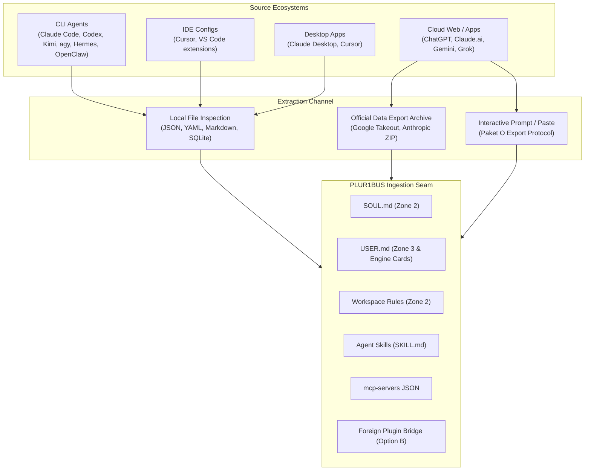

# Profile and Extension Sources: Research and Inventory

**Status:** Research note, 2026-10-27, owner request · **Context:** Preparation for Milestone M7b/M7c (profile import) and foreign plugin compatibility · **Companion:** [Profile import and plugin compatibility spec](../superpowers/specs/2026-10-27-profile-import-and-plugin-compat-design.md), [Importers documentation](../import.md), [Agent Bridge connectors](2026-10-07-agent-bridge-connectors.md), [Extensions ecosystem design](../superpowers/specs/2026-09-27-extensions-ecosystem-design.md).

## 1. Overview and Methodology

This document surveys eleven external AI coding and chat ecosystems to establish exact data locations, file formats, access methods, and extraction boundaries for user profiles, instructions, stored memories, skills, MCP servers, plugins, commands, and subagents.

### 1.1 Sources Covered

1. **Kimi** (Moonshot AI — CLI, Web/App, IDE)
2. **Claude** (Anthropic — Claude Code CLI, Claude Desktop, Claude Web/Pro)
3. **Codex** (OpenAI — Codex CLI, IDE extension)
4. **Gemini / AGY** (Google DeepMind — Antigravity CLI `agy`, Gemini Web/Advanced, Gemini Code Assist IDE)
5. **Grok** (xAI — Grok Web/App)
6. **Grokbot** (xAI / Telegram / X — Bot interfaces)
7. **Cursor** (Anysphere — Desktop IDE)
8. **Hermes** (Nous Research — Hermes Agent CLI/daemon)
9. **OpenClaw** (OpenClaw CLI/daemon)
10. **PLUR1BUS/OpenClaw** (HM1 — `@cyb3rb1ade/plur1bus-memory` plugin on OpenClaw)
11. **PLUR1BUS/Hermes** (HM2 — `plur1bus_hermes` memory provider on Hermes)

### 1.2 Evidence Criteria

- **Verified (`V`)**: Inspected directly from source code, official release tarball, or verified local installation on 2026-10-27.
- **Partly Verified (`P`)**: Documented in official vendor documentation or specifications; specific platform paths or edge behaviors marked `(unverified)`.
- **Unverified (`U`)**: Inferred from ecosystem conventions; explicitly marked as unverified pending physical test fixture.
- **Access Boundary Principle**: Only official local file reads, documented data export archives (e.g., Google Takeout, Anthropic account export), or explicit user copy-paste are admitted. **Strictly zero unauthorized web scraping, private session hijacking, or credential extraction** (in accordance with ADR-005 and vendor terms of service).

---

## 2. Source Inventory Tables

### 2.1 Kimi (Moonshot AI)

| Category | Variant | Format | Access Method | OS Paths (Linux / macOS / Windows) | Source & Evidence |
|---|---|---|---|---|---|
| **Global Instructions** | CLI (`kimi-code`) | Markdown | Direct file read | **Linux/macOS:** `~/.kimi-code/AGENTS.md`, `~/.agents/AGENTS.md` **Windows:** `%USERPROFILE%\.kimi-code\AGENTS.md`, `%USERPROFILE%\.agents\AGENTS.md` | `kimi-code` 2.1.1 docs; [Agent Bridge](2026-10-07-agent-bridge-connectors.md) · **V** |
| **Project Rules** | CLI / IDE | Markdown | Direct file read | `<workspace>/AGENTS.md`, `<workspace>/.kimi-code/config.toml` | `kimi-code` docs · **V** |
| **Persona / Personalization** | Web / App | Cloud / Text | User paste / Prompt export | N/A (cloud-hosted account settings at `kimi.ai`) | Web inspection · **V** |
| **Stored Memories** | Web / App | Cloud / Text | Prompt export (Paket O) | N/A (server-side chat context and memory bank) | Paket O spec · **V** |
| **Skills** | CLI | Agent Skills (`SKILL.md`) | Direct file read | **Linux/macOS:** `~/.kimi-code/skills/<id>/SKILL.md`, `<workspace>/.kimi-code/skills/<id>/SKILL.md` **Windows:** `%USERPROFILE%\.kimi-code\skills\<id>\SKILL.md` | Moonshot AI skill specification · **V** |
| **MCP Servers** | CLI | JSON (`mcpServers`) | Direct file read | **Linux/macOS:** `~/.kimi-code/mcp.json`, `<workspace>/.kimi-code/mcp.json` **Windows:** `%USERPROFILE%\.kimi-code\mcp.json` | `kimi-code` customization docs · **V** |
| **Plugins / Hooks** | CLI | TOML (`[[hooks]]`) | Direct file read | `~/.kimi-code/config.toml` (`[[hooks]]`: `UserPromptSubmit`, etc.) | `config.toml` schema · **V** |
| **Commands / Prompts** | CLI | Markdown / TOML | Direct file read | `~/.kimi-code/prompts/` (unverified), `config.toml` | `kimi-code` CLI reference · **P** |
| **Subagents** | CLI | ACP JSON-RPC | Out-of-band | N/A (ACP runtime negotiation) | ACP v1 specification · **V** |

---

### 2.2 Claude (Anthropic)

| Category | Variant | Format | Access Method | OS Paths (Linux / macOS / Windows) | Source & Evidence |
|---|---|---|---|---|---|
| **Global Instructions** | CLI (`claude`) | Markdown | Direct file read | **Linux/macOS:** `~/.claude/CLAUDE.md` **Windows:** `%USERPROFILE%\.claude\CLAUDE.md` | `@anthropic-ai/claude-code` 2.1.292 · **V** |
| **Project Rules** | CLI (`claude`) | Markdown | Direct file read | `<workspace>/CLAUDE.md`, `<workspace>/.claude/CLAUDE.md` | Claude Code docs · **V** |
| **Persona / Personalization** | Web / Pro | JSON / Text | Account Data Export / Paste | Account Settings > Export Data (`users.json`, `custom_instructions.json`) | Claude Web settings export · **V** |
| **Stored Memories** | Web / Pro | JSON / Text | Account Data Export / Prompt (Paket O) | Account export archive `memories.json` or prompt export | Anthropic Account Export · **V** |
| **Skills / Tools** | CLI | Custom / Node | Package import (X2) | Bundle import under `~/.claude/plugins/` (unverified) | Extensions spec X2 · **P** |
| **MCP Servers** | Desktop | JSON (`mcpServers`) | Direct file read | **macOS:** `~/Library/Application Support/Claude/claude_desktop_config.json` **Linux:** `~/.config/Claude/claude_desktop_config.json` **Windows:** `%APPDATA%\Claude\claude_desktop_config.json` | Claude Desktop documentation · **V** |
| **MCP Servers** | CLI (`claude`) | JSON (`mcpServers`) | Direct file read | **Linux/macOS:** `~/.claude.json`, `<workspace>/.claude.json` **Windows:** `%USERPROFILE%\.claude.json` | Claude Code settings reference · **V** |
| **Plugins** | CLI | Bundle (`.bundle`) | Bundle importer (X2) | Bundled MCP servers and skills (commands/hooks skipped per X2) | Extensions spec §7.3 · **V** |
| **Commands / Prompts** | CLI | Markdown | Direct file read | `~/.claude/commands/`, `<workspace>/.claude/commands/` | Claude Code slash commands · **V** |
| **Subagents** | CLI | Node subprocess | Not accessible | Internal `Task` subagent tool execution | Claude Code internal runtime · **V** |

---

### 2.3 Codex (OpenAI)

| Category | Variant | Format | Access Method | OS Paths (Linux / macOS / Windows) | Source & Evidence |
|---|---|---|---|---|---|
| **Global Instructions** | CLI (`codex`) | Markdown / TOML | Direct file read | **Linux/macOS:** `~/.codex/config.toml`, `~/.codex/instructions.md`, `~/.agents/AGENTS.md` **Windows:** `%USERPROFILE%\.codex\config.toml`, `%USERPROFILE%\.agents\AGENTS.md` | `@openai/codex` 0.160.1 · **V** |
| **Project Rules** | CLI / IDE | Markdown | Direct file read | `<workspace>/AGENTS.md`, `<workspace>/.codex/config.toml` | Codex CLI specification · **V** |
| **Persona / Personalization** | CLI / IDE | TOML | Direct file read | `~/.codex/config.toml` (`[developer_instructions]`) | Codex configuration reference · **V** |
| **Stored Memories** | CLI | SQLite / JSON | Direct file read | `~/.codex/sessions/*.json` | Codex session store · **V** |
| **Skills** | CLI | Agent Skills (`SKILL.md`) | Direct file read | `~/.codex/skills/<id>/SKILL.md`, `~/.agents/skills/<id>/SKILL.md` | Agent Skills standard · **V** |
| **MCP Servers** | CLI | TOML (`[mcp_servers]`) | Direct file read | `~/.codex/config.toml` (`[mcp_servers.<id>]`) | Codex MCP config reference · **V** |
| **Plugins / Hooks** | CLI | JSON (`hooks.json`) | Direct file read | `~/.codex/hooks.json`, `<workspace>/.codex/hooks.json` | Codex hooks specification · **V** |
| **Commands / Prompts** | CLI | Markdown / TOML | Direct file read | `~/.codex/prompts/*.md` (unverified) | Community configuration · **U** |
| **Subagents** | CLI | ACP JSON-RPC | Out-of-band | Subagent workers via `@agentclientprotocol/codex-acp` | ACP adapter reference · **V** |

---

### 2.4 Gemini / AGY (Google DeepMind)

| Category | Variant | Format | Access Method | OS Paths (Linux / macOS / Windows) | Source & Evidence |
|---|---|---|---|---|---|
| **Global Instructions** | CLI (`agy`) | Markdown | Direct file read | **Linux/macOS:** `~/.gemini/antigravity-cli/rules/*.md`, `~/.agents/rules/*.md` **Windows:** `%USERPROFILE%\.gemini\antigravity-cli\rules\*.md` | Antigravity CLI builtin configuration · **V** |
| **Project Rules** | CLI / IDE | Markdown | Direct file read | `<workspace>/AGENTS.md`, `<workspace>/.gemini/` | AGY workspace guidelines · **V** |
| **Persona / Personalization** | Web / Advanced | JSON / HTML | Google Takeout / Paste | Google Takeout archive (`Takeout/Gemini/Gems/`) or user paste | Google Takeout specification · **V** |
| **Stored Memories** | Web / Advanced | JSON / Text | Google Takeout / Prompt | Google Takeout `Takeout/Gemini/Saved Info/` or prompt export | Gemini Saved Info settings · **V** |
| **Skills** | CLI (`agy`) | Agent Skills (`SKILL.md`) | Direct file read | `~/.gemini/config/skills/<id>/SKILL.md`, `~/.agents/skills/<id>/SKILL.md` | Antigravity Skills catalog · **V** |
| **MCP Servers** | CLI (`agy`) | JSON / Config | Direct file read | `~/.gemini/antigravity-cli/mcp/<server>/` (tool schemas), `config.json` | AGY MCP configuration · **V** |
| **Plugins / Extensions** | CLI / IDE | Manifest / JSON | Direct file read | `~/.gemini/antigravity-cli/plugins/` (unverified), IDE settings | Cloud Code / Gemini extension · **P** |
| **Commands / Prompts** | CLI (`agy`) | Markdown / JSON | Direct file read | Built-in slash commands (`/goal`, `/plan`, `/schedule`) | AGY command reference · **V** |
| **Subagents** | CLI (`agy`) | Definition / Python | Direct file read | Built-in subagents (`research`, `image-generator`, `self`) | AGY subagent engine · **V** |

---

### 2.5 Grok (xAI)

| Category | Variant | Format | Access Method | OS Paths (Linux / macOS / Windows) | Source & Evidence |
|---|---|---|---|---|---|
| **Global Instructions** | Web / App | Cloud Text | User paste | N/A (hosted on `grok.com` / X profile settings) | Web interface inspection · **V** |
| **Project Rules** | Web / App | Cloud Text | User paste | N/A (Projects / chat context) | Grok web interface · **V** |
| **Persona / Personalization** | Web / App | Cloud Settings | User paste | N/A (Mode toggle: Fun / Normal / Custom Instructions) | Web settings inspection · **V** |
| **Stored Memories** | Web / App | Cloud / Text | Prompt export (Paket O) | N/A (Server-side stored memory context; exportable via prompt) | Paket O prompt export · **V** |
| **Skills** | Web / App | Built-in | Not accessible | N/A (server-side tool capabilities: Web search, Python interpreter) | xAI platform architecture · **V** |
| **MCP Servers** | Web / App | None | Not accessible | N/A (no public client MCP configuration) | xAI developer documentation · **V** |
| **Plugins / Extensions** | Web / App | None | Not accessible | N/A | xAI platform architecture · **V** |
| **Commands / Prompts** | Web / App | Text | User paste | N/A | Web chat history · **V** |
| **Subagents** | Web / App | Cloud pipeline | Not accessible | Server-side execution pipeline | xAI platform architecture · **V** |

---

### 2.6 Grokbot (xAI / Telegram / X)

| Category | Variant | Format | Access Method | OS Paths (Linux / macOS / Windows) | Source & Evidence |
|---|---|---|---|---|---|
| **Global Instructions** | Telegram / X Bot | Cloud | Not accessible | N/A (hosted bot backend) | Telegram Bot API · **V** |
| **Project Rules** | Telegram / X Bot | None | Not accessible | N/A | [Agent Bridge](2026-10-07-agent-bridge-connectors.md) · **V** |
| **Persona / Personalization** | Telegram / X Bot | Static | Not accessible | Hardcoded bot system persona | Bot observation · **V** |
| **Stored Memories** | Telegram / X Bot | Chat history | Telegram export | Telegram desktop JSON export (per-chat history) | Telegram Desktop Export · **V** |
| **Skills / MCP / Plugins** | Telegram / X Bot | None | Not accessible | N/A | Bot architecture · **V** |
| **Commands / Prompts** | Telegram / X Bot | Bot Commands | Chat interaction | `/start`, `/help`, `/reset` | Telegram command menu · **V** |
| **Subagents** | Telegram / X Bot | None | Not accessible | N/A | Bot architecture · **V** |

---

### 2.7 Cursor (Anysphere)

| Category | Variant | Format | Access Method | OS Paths (Linux / macOS / Windows) | Source & Evidence |
|---|---|---|---|---|---|
| **Global Instructions** | Desktop IDE | JSON | Direct file read | **macOS:** `~/Library/Application Support/Cursor/User/settings.json` **Linux:** `~/.config/Cursor/User/settings.json` **Windows:** `%APPDATA%\Cursor\User\settings.json` *(Key: `cursor.general.rulesForAi`)* | Cursor 0.42+ settings specification · **V** |
| **Project Rules** | Desktop IDE | Markdown / MDC | Direct file read | `<workspace>/.cursorrules` `<workspace>/.cursor/rules/*.mdc` (frontmatter: `description`, `globs`, `alwaysApply`) | Cursor Rules documentation · **V** |
| **Persona / Personalization** | Desktop IDE | JSON | Direct file read | `settings.json` (`cursor.chat.customInstructions`) | Cursor user configuration · **V** |
| **Stored Memories** | Desktop IDE | SQLite | Direct file read | **macOS:** `~/Library/Application Support/Cursor/User/globalStorage/state.vscdb` **Linux:** `~/.config/Cursor/User/globalStorage/state.vscdb` **Windows:** `%APPDATA%\Cursor\User\globalStorage\state.vscdb` | VS Code / Cursor storage layout · **V** |
| **Skills / Tools** | Desktop IDE | VS Code Ext | File / Extensions dir | **Linux/macOS:** `~/.cursor/extensions/` **Windows:** `%USERPROFILE%\.cursor\extensions\` | Cursor extension catalog · **V** |
| **MCP Servers** | Desktop IDE | JSON (`mcpServers`) | Direct file read | **Global:** `~/.cursor/mcp.json` or `~/Library/Application Support/Cursor/User/globalStorage/mcp.json` **Project:** `<workspace>/.cursor/mcp.json` | Cursor MCP documentation · **V** |
| **Plugins / Extensions** | Desktop IDE | VS Code Ext | Package inspect | Standard VS Code `.vsix` packages | VS Code extension standard · **V** |
| **Commands / Prompts** | Desktop IDE | Markdown | Direct file read | `<workspace>/.cursor/commands/*.md` (unverified) | Community configuration · **U** |
| **Subagents** | Desktop IDE | Agent Mode | Internal runtime | Background Composer execution | Cursor Agent documentation · **V** |

---

### 2.8 Hermes (Nous Research)

| Category | Variant | Format | Access Method | OS Paths (Linux / macOS / Windows) | Source & Evidence |
|---|---|---|---|---|---|
| **Global Instructions** | CLI / Daemon | YAML / Markdown | Direct file read | **Linux/macOS:** `~/.hermes/config.yaml`, `~/.hermes/agent/SOUL.md` **Windows:** `%USERPROFILE%\.hermes\config.yaml` | Hermes agent repo `743ee72`; [Importers](../import.md) · **V** |
| **Project Rules** | CLI / Profiles | YAML | Direct file read | `~/.hermes/profiles/<name>/config.yaml`, `<workspace>/.hermes/config.yaml` | Hermes profile architecture · **V** |
| **Persona / Personalization** | CLI / Daemon | Markdown (`SOUL.md`) | Direct file read | `~/.hermes/agent/SOUL.md`, `~/.hermes/profiles/<name>/SOUL.md` | ADR-003, [Importers](../import.md) §1 · **V** |
| **User Facts** | CLI / Daemon | Markdown (`USER.md`) | Direct file read | `~/.hermes/agent/USER.md`, `~/.hermes/profiles/<name>/USER.md` | ADR-003, [Importers](../import.md) §1 · **V** |
| **Stored Memories** | CLI / Daemon | Markdown / SQLite | Direct file read | `~/.hermes/agent/MEMORY.md`, `~/.hermes/state/memory.db` | Hermes memory provider specification · **V** |
| **Skills** | CLI / Daemon | Agent Skills (`SKILL.md`) | Direct file read | `~/.hermes/skills/<id>/SKILL.md` | Extensions spec §4.3 · **V** |
| **MCP Servers** | CLI / Daemon | YAML (`mcp_servers`) | Direct file read | `~/.hermes/config.yaml` (`mcp_servers: { <name>: { command, args, env } }`) | Hermes MCP client specification · **V** |
| **Plugins** | CLI / Daemon | Python packages | Direct file read | `~/.hermes/plugins/<name>/` (`plugin.yaml`, Python module exposing hooks, tools, providers) | Hermes plugin specification · **V** |
| **Commands / Prompts** | CLI / Daemon | Python / YAML | Direct file read | Registered via plugins (`cli.py`) | Hermes CLI architecture · **V** |
| **Cron Jobs** | CLI / Daemon | YAML | Direct file read | `~/.hermes/config.yaml` (`cron:` schedules) or `~/.hermes/cron/*.yaml` | [Importers](../import.md) §1.1 · **V** |
| **Channels** | CLI / Daemon | YAML | Direct file read | `~/.hermes/config.yaml` (`channels:` telegram, discord, slack credentials/allowlists) | [Importers](../import.md) §1.1 · **V** |

---

### 2.9 OpenClaw

| Category | Variant | Format | Access Method | OS Paths (Linux / macOS / Windows) | Source & Evidence |
|---|---|---|---|---|---|
| **Global Instructions** | CLI / Daemon | JSON | Direct file read | **Linux/macOS:** `~/.openclaw/openclaw.json` **Windows:** `%USERPROFILE%\.openclaw\openclaw.json` | OpenClaw repo `b9421f4` (v2026.9.5); [Importers](../import.md) · **V** |
| **Project Rules** | CLI / Daemon | JSON / Markdown | Direct file read | `<workspace>/openclaw.json`, `<workspace>/AGENTS.md` | OpenClaw workspace specification · **V** |
| **Persona / Personalization** | CLI / Daemon | Markdown (`SOUL.md`) | Direct file read | `~/.openclaw/agents/<id>/SOUL.md` (exactly one per agent, D14) | ADR-003, [Importers](../import.md) §1 · **V** |
| **Agent Identity** | CLI / Daemon | Markdown (`IDENTITY.md`) | Direct file read | `~/.openclaw/agents/<id>/IDENTITY.md` | ADR-003, [Importers](../import.md) §1.1 · **V** |
| **User Facts** | CLI / Daemon | Markdown (`USER.md`) | Direct file read | `~/.openclaw/agents/<id>/USER.md` | ADR-003, [Importers](../import.md) §1.1 · **V** |
| **Stored Memories** | CLI / Daemon | Markdown / LanceDB | Direct file read | `~/.openclaw/agents/<id>/MEMORY.md` `~/.openclaw/agents/<id>/memory/YYYY-MM-DD.md` `~/.openclaw/state/lancedb/` | [Importers](../import.md) §1.1 · **V** |
| **Skills** | CLI / Daemon | Agent Skills (`SKILL.md`) | Direct file read | `~/.openclaw/skills/<id>/SKILL.md`, `skills/index.json` | [Importers](../import.md) §7.3, §9 · **V** |
| **MCP Servers** | CLI / Daemon | JSON (`mcpServers`) | Direct file read | `~/.openclaw/openclaw.json` (`mcpServers` object) | [Importers](../import.md) §1.1 · **V** |
| **Plugins / Extensions** | CLI / Daemon | Node / TS packages | Direct file read | `~/.openclaw/extensions/<name>/` (`openclaw.plugin.json`, `package.json`) | OpenClaw extension architecture · **V** |
| **Commands / Prompts** | CLI / Daemon | Node / JSON | Direct file read | Exported from extensions (`registerCommand`) | OpenClaw host contract · **V** |
| **Cron Jobs** | CLI / Daemon | JSON | Direct file read | `~/.openclaw/openclaw.json` (`cron.jobs[]`) | [Importers](../import.md) §1.1 · **V** |
| **Channels** | CLI / Daemon | JSON | Direct file read | `~/.openclaw/openclaw.json` (`channels.<kind>` allowlists, token refs) | [Importers](../import.md) §1.1 · **V** |

---

### 2.10 PLUR1BUS/OpenClaw (HM1)

| Category | Variant | Format | Access Method | OS Paths (Linux / macOS / Windows) | Source & Evidence |
|---|---|---|---|---|---|
| **Memory Store** | OpenClaw Plugin | LanceDB directory | Direct file read | `~/.openclaw/stores/<agentId>/` `~/.openclaw/state/lancedb/` | Package `@cyb3rb1ade/plur1bus-memory` 7.15.4; [Importers](../import.md) §2 · **V** |
| **Configuration** | OpenClaw Plugin | JSON | Direct file read | `~/.openclaw/openclaw.json` (`plugins["@cyb3rb1ade/plur1bus-memory"]`) | HM1 specification · **V** |
| **Curated Files** | OpenClaw Plugin | Markdown | Direct file read | Mirrors OpenClaw agent files (`SOUL.md`, `USER.md`, `KNOWLEDGE.md`) | [Importers](../import.md) §2.3 · **V** |
| **Post-Import Action** | Harness CLI | JSON update | Importer automated | Plugin disabled on source host after verified import (D28) | [Importers](../import.md) §1 · **V** |

---

### 2.11 PLUR1BUS/Hermes (HM2)

| Category | Variant | Format | Access Method | OS Paths (Linux / macOS / Windows) | Source & Evidence |
|---|---|---|---|---|---|
| **Memory Store** | Hermes Provider | LanceDB directory | Direct file read | `~/.hermes/stores/<agentId>/` `~/.hermes/state/lancedb/` | HM2 design spec; `docs/hermes-host-mode.md` · **V** |
| **Configuration** | Hermes Provider | YAML | Direct file read | `~/.hermes/config.yaml` (`memory.provider: plur1bus`) | HM2 specification · **V** |
| **Curated Files** | Hermes Provider | Markdown | Direct file read | Mirrors Hermes agent files (`SOUL.md`, `USER.md`, `MEMORY.md`) | [Importers](../import.md) §2.3 · **V** |
| **Post-Import Action** | Harness CLI | YAML update | Importer automated | Provider switched back to default on source host after verified import (D28) | [Importers](../import.md) §1 · **V** |

---

## 3. Analysis Across Modalities

### 3.1 Direct File Read Sources
- **Ecosystems**: Claude Code, Claude Desktop, Codex CLI, Kimi CLI, AGY, Cursor, Hermes, OpenClaw, PLUR1BUS/OpenClaw, PLUR1BUS/Hermes.
- **Feasibility**: 100% automated via `plur1bus import profile <source>` or the Web UI wizard when run locally on the host.
- **Safety**: Unchecked configuration files must never be executed; files are parsed using strict, typed schemas. Secrets are stripped via the central redactor.

### 3.2 Export Archive Sources
- **Ecosystems**: Google Takeout (Gemini), Anthropic Account Export (Claude Web), Telegram chat export (Grokbot).
- **Feasibility**: High. The Web wizard provides a dedicated archive dropzone (`.zip`, `.tar.gz`) that unpacks in a sandbox directory and applies standard extractors.
- **Safety**: Archives are subject to zip-slip validation, size limits (max 50 MB), and file count limits (max 1 000 files).

### 3.3 Interactive User Paste Sources
- **Ecosystems**: Grok Web, Grokbot, proprietary cloud assistants lacking machine-readable exports.
- **Feasibility**: High. Leverages the canonical prompt export protocol defined in Paket O (`C/import/prompt/export-prompt.md`) and the tolerant parser (`parseMemoryExport`).
- **Safety**: Input is treated as untrusted text. Rule entries land in the review queue as proposals; user confirmation is strictly mandatory.
