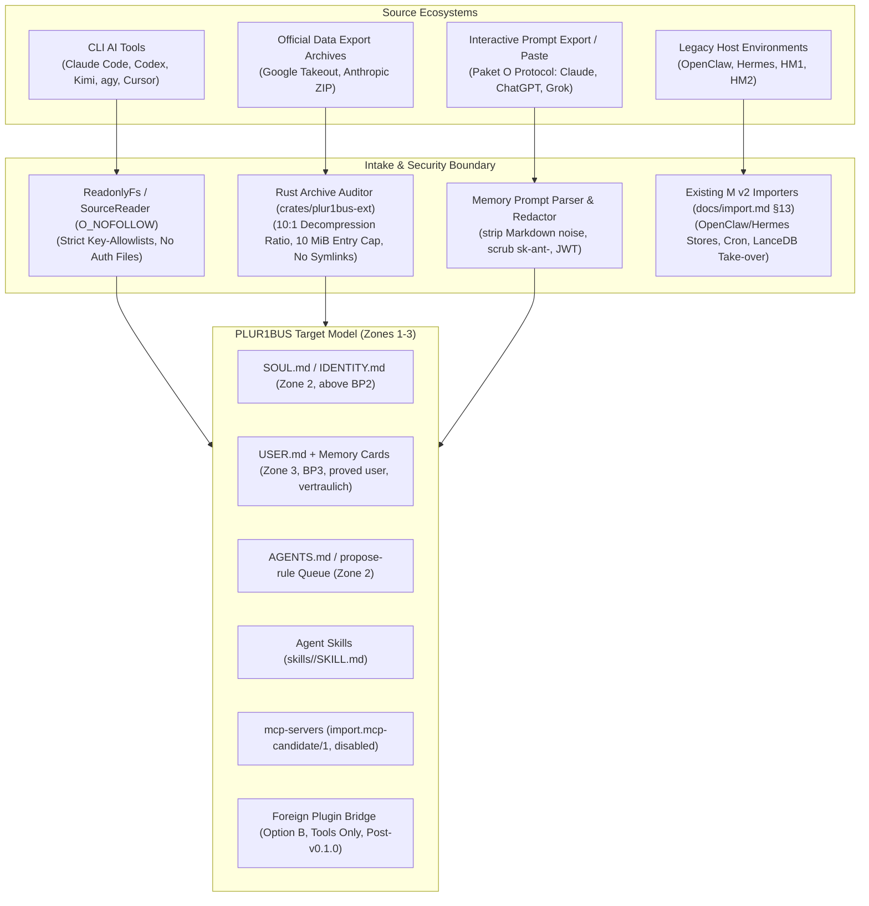

# Profile and Extension Sources: Research and Inventory

**Status:** Research note, 2026-10-27 (revised 2026-10-31), owner request · **Context:** Preparation for Milestone M7b/M7c (profile import) and foreign plugin compatibility · **Companion:** [Profile import and plugin compatibility spec](../superpowers/specs/2026-10-27-profile-import-and-plugin-compat-design.md), [Profile import implementation plan](../superpowers/plans/2026-10-31-profile-import-and-plugin-compat.md), [Importers documentation](../import.md), [Agent Bridge connectors](2026-10-07-agent-bridge-connectors.md), [Extensions ecosystem design](../superpowers/specs/2026-09-27-extensions-ecosystem-design.md).

## 1. Overview and Methodology

This document surveys eleven external AI coding and chat ecosystems to establish exact data locations, file formats, access methods, and extraction boundaries for user profiles, instructions, stored memories, skills, MCP servers, plugins, commands, and subagents.

### 1.1 Source Scope Partitioning (Decision D121-J5)

The eleven ecosystems divide into two distinct operational groups:
1. **New Profile Import Sources (Milestone M7b/M7c)**: Sources 1–7 (Kimi, Claude, Codex, Gemini/AGY, Grok, Grokbot, Cursor). These lack dedicated importers in the harness and are ingested through `plur1bus import profile` and the extended `ImportWizard` (F37).
2. **Existing Legacy Host Sources (Milestone M7 v2)**: Sources 8–11 (Hermes, OpenClaw, HM1, HM2). These are already comprehensively handled by the dedicated offline and supervised importers ([`docs/import.md`](../import.md) §10–§13: `plur1bus import openclaw` and `plur1bus import hermes`). They are inventoried below solely to provide cross-platform architectural reference and avoid duplication.

### 1.2 Evidence Criteria

- **Verified (`V`)**: Inspected directly from source code, official release tarball, or verified local installation.
- **Partly Verified (`P`)**: Documented in official vendor documentation or specifications; specific platform paths or edge behaviors marked `(unverified)`.
- **Unverified (`U`)**: Inferred from ecosystem conventions; explicitly marked as unverified pending physical test fixture.
- **Access Boundary Principle**: Only official local file reads, documented data export archives (e.g., Google Takeout, Anthropic account export), or explicit user copy-paste are admitted. **Strictly zero unauthorized web scraping, private session hijacking, or credential extraction** (in accordance with ADR-005, ADR-011, and vendor terms of service). All source filesystem access is strictly read-only (`O_NOFOLLOW` / `ReadonlyFs`).

---

## 2. Source Inventory Tables

### 2.1 Kimi (Moonshot AI)

| Category | Variant | Format | Access Method | OS Paths (Linux / macOS / Windows) | Source & Evidence |
|---|---|---|---|---|---|
| **Global Instructions** | CLI (`kimi-code`) | Markdown | Direct file read | **Linux/macOS:** `~/.kimi-code/AGENTS.md`, `~/.agents/AGENTS.md` **Windows:** `%USERPROFILE%\.kimi-code\AGENTS.md`, `%USERPROFILE%\.agents\AGENTS.md` | `kimi-code` 2.1.1 docs; [Agent Bridge](2026-10-07-agent-bridge-connectors.md) · **V** |
| **Project Rules** | CLI / IDE | Markdown | Direct file read | `<workspace>/AGENTS.md`, `<workspace>/.kimi-code/config.toml` | `kimi-code` docs · **V** |
| **Persona / Personalization** | Web / App | Cloud / Text | User paste / Prompt export | N/A (cloud-hosted account settings at `kimi.ai`) | Web inspection · **V** |
| **Stored Memories** | Web / App | Cloud / Text | Prompt export (Paket O) | N/A (server-side chat context and memory bank) | Paket O spec · **V** |
| **Skills** | CLI | Agent Skills (`SKILL.md`) | Direct file read | **Linux/macOS:** `~/.kimi-code/skills/<id>/SKILL.md`, `<workspace>/.kimi-code/skills/<id>/SKILL.md` **Windows:** `%USERPROFILE%\.kimi-code\skills\<id>\SKILL.md` | Moonshot AI skill specification · **V** |
| **MCP Servers** | CLI | JSON (`mcpServers`) | Direct file read | **Linux/macOS:** `~/.kimi-code/mcp.json`, `<workspace>/.kimi-code/mcp.json` **Windows:** `%USERPROFILE%\.kimi-code\mcp.json` | `kimi-code` customization docs · **V** |
| **Plugins / Hooks** | CLI | TOML (`[[hooks]]`) | Skipped & Reported | `~/.kimi-code/config.toml` (`[[hooks]]`: contains arbitrary shell commands; skipped per Ext spec §3/§7.3) | `config.toml` schema · **V** |
| **Commands / Prompts** | CLI | Markdown / TOML | Direct file read | `~/.kimi-code/prompts/` (unverified), `config.toml` | `kimi-code` CLI reference · **P** |
| **Subagents** | CLI | ACP JSON-RPC | Out-of-band | N/A (ACP runtime negotiation) | ACP v1 specification · **V** |

---

### 2.2 Claude (Anthropic)

| Category | Variant | Format | Access Method | OS Paths (Linux / macOS / Windows) | Source & Evidence |
|---|---|---|---|---|---|
| **Global Instructions** | CLI (`claude`) | Markdown | Direct file read | **Linux/macOS:** `~/.claude/CLAUDE.md` **Windows:** `%USERPROFILE%\.claude\CLAUDE.md` | `@anthropic-ai/claude-code` 2.1.292 · **V** |
| **Project Rules** | CLI (`claude`) | Markdown | Direct file read | `<workspace>/CLAUDE.md`, `<workspace>/.claude/CLAUDE.md` | Claude Code docs · **V** |
| **Persona / Personalization** | Web / Pro | JSON / Text | Account Data Export / Paste | Account Settings > Export Data (`users.json`, `custom_instructions.json`) | Claude Web settings export · **V** |
| **Stored Memories** | Web / Pro | JSON / Text | Account Export / Prompt (Paket O) | Account export archive `memories.json` (unverified schema pending fixture) or prompt export | Anthropic Account Export · **U** |
| **Skills / Tools** | CLI | Custom / Node | Package import (X2) | Bundle import under `~/.claude/plugins/` (unverified) | Extensions spec X2 · **P** |
| **MCP Servers** | Desktop | JSON (`mcpServers`) | Direct file read | **macOS:** `~/Library/Application Support/Claude/claude_desktop_config.json` **Linux:** `~/.config/Claude/claude_desktop_config.json` **Windows:** `%APPDATA%\Claude\claude_desktop_config.json` | Claude Desktop documentation · **V** |
| **MCP Servers** | CLI (`claude`) | JSON (`mcpServers`) | Direct file read | **Linux/macOS:** `~/.claude.json`, `<workspace>/.claude.json` **Windows:** `%USERPROFILE%\.claude.json` *(Key-allowlisted: only `mcpServers`; auth and account keys strictly dropped)* | Claude Code settings reference · **V** |
| **Credentials** | CLI / Desktop | JSON | Strictly prohibited | `~/.claude/.credentials.json`, `~/.claude.json` (`oauth_tokens`) — **Never read, copied, or parsed (ADR-011)** | Security policy · **V** |
| **Plugins** | CLI | Bundle (`.bundle`) | Bundle importer (X2) | Bundled MCP servers and skills (commands/hooks skipped per X2) | Extensions spec §7.3 · **V** |
| **Commands / Prompts** | CLI | Markdown | Direct file read | `~/.claude/commands/`, `<workspace>/.claude/commands/` | Claude Code slash commands · **V** |
| **Subagents** | CLI | Node subprocess | Not accessible | Internal `Task` subagent tool execution | Claude Code internal runtime · **V** |

---

### 2.3 Codex (OpenAI)

| Category | Variant | Format | Access Method | OS Paths (Linux / macOS / Windows) | Source & Evidence |
|---|---|---|---|---|---|
| **Global Instructions** | CLI (`codex`) | Markdown / TOML | Direct file read | **Linux/macOS:** `~/.codex/config.toml`, `~/.codex/instructions.md`, `~/.agents/AGENTS.md` **Windows:** `%USERPROFILE%\.codex\config.toml`, `%USERPROFILE%\.agents\AGENTS.md` | `@openai/codex` 0.160.1 · **V** |
| **Project Rules** | CLI / IDE | Markdown | Direct file read | `<workspace>/AGENTS.md`, `<workspace>/.codex/config.toml` | Codex CLI specification · **V** |
| **Persona / Personalization** | CLI / IDE | TOML | Direct file read | `~/.codex/config.toml` (`[developer_instructions]`) | Codex configuration reference · **V** |
| **Session Transcripts** | CLI | SQLite / JSON | Sensitive / Not imported | `~/.codex/sessions/*.json` (full conversation transcripts; sensitive; not imported by default per `docs/import.md`) | Codex session store · **V** |
| **Credentials** | CLI | JSON | Strictly prohibited | `~/.codex/auth.json` — **Never read, copied, or parsed (ADR-011)** | Security policy · **V** |
| **Skills** | CLI | Agent Skills (`SKILL.md`) | Direct file read | `~/.codex/skills/<id>/SKILL.md`, `~/.agents/skills/<id>/SKILL.md` | Agent Skills standard · **V** |
| **MCP Servers** | CLI | TOML (`[mcp_servers]`) | Direct file read | `~/.codex/config.toml` (`[mcp_servers.<id>]`) | Codex MCP config reference · **V** |
| **Plugins / Hooks** | CLI | JSON (`hooks.json`) | Skipped & Reported | `~/.codex/hooks.json` (contains arbitrary shell commands; skipped per Ext spec §3/§7.3) | Codex hooks specification · **V** |
| **Commands / Prompts** | CLI | Markdown / TOML | Direct file read | `~/.codex/prompts/*.md` (unverified) | Community configuration · **U** |
| **Subagents** | CLI | ACP JSON-RPC | Out-of-band | Subagent workers via `@agentclientprotocol/codex-acp` | ACP adapter reference · **V** |

---

### 2.4 Gemini / AGY (Google DeepMind)

| Category | Variant | Format | Access Method | OS Paths (Linux / macOS / Windows) | Source & Evidence |
|---|---|---|---|---|---|
| **Global Instructions** | CLI (`agy`) | Markdown | Direct file read | **Linux/macOS:** `~/.gemini/antigravity-cli/rules/*.md`, `~/.agents/rules/*.md` **Windows:** `%USERPROFILE%\.gemini\antigravity-cli\rules\*.md` | Antigravity CLI builtin configuration · **V** |
| **Project Rules** | CLI / IDE | Markdown | Direct file read | `<workspace>/AGENTS.md`, `<workspace>/.gemini/` | AGY workspace guidelines · **V** |
| **Persona / Gems** | Web / Advanced | JSON / HTML | Google Takeout / Paste | Google Takeout archive (`Takeout/Gemini/Gems/`) or user paste | Google Takeout export · **U** |
| **Stored Memories** | Web / Advanced | JSON / Text | Google Takeout / Prompt | Google Takeout `Takeout/Gemini/Saved Info/` or prompt export | Gemini Saved Info · **U** |
| **Skills** | CLI (`agy`) | Agent Skills (`SKILL.md`) | Direct file read | `~/.gemini/config/skills/<id>/SKILL.md`, `~/.agents/skills/<id>/SKILL.md` | Antigravity Skills catalog · **V** |
| **MCP Servers** | CLI (`agy`) | JSON / Config | Direct file read | `~/.gemini/antigravity-cli/mcp/<server>/` (tool schemas), `config.json` | AGY MCP configuration · **V** |
| **Plugins / Extensions** | CLI / IDE | Manifest / JSON | Direct file read | `~/.gemini/antigravity-cli/plugins/` (unverified), IDE settings | Cloud Code / Gemini extension · **P** |
| **Commands / Prompts** | CLI (`agy`) | Markdown / JSON | Direct file read | Built-in slash commands (`/goal`, `/plan`, `/schedule`) | AGY command reference · **V** |
| **Subagents** | CLI (`agy`) | Definition / Python | Direct file read | Built-in subagents (`research`, `image-generator`, `self`) | AGY subagent engine · **V** |

---

### 2.5 Grok (xAI)

| Category | Variant | Format | Access Method | OS Paths (Linux / macOS / Windows) | Source & Evidence |
|---|---|---|---|---|---|
| **Global Instructions** | Web / App | Cloud Text | User paste | N/A (hosted on `grok.com` / X profile settings) | Web interface inspection · **V** |
| **Project Rules** | Web / App | Cloud Text | User paste | N/A (Projects / chat context) | Grok web interface · **V** |
| **Persona / Personalization** | Web / App | Cloud Settings | User paste | N/A (Mode toggle: Fun / Normal / Custom Instructions) | Web settings inspection · **V** |
| **Stored Memories** | Web / App | Cloud / Text | Prompt export (Paket O) | N/A (Server-side stored memory context; exportable via prompt) | Paket O prompt export · **V** |
| **Skills / MCP / Plugins** | Web / App | Built-in | Not accessible | N/A (server-side tool capabilities: Web search, Python interpreter) | xAI platform architecture · **V** |
| **Commands / Prompts** | Web / App | Text | User paste | N/A | Web chat history · **V** |
| **Subagents** | Web / App | Cloud pipeline | Not accessible | Server-side execution pipeline | xAI platform architecture · **V** |

---

### 2.6 Grokbot (xAI / Telegram / X)

| Category | Variant | Format | Access Method | OS Paths (Linux / macOS / Windows) | Source & Evidence |
|---|---|---|---|---|---|
| **Chat History / Transcripts** | Telegram / X Bot | Chat history | Telegram export | Telegram desktop JSON export (contains multi-user chats; sensitive; **dropped from profile import**) | Telegram Desktop Export · **V** |
| **Instructions / Memories** | Telegram / X Bot | None | Dropped | Not accessible / multi-party content excluded | Architectural review · **V** |

---

### 2.7 Cursor (Anysphere)

| Category | Variant | Format | Access Method | OS Paths (Linux / macOS / Windows) | Source & Evidence |
|---|---|---|---|---|---|
| **Global Instructions** | Desktop IDE | JSON | Direct file read | **macOS:** `~/Library/Application Support/Cursor/User/settings.json` **Linux:** `~/.config/Cursor/User/settings.json` **Windows:** `%APPDATA%\Cursor\User\settings.json` *(Key-allowlist: only `cursor.general.rulesForAi`)* | Cursor 0.42+ settings specification · **V** |
| **Project Rules** | Desktop IDE | Markdown / MDC | Direct file read (`O_NOFOLLOW`) | `<workspace>/.cursorrules` `<workspace>/.cursor/rules/*.mdc` (frontmatter: `description`, `globs`, `alwaysApply`) | Cursor Rules documentation · **V** |
| **Persona / Personalization** | Desktop IDE | JSON | Direct file read | `settings.json` (`cursor.chat.customInstructions`) | Cursor user configuration · **V** |
| **Storage / State DB** | Desktop IDE | SQLite | Strict key-allowlist | **macOS:** `~/Library/Application Support/Cursor/User/globalStorage/state.vscdb` **Linux:** `~/.config/Cursor/User/globalStorage/state.vscdb` **Windows:** `%APPDATA%\Cursor\User\globalStorage\state.vscdb` *(Contains auth tokens, workspace state, chat history. Only non-sensitive custom prompt keys extracted; auth/session keys strictly excluded per ADR-005)* | VS Code / Cursor storage layout · **V** |
| **Skills / Tools** | Desktop IDE | VS Code Ext | File / Extensions dir | **Linux/macOS:** `~/.cursor/extensions/` **Windows:** `%USERPROFILE%\.cursor\extensions\` | Cursor extension catalog · **V** |
| **MCP Servers** | Desktop IDE | JSON (`mcpServers`) | Direct file read | **Global:** `~/.cursor/mcp.json` or `~/Library/Application Support/Cursor/User/globalStorage/mcp.json` **Project:** `<workspace>/.cursor/mcp.json` | Cursor MCP documentation · **V** |
| **Plugins / Extensions** | Desktop IDE | VS Code Ext | Package inspect | Standard VS Code `.vsix` packages | VS Code extension standard · **V** |
| **Commands / Prompts** | Desktop IDE | Markdown | Direct file read | `<workspace>/.cursor/commands/*.md` (unverified) | Community configuration · **U** |
| **Subagents** | Desktop IDE | Agent Mode | Internal runtime | Background Composer execution | Cursor Agent documentation · **V** |

---

### 2.8 Hermes (Nous Research) — Handled by `plur1bus import hermes`

Reference inventory matching [`docs/import.md`](../import.md) §3.0 and §3.2:

| Category | Variant | Format | Access Method | OS Paths (Linux / macOS / Windows) | Source & Evidence |
|---|---|---|---|---|---|
| **Global Instructions** | CLI / Daemon | YAML / Markdown | Direct file read | **Linux/macOS:** `~/.hermes/config.yaml`, `~/.hermes/SOUL.md` **Windows:** `%LOCALAPPDATA%\hermes\config.yaml` (the HM3 fix) | Hermes agent repo `743ee72`; `docs/import.md` §3.0 · **V** |
| **Project Rules** | CLI / Profiles | YAML | Direct file read | `~/.hermes/profiles/<name>/config.yaml`, `<workspace>/.hermes/config.yaml` | Hermes profile architecture · **V** |
| **Persona / Personalization** | CLI / Daemon | Markdown (`SOUL.md`) | Direct file read | `~/.hermes/SOUL.md` at profile root, `~/.hermes/profiles/<name>/SOUL.md` | ADR-003, `docs/import.md` §3.0 · **V** |
| **User Facts** | CLI / Daemon | Markdown (`USER.md`) | Direct file read | `~/.hermes/memories/USER.md` (§-delimited) | ADR-003, `docs/import.md` §3.2 · **V** |
| **Stored Memories** | CLI / Daemon | Markdown / SQLite | Direct file read | `~/.hermes/memories/MEMORY.md` (§-delimited), `~/.hermes/state.db` | `docs/import.md` §3.2 · **V** |
| **Skills** | CLI / Daemon | Agent Skills (`SKILL.md`) | Direct file read | `~/.hermes/skills/<id>/SKILL.md` | Extensions spec §4.3 · **V** |
| **MCP Servers** | CLI / Daemon | YAML (`mcp_servers`) | Direct file read | `~/.hermes/config.yaml` (`mcp_servers: { <name>: { command, args, env } }`) | Hermes MCP client specification · **V** |
| **Plugins** | CLI / Daemon | Python packages | Direct file read | `~/.hermes/plugins/<name>/` (`plugin.yaml`, Python module exposing hooks, tools, providers) | Hermes plugin specification · **V** |
| **Cron Jobs** | CLI / Daemon | JSON | Direct file read | `~/.hermes/cron/jobs.json` | `docs/import.md` §3.0 · **V** |
| **Channels** | CLI / Daemon | JSON | Direct file read | `~/.hermes/platforms/pairing/*-approved.json` | `docs/import.md` §3.0 · **V** |

---

### 2.9 OpenClaw — Handled by `plur1bus import openclaw`

Reference inventory matching [`docs/import.md`](../import.md) §2.2:

| Category | Variant | Format | Access Method | OS Paths (Linux / macOS / Windows) | Source & Evidence |
|---|---|---|---|---|---|
| **Global Configuration** | CLI / Daemon | JSON5 | Direct file read | **Linux/macOS:** `~/.openclaw/openclaw.json` **Windows:** `%USERPROFILE%\.openclaw\openclaw.json` | OpenClaw repo `b9421f4`; `docs/import.md` §2.2 · **V** |
| **Project Rules** | CLI / Daemon | Markdown | Direct file read | `workspace/AGENTS.md` or `workspace-<agentId>/AGENTS.md` | `docs/import.md` §2.2 · **V** |
| **Persona / Personalization** | CLI / Daemon | Markdown (`SOUL.md`) | Direct file read | `workspace/SOUL.md` or `workspace-<agentId>/SOUL.md` | ADR-003, `docs/import.md` §2.2 · **V** |
| **Agent Identity** | CLI / Daemon | Markdown (`IDENTITY.md`) | Direct file read | `workspace/IDENTITY.md` or `workspace-<agentId>/IDENTITY.md` | ADR-003, `docs/import.md` §2.2 · **V** |
| **User Facts** | CLI / Daemon | Markdown (`USER.md`) | Direct file read | `workspace/USER.md` or `workspace-<agentId>/USER.md` | ADR-003, `docs/import.md` §2.2 · **V** |
| **Stored Memories** | CLI / Daemon | Markdown / SQLite / LanceDB | Direct file read | `workspace/MEMORY.md`, `workspace/memory/YYYY-MM-DD.md`, `state/openclaw.sqlite` (tables: `memories`, `cron_jobs`), LanceDB take-over | `docs/import.md` §2.2 · **V** |
| **Skills** | CLI / Daemon | Agent Skills (`SKILL.md`) | Direct file read | `~/.openclaw/skills/<id>/SKILL.md`, `skills/index.json` | `docs/import.md` §7.3, §9 · **V** |
| **MCP Servers** | CLI / Daemon | JSON5 (`mcpServers`) | Direct file read | `~/.openclaw/openclaw.json` (`mcpServers` object) | `docs/import.md` §2.2 · **V** |
| **Plugins / Extensions** | CLI / Daemon | Node / TS packages | Direct file read | `~/.openclaw/extensions/<name>/` (`openclaw.plugin.json`, `package.json`) | OpenClaw extension architecture · **V** |
| **Cron Jobs** | CLI / Daemon | SQLite | Direct file read | Table `cron_jobs` in `~/.openclaw/state/openclaw.sqlite` | `docs/import.md` §2.2 · **V** |
| **Channels** | CLI / Daemon | JSON5 | Direct file read | `~/.openclaw/openclaw.json` (`channels.<kind>` allowlists, token refs) | `docs/import.md` §2.2 · **V** |

---

### 2.10 PLUR1BUS/OpenClaw (HM1) — Handled by `plur1bus import openclaw`

| Category | Variant | Format | Access Method | OS Paths (Linux / macOS / Windows) | Source & Evidence |
|---|---|---|---|---|---|
| **Memory Store** | OpenClaw Plugin | LanceDB directory | Direct file read | `~/.openclaw/stores/<agentId>/` `~/.openclaw/state/lancedb/` | Package `@cyb3rb1ade/plur1bus-memory` 7.15.4; `docs/import.md` §2 · **V** |
| **Configuration** | OpenClaw Plugin | JSON5 | Direct file read | `~/.openclaw/openclaw.json` (`plugins["@cyb3rb1ade/plur1bus-memory"]`) | HM1 specification · **V** |
| **Curated Files** | OpenClaw Plugin | Markdown | Direct file read | Mirrors OpenClaw agent files (`SOUL.md`, `USER.md`, `KNOWLEDGE.md`) | `docs/import.md` §2.3 · **V** |
| **Post-Import Action** | Harness CLI | Human recommendation | Operator manual step | Report follow-up recommendation for operator; **strictly zero write to source host** (`docs/import.md:21`) | `docs/import.md:21` · **V** |

---

### 2.11 PLUR1BUS/Hermes (HM2) — Handled by `plur1bus import hermes`

| Category | Variant | Format | Access Method | OS Paths (Linux / macOS / Windows) | Source & Evidence |
|---|---|---|---|---|---|
| **Memory Store** | Hermes Provider | LanceDB directory | Direct file read | LanceDB store under PLUR1BUS home (`docs/hermes-host-mode.md:18`) | HM2 design spec; `docs/hermes-host-mode.md:18` · **V** |
| **Configuration** | Hermes Provider | YAML | Direct file read | `~/.hermes/config.yaml` (`memory.provider: plur1bus`) | HM2 specification; `hosts/hermes/plur1bus/` · **V** |
| **Curated Files** | Hermes Provider | Markdown | Direct file read | Mirrors Hermes agent files (`SOUL.md`, `USER.md`, `MEMORY.md`) | `docs/import.md` §2.3 · **V** |
| **Post-Import Action** | Harness CLI | Human recommendation | Operator manual step | Report follow-up recommendation for operator; **strictly zero write to source host** (`docs/import.md:21`) | `docs/import.md:21` · **V** |

---

## 3. Analysis Across Modalities

### 3.1 Direct File Read Sources (New Tools: Claude, Codex, Cursor, Kimi, AGY)
- **Feasibility**: High. Automated via `plur1bus import profile` or the extended `ImportWizard` (F37).
- **Safety**: Unchecked configuration files must never be executed. Parsers enforce strict field-allowlists. Credential files (`auth.json`, `.credentials.json`) are blocked by path filters and verified by automated spike-11 tests. Files are read via `SourceReader` with `O_NOFOLLOW`.

### 3.2 Export Archive Sources (Takeout, Anthropic Account Export)
- **Feasibility**: Supported via the Web wizard archive dropzone and CLI `--archive`.
- **Hardened Archive Intake**:
  - Stream-select named entries required by detected parsers; ignore unrelated files.
  - Enforce a strict 10:1 maximum decompression ratio ceiling to neutralize zip-bomb attacks.
  - Enforce a 10 MiB maximum decompressed file size per single entry; 100 MiB total per archive.
  - Disallow symlinks, hardlinks, absolute paths, and path traversal (`..`).
  - Implemented in Rust under `crates/plur1bus-ext` by a Claude agent per D120 / ADR-019.

### 3.3 Interactive User Paste Sources (ChatGPT, Grok, Claude Web)
- **Feasibility**: Fully aligned with Paket O ([#838](https://github.com/Cyb3rb1ade/PLUR1BUS-Harness/pull/838)).
- **Integration**: Reuses canonical prompt export text (`packages/core/src/import/prompt/export-prompt.md`) and the tolerant parser (`parseMemoryExport`).
- **Safety**: Input is treated as untrusted external text. Rule entries route to `propose-rule` review queue; user confirmation is strictly mandatory. Memory cards default to `vertraulich` confidentiality.
