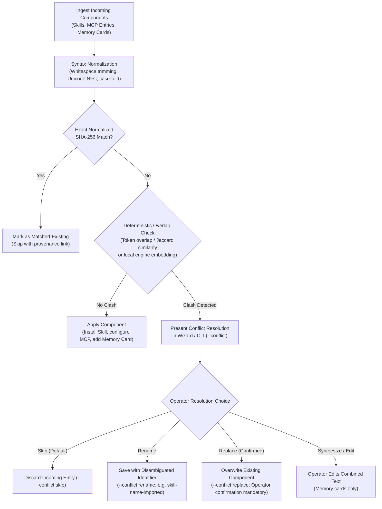
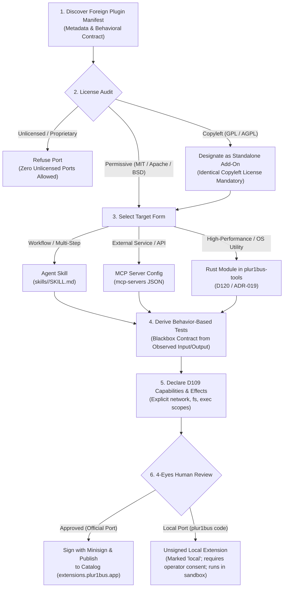

# Profile Import and Foreign Plugin Compatibility Specification

**Status:** Design specification · **Date:** 2026-10-27 (revised 2026-10-31) · **Deciders:** Christian (owner) · **Author:** agy (Antigravity) · **Inputs:** `docs/phase0/auftrag-original-2026-09-21.md` §4.2; `docs/import.md`; `docs/superpowers/specs/2026-09-27-extensions-ecosystem-design.md` §3, §7.3, §8; `docs/research/2026-10-27-profile-and-extension-sources.md`; [`docs/superpowers/plans/2026-10-31-profile-import-and-plugin-compat.md`](../plans/2026-10-31-profile-import-and-plugin-compat.md); ADR-003, ADR-005, ADR-010, ADR-011, ADR-019 / D120; Decided Register Entry **D121** (sub-ids D121-J1 to D121-J6).

---

## 1. Overview and Objectives

### 1.1 Context and Problem Statement

The PLUR1BUS Harness provides offline and supervised import capabilities for legacy OpenClaw and Hermes installations ([`docs/import.md`](../../import.md) §10–§13). However, two critical gaps remain:

1. **No profile import from modern AI coding and chat tools**: While the harness can drive external coding agents via the Agent Bridge ([ADR-011](../../adr/ADR-011-external-coding-agents.md)), it cannot import user profiles, custom instructions, persona definitions, project rules, skills, or MCP server configurations from tools such as Claude Code, OpenAI Codex, Cursor, Kimi, AGY/Gemini, or Grok. Note that legacy OpenClaw, Hermes, HM1, and HM2 remain fully covered by their existing dedicated M v2 importers (`docs/import.md` §13); the profile importer focuses strictly on the 7 new tool sources.
2. **Web UI Import wizard extension**: The original commission ([`docs/phase0/auftrag-original-2026-09-21.md`](../../phase0/auftrag-original-2026-09-21.md) §4.2) requires a re-runnable UI wizard. On main, F37 already describes the built `ImportWizard` ([`docs/web-ui.md`](../../web-ui.md) F37, `packages/web/src/pages/import/*`), and Paket O ([#838](https://github.com/Cyb3rb1ade/PLUR1BUS-Harness/pull/838)) adds prompt import. Milestone M7c extends `ImportWizard` (F37) with new tiles for the new sources, granular component selection, side-by-side conflict resolution, archive dropzone, and atomic rollback.
3. **Foreign plugin compatibility (Owner decision D121-J1, 2026-10-31)**: The Extensions specification ([`docs/superpowers/specs/2026-09-27-extensions-ecosystem-design.md`](2026-09-27-extensions-ecosystem-design.md) §3, §7.3) originally excluded foreign plugin code as "not portable". Following the owner directive of 2026-10-27 to examine how plugins could work, and the owner ruling of 2026-10-31 (D121-J1), compatibility is achieved without emulation shims or execution bridges. Decision D9 (*"Modules that would only work as an emulation are rewritten"*) remains binding. Compatibility is provided through **native ports** (first by PLUR1BUS agents in the PR workflow, later by users via `plur1bus code`), accompanied by **read-only plugin manifest discovery during import** and a structured **port pipeline**. Option 1 ("Host as MCP server") is retained strictly as a theoretical reserve.

### 1.2 Core Objectives

- **Scoped profile intake**: Ingest persona, instructions, user facts, memories, skills, and MCP configurations across new AI tool sources (Claude Code, OpenAI Codex, Cursor, Kimi, AGY/Gemini via direct file intake; Grok via user paste / prompt export; Grokbot dropped/unsupported as multi-party transcript).
- **Extended Web wizard (extending F37 `ImportWizard`)**: Deliver a fully accessible, bilingual (DE/EN) wizard extension with automatic source detection, granular entity selection, side-by-side conflict resolution, transactional execution, and one-click rollback.
- **Read-only foreign plugin manifest discovery and native port pipeline (D121-J1 decided)**: Provide read-only discovery of OpenClaw and Hermes plugin manifests during import without foreign code execution. Classify discovered plugins into four discrete categories:
  1. *Native equivalent available*
  2. *Known MCP server available*
  3. *Candidate for a port*
  4. *Non-portable (with reason)*
  Surface findings in preview and import reports, with local-only demand counting (strictly local, zero telemetry). Establish a structured 6-stage port pipeline (license audit, target form selection, behavior-derived tests, D109 capability declarations, human review, signed catalog distribution vs. sandboxed local ports from `plur1bus code`).
- **Strict security & zero credential migration (ADR-005, ADR-011)**: Untrusted imported instructions never enter the prompt cache or system prompt without explicit user preview and quarantine (in v1 reported as `instructions-not-imported` per Paket O) with read-only copy-out. Sensitive tokens are scrubbed using the central redactor. Zero credential or session hijacking is permitted; no code path reads credential files (`auth.json`, `.credentials.json`, Cursor `state.vscdb`).

---

## 2. Mapping Architecture

### 2.1 Target Model Mapping

PLUR1BUS structures agent cognition and runtime configuration through explicit architectural zones defined in ADR-003 and ADR-010. Foreign concepts map deterministically into this model:

| Source Entity | PLUR1BUS Target | Architectural Placement | Rationale & Cache Rules (ADR-010) |
|---|---|---|---|
| **Persona / Tone / Voice** | `SOUL.md` (read-only copy-out in v1) | System Prompt (Zone 2, above BP2) | Static persona definition; changes invalidate prompt cache from BP2 downwards. In v1 under D121-J3 Option A, imported personas are presented read-only in preview and report with copy-out to preserve prompt cache and prevent prompt injection; `--conflict` does not apply and never writes to `SOUL.md` without operator preview. |
| **Agent Operational Identity** | `IDENTITY.md` | System Prompt (Zone 2, above BP2) | Operating context and environment facts for the agent. Written when targeting an existing agent with verified identity facts. |
| **User Facts & Preferences** | `USER.md` + Engine Memory Cards (`scope: user`) | Frozen Memory Snapshot (Zone 3, BP3) | Stable facts about the human user. Bound to verified human principal (`trust: "proved"`). Without proved user, rejected with `unresolved-user-scope` (no automatic fallback to agent-private scope per ADR-007 Q4). Default confidentiality is `vertraulich` (D116 (6)), never `teilbar`. |
| **Global / Operating Instructions** | Agent Operating Instructions (`AGENTS.md` / `SOUL.md` sections) | System Prompt (Zone 2, above BP2) | General guidelines ("always do X", "never do Y"). In v1, presented in preview and report as `instructions-not-imported` (per Paket O) with read-only copy-out to prevent automated prompt injection. Never automatically written to Zone 2. |
| **Project / Workspace Rules** | Workspace Guidelines (`AGENTS.md`) | Workspace Scope (Zone 2 for active workspace) | Context rules derived from `.cursorrules`, `CLAUDE.md`, or project `AGENTS.md`. In v1, presented in preview and report as `instructions-not-imported` (per Paket O) with read-only copy-out. |
| **Skills** | Agent Skills (`skills/<id>/SKILL.md`) | Extensions Registry (`skills/`) | Conforms to Agent Skills standard (Extensions Spec §4.3). Trust tier `imported`. Subject to `--conflict skip \| rename \| replace`. |
| **MCP Servers** | `mcp-servers` configuration | Tool Definitions (Zone 1, BP1) | Declarative stdio/HTTP server entries. Conforms to `import.mcp-candidate/1`: slot names preserved, arguments and env values scrubbed, disabled by default. Changes invalidate BP1. Subject to `--conflict`. |
| **Foreign Plugins (Manifest Discovery)** | Plugin Manifest Discovery (D121-J1) | Import Report / Catalog Queue | Manifests read strictly read-only (`openclaw.plugin.json`, `package.json`, `plugin.yaml`). Classified into 4 categories; zero foreign code executed. Local demand count incremented without telemetry; feeds native port pipeline. |
| **Foreign Memory / Channels / Providers** | *Non-Portable* | N/A | Handled natively by PLUR1BUS core and engine. Classified as non-portable with explicit architectural reason. |

#### Confidentiality & Principal Constraints (D116, ADR-007)
- **Confidentiality Level:** In accordance with D116 (6), all imported memories default to `vertraulich`. They are never imported as `teilbar` without explicit per-item promotion by the operator.
- **User Scope vs. Agent-Private:** As decided in ADR-007 Q4 and Paket O, `scope: user` memory cards require an unambiguous human principal authenticated with `trust: "proved"`. The CLI cannot mint a proved human principal; unauthenticated CLI profile imports fail with `unresolved-user-scope` (no automatic fallback to agent-private scope per ADR-007 Q4).
- **Prompt Cache (ADR-010) Impact:** Zone 1 holds tools, Zone 2 holds system prompt instructions (`SOUL.md`, `IDENTITY.md`, `AGENTS.md`), Zone 3 holds memory snapshots, and Zone 4 holds conversation history. Breakpoint 2 closes Zone 2 (system prompt). Any addition or edit to instructions forces a re-computation of the prompt cache from BP2 downwards. To prevent accidental cache invalidation and reasoning instability, incoming instructions and personas never touch Zone 2 directly; in v1 they are reported as `instructions-not-imported` per Paket O with read-only copy-out.

---

### 2.2 Multi-Source Conflict Resolution

When importing resources into an agent that already contains configured guidelines or skills, conflicting entries can arise.

> [!IMPORTANT]
> **Strict Rule: No Silent Concatenation & Zone 2 Safety (N1).**
> Concatenating opposing instructions pollutes Zone 2 of the system prompt, confuses model reasoning, and degrades prompt cache performance. In v1 under D121-J3 Option A:
> - `--conflict` (`skip | rename | replace`, default `skip`) and the conflict resolution screen apply **only to skills, MCP server entries, and memory cards**.
> - Foreign persona definitions and operating instructions are **never automatically written, renamed, replaced, or concatenated into Zone 2 (`SOUL.md` or `AGENTS.md`)**. They are presented read-only with copy-out in preview and report (`instructions-not-imported` per Paket O).

#### Conflict Resolution Workflow



1. **Exact Deduplication**: Normalized components matching existing entries by SHA-256 hash are flagged as `matched-existing` and skipped.
2. **Deterministic Overlap Detection**: Components with overlapping identifiers, slot names, or near-duplicate intent are detected locally via normalized token overlap and Jaccard similarity, optionally supplemented by the local Rust engine embedding if available offline. **Zero cloud LLM inference is permitted** for conflict detection to respect `privacy.localOnly` and prevent data leaks. Semantic opposition that shares no tokens is surfaced via side-by-side operator review.
3. **Interactive Resolution (`--on-conflict` / `--conflict`)**:
   - *Skip* (default, `--conflict skip`): Preserves current PLUR1BUS resource; drops incoming entry.
   - *Rename* (`--conflict rename`): Preserves existing entry and installs incoming resource with a disambiguated identifier (e.g. `skills/<id>-imported-<source>/`, suffixed MCP slot name, or distinct memory card ID). In v1, `rename` never writes `SOUL.imported-...` or `AGENTS.imported-...` to Zone 2.
   - *Replace* (`--conflict replace`): Overwrites existing skill, MCP entry, or memory card with explicit operator confirmation. In v1, `replace` never performs an unreviewed overwrite of Zone 2 files (`SOUL.md` / `AGENTS.md`).
   - *Synthesize / Edit*: For memory cards, opens an inline editor allowing the operator to combine both intents.
4. **Plan Hash and Byte Invariance**: The preview displayed in the CLI or Web UI must exactly equal the applied bytes (plan hash). Preprocessing and normalization must not strip content (such as HTML comments or bidirectional Unicode characters) in preview while leaving them in apply.
5. **Per-Entry Bounds**: Following Paket O standards (`packages/core/src/import/prompt/parse.ts:11,13`), individual imported prompt memory payloads are capped at 512 KiB total input (`MAX_INPUT_BYTES`) and 4 000 characters per statement text (`MAX_ENTRY_CHARS`).
6. **Provenance Tracking**: Every imported skill, MCP entry, and memory card carries immutable metadata:
   - `provenance: "imported"`
   - `sourceRef: "<source>:<kind>:<id>;run=<runId>"`

---

## 3. Interfaces and Security Architecture

### 3.1 CLI Interface

Profile import integrates into the existing `plur1bus import` command structure under `crates/plur1bus` (`src/cli.rs`, `src/commands/import.rs`), strictly scoped to the 7 new sources:

```bash
# Detect available profile sources across the host
plur1bus import profile --detect

# Preview profile import from a specific source (dry-run by default)
plur1bus import profile claude --preview --agent main

# Apply profile import with explicit conflict resolution strategy (options: skip | rename | replace; default: skip)
plur1bus import profile cursor --apply --agent dev --workspace ws-alpha --conflict skip

# Import from a manual export archive (.zip or .tar.gz)
plur1bus import profile gemini --archive ~/Downloads/takeout-gemini.zip --apply

# Rollback a completed profile import run
plur1bus import profile --rollback <runId-or-report-path>
```

#### CLI Exit Codes (Aligned with `docs/errors.md`)
The `plur1bus import` command passes through the importer's exit codes (1..255 per `docs/errors.md`):
- `0`: Success (dry-run plan generated or apply completed cleanly).
- `1`: Application or validation error (`source-unreadable`, invalid archive, schema mismatch, internal failure).
- `2`: Usage error or refused before work (missing required arguments, invalid flag combinations).
- `3`: `E_LOCKED` (concurrent lock held).

#### Source Delegation
Legacy OpenClaw, Hermes, HM1, and HM2 sources are handled by the existing dedicated importers (`plur1bus import openclaw` and `plur1bus import hermes`, `docs/import.md` §13). Invoking `plur1bus import profile openclaw` delegates to `plur1bus import openclaw` with a diagnostic notice.

---

### 3.2 RPC Interface

Profile import extends the existing administrative import namespace (`admin.import.*`, `docs/import.md` §13.1) rather than creating a parallel API surface. All methods are Owner/Admin only, require authenticated sessions, and are assigned the **next free RPC minor version at implementation time** (extending `SourceType`, `source-catalog.json`, and the source registry under `packages/core/src/import/sources/`):

- `admin.import.detect`: Extended to return detected profile sources alongside existing OpenClaw/Hermes installations.
- `admin.import.plan`: Generates an immutable preview manifest for a profile source, archive, or prompt text, checking for component conflicts against target agents. Foreign plugin manifests are detected and classified.
- `admin.import.apply`: Requires fresh preflight and downtime consent; takes import locks, journals intent, snapshots mutated state, applies memory cards, skills, and MCP configs atomically, and writes `report.json` (0600).
- `admin.import.rollback`: Reverts changes associated with a specific `importRunId` using the cold recovery snapshot.

Agents and WebMCP receive no import methods (`docs/import.md` §13.1).

---

### 3.3 Web UI Wizard (Extending F37 `ImportWizard`)

The Web UI extends the existing `ImportWizard` ([`docs/web-ui.md`](../../web-ui.md) F37, `packages/web/src/pages/import/*`):

```mermaid
sequenceDiagram
    autonumber
    actor User as Human Operator
    participant UI as ImportWizard (Web UI F37)
    participant Core as PLUR1BUS Core (admin.import.*)
    participant Tools as Rust Archive Auditor (plur1bus-tools)
    participant Redact as Central Secrets Redactor

    User->>UI: Navigate to /import -> New Source Tile
    UI->>Core: admin.import.detect()
    Core-->>UI: Return Detected Tools (Claude, Cursor, Codex, Kimi, AGY)
    User->>UI: Step 1: Select Source or Drop Archive / Paste Text
    opt Archive Upload
        UI->>Core: Upload Archive
        Core->>Tools: Stream audit & unpack allowlisted files
        Tools-->>Core: Verified unpacked entries
    end
    User->>UI: Step 2: Choose Components (Skills, MCP, User Facts, Read-Only Instructions)
    UI->>Core: admin.import.plan(selection)
    Core->>Redact: Scrub secrets (sk-ant-, JWT, OAuth)
    Core-->>UI: Step 3: Present Per-Agent Preview (Read-Only Copy-Out for Persona/Rules; Diffs for Skills/MCP/Memory)
    opt Conflicts Detected (Skills, MCP, Memory)
        UI->>User: Step 4: Side-by-Side Conflict Screen (Skip, Rename, Replace)
        User->>UI: Choose Resolution Strategy
    end
    User->>UI: Step 5: Confirm Apply (Downtime & Snapshot Consent)
    UI->>Core: admin.import.apply(plan)
    Core-->>UI: Step 6: Completion Report (Discovered Plugins Classification) & Rollback Button
```

1. **Step 1: Detect & Select Source**: Adds tiles for the 7 new tools alongside existing OpenClaw, Hermes, and Prompt Import tiles. Provides an archive dropzone (`.zip`, `.tar.gz`) and prompt paste box.
2. **Step 2: Component Selection**: Granular checklist grouped by category (Persona/Identity, Instructions, User Facts, Skills, MCP Servers, Foreign Plugin Discovery).
3. **Step 3: Preview**: Diffs for `IDENTITY.md`, `USER.md`, proposed skills, memory cards, and MCP tool additions. Persona definitions and operating instructions are presented read-only with copy-out buttons; foreign plugin discovery findings are displayed by category.
4. **Step 4: Conflict Resolution**: Side-by-side comparison screen for detected skill, MCP, or memory clashes with Skip / Rename / Replace options.
5. **Step 5: Apply & Execution**: Displays progress bar, takes pre-flight snapshot, and writes state atomically.
6. **Step 6: Report & Rollback**: Comprehensive run statistics, download for `report.json`, plugin discovery categorization report, and one-click rollback.

---

### 3.4 Container Mode Strategy

When PLUR1BUS runs inside a container (e.g., Docker desktop bundle per D77):
- **No Insecure Host Mounts**: Blindly mounting the host home directory (`-v ~:/host-home:ro`) is strictly prohibited, as it exposes sensitive directories (`~/.ssh`, `~/.aws`, browser profiles, crypto wallets) and violates the snapshot-producer design (D91/D107).
- **No Unauthenticated Probing**: `/.dockerenv` sniffing is avoided. In accordance with F37, only authenticated container deployment metadata may propose host endpoints (`host.docker.internal`).
- **Supported Workflows in Containers**:
  1. *Archive Upload & Text Paste*: The Web UI enables direct drag-and-drop of export archives and copy-pasted exports.
  2. *Authenticated Desktop Helper (D90 / D2)*: When paired with the native desktop shell helper, the helper gathers sanitized source snapshots on the host and transmits them over the authenticated host bridge (`host.importSnapshot`).
  3. *Producer-Side Key-Allowlist for `host.importSnapshot` (R3-M3)*: The desktop helper executes the same selective key-allowlist extractors directly on the host and transmits only the extracted fields. It never ships raw, uninspected files (such as full `~/.claude.json` containing tokens, or bare `config.toml` containing Kimi hooks or Codex env values) into the harness volume. All files matching credential patterns (`*auth*`, `*credential*`, `*token*`, `*.vscdb`, `*key*`, `*secret*`, `*.pem`, `*.env*`) are excluded on the host prior to transmission.

---

### 3.5 Security, Credential Defense, and Data Boundaries

#### Single Canonical Read vs. Never-Read Boundary Table (N2)

| Source | Target Category | Exactly What is READ | Exactly What is NEVER READ (Strictly Banned) |
|---|---|---|---|
| **Claude Code** | Global/Project rules, MCP config | `~/.claude/CLAUDE.md`, `<workspace>/CLAUDE.md`, `<workspace>/.claude/CLAUDE.md`. Mixed file `~/.claude.json` / `<workspace>/.mcp.json`: streaming key-allowlist extractor extracts `mcpServers` ONLY. Non-allowlisted keys are never retained or emitted. | `~/.claude/.credentials.json` (banned), all non-allowlisted keys in `~/.claude.json` (`oauth_tokens`, `account`, `session` dropped immediately), `~/.claude/history/`. |
| **OpenAI Codex** | Instructions, skills, MCP config | `~/.codex/config.toml` (only `[developer_instructions]` and `[mcp_servers]`), `<workspace>/AGENTS.md`, `~/.codex/skills/`. | `~/.codex/auth.json` (banned), `~/.codex/sessions/*.json` (sensitive transcripts; dropped), shell hooks in `~/.codex/hooks.json` (skipped). |
| **Cursor** | Project rules, global rules, MCP | `.cursorrules`, `.cursor/rules/*.mdc`, `.cursor/mcp.json`, `settings.json` (`cursor.general.rulesForAi` [**U**]). User instructions via paste. | `state.vscdb` (SQLite storage with auth tokens/chat history; **NEVER opened, copied, or parsed**), `~/.cursor/extensions/` native binaries. |
| **Kimi** | Rules, skills, MCP config | `~/.kimi-code/AGENTS.md`, `<workspace>/AGENTS.md`, `~/.kimi-code/skills/`, `~/.kimi-code/mcp.json`. | Shell hooks in `config.toml` `[[hooks]]` (skipped), web session credentials, private API keys. |
| **Gemini / AGY** | Rules, skills, MCP config | `~/.gemini/antigravity-cli/rules/*.md`, `<workspace>/AGENTS.md`, `~/.gemini/config/skills/`, `mcp/<server>/` schemas. | Cloud account credentials, OAuth tokens, browser session stores. |
| **Grok** | Instructions, memories | User paste or prompt export (`PLUR1BUS-MEMORY-EXPORT v1`). | No filesystem access (cloud-only). Zero scraping. |
| **Grokbot** | Transcripts, chats | **None (Dropped entirely)**. Architectural decision note: multi-party chats excluded. | Telegram export JSON / desktop database (contains multi-party chats; sensitive). |

- **Prompt Injection Defense**: All imported instructions originate from external environments and are treated as untrusted text. In v1 they are never automatically activated into Zone 2; they are presented in preview and report as `instructions-not-imported` per Paket O with read-only copy-out.
- **Strict Key-Allowlist Parsers**: Parsers only extract explicitly documented configuration keys. Unknown, unparsed, or executable fields are discarded.
- **Zero Credential Migration (ADR-005, ADR-011)**:
  - Credential files (`~/.codex/auth.json`, `~/.claude/.credentials.json`, tokens in Cursor `state.vscdb`) are prohibited from being opened or read.
  - Automated spike-11 tests assert that no code path opens or reads credential files.
  - A mixed-file test seeds sentinel secrets into non-allowlisted keys of `~/.claude.json` and asserts that no log, report, or output contains them.
  - `secret-file-names.ts` and leak-sweep fixtures are extended to prevent reading credential stores.
  - Imported MCP server configs reuse `import.mcp-candidate/1` (`mcp-config.ts`): command arguments and environment variables are scrubbed, slot names are preserved, servers are set to disabled by default, and unsupported configurations route to manual setup.
- **Enhanced Centralized Redaction**: The central redactor (`crates/plur1bus/src/firstaid_bundle/redact.rs` and `packages/core/src/logs/redact.ts`) is extended to match Anthropic keys (`sk-ant-`), JSON Web Tokens (JWT), OAuth refresh tokens, and private key blocks.
- **Safe Filesystem Traversal**: File reading uses `SourceReader` / `readSourceFileSafe` with `O_NOFOLLOW` and the `@plur1bus/remote-fs` read-only port to guarantee that symlinked files (e.g., a `.cursorrules` pointing to `~/.ssh/id_rsa`) are rejected.
- **Hardened Archive Extraction & Limits (M5)**: Archive intake in `plur1bus-tools` (called over harness RPC per D120) enforces:
  - Stream selection of named entries required by detected parsers.
  - A maximum decompression ratio ceiling of 100:1 (matching `zipaudit`).
  - A 10 MiB limit per single decompressed file.
  - A 100 MiB total uncompressed bytes limit for the entire archive payload.
  - Rejection of symlinks, hardlinks, absolute paths, directory traversal (`..`), and nested archives.
  - **Sequential `.tar.gz` stream handling**: Because `.tar.gz` is a single sequential gzip stream, skipping entries requires decompressing through the gzip stream in memory; all decompressed bytes count towards the 100:1 ratio ceiling and the 100 MiB total cap.

---

## 4. Foreign Plugin Compatibility: Manifest Discovery & Native Port Pipeline

In accordance with Owner Decision D121-J1 (decided 2026-10-31), foreign plugin compatibility strictly upholds Decision D9: **no emulation shims and no foreign plugin bridges are built**. Foreign plugin code is never executed. Instead, compatibility is established through:
1. **Read-only foreign plugin manifest discovery during import**
2. **A structured native port pipeline** (conducted by PLUR1BUS agents in the PR process, and later by users via `plur1bus code`)

### 4.1 Read-Only Plugin Manifest Discovery during Import

During profile import, PLUR1BUS scans the plugin directories of legacy host installations (`~/.openclaw/extensions/`, `~/.hermes/plugins/`) strictly in read-only mode (`O_NOFOLLOW`).

#### Discovery Rules
- **Manifest-Only Inspection**: Only declarative metadata manifests are read (`openclaw.plugin.json`, `package.json`, `plugin.yaml`).
- **Zero Foreign Code Execution**: No Node.js or Python runtime is spawned; no package dependencies are installed; no code is evaluated (`eval`/`Function`).
- **Deterministic 4-Way Classification**: Every discovered plugin is mapped to one of four discrete categories:
  1. **Native Equivalent Available**: A native PLUR1BUS tool, skill, or engine capability already provides this functionality (e.g. native filesystem, process execution, Git, Web search, LanceDB memory).
  2. **Known MCP Server Available**: An existing, standard Model Context Protocol (MCP) server exists in the ecosystem that provides equivalent capability (e.g. Postgres, SQLite, GitHub, Fetch). The import wizard suggests adding the corresponding MCP server configuration.
  3. **Candidate for a Port**: A standalone tool plugin with a well-defined functional contract, eligible for the native port pipeline.
  4. **Non-Portable (with Reason)**: Incompatible architectural role (e.g. context-engine override, turn lifecycle hook modifying prompt cache, custom channel adapter, private memory backend, binary dependency requiring C/C++ compilation). The report documents the specific incompatibility reason.

#### Presentation & Local Demand Tracking
- **Wizard Preview & Report**: The discovered plugins and their classifications are displayed in Step 3 of the import wizard and documented in the final `report.json`.
- **Local Demand Counting (Zero Telemetry)**: If an imported plugin is classified as a port candidate or known MCP server, a local counter is incremented within the user's local instance configuration (`~/.plur1bus/state/plugin-demand.json`). This demand metric is used exclusively by the local operator and local `plur1bus code` to prioritize porting efforts. **Zero telemetry or external network calls are performed.**

---

### 4.2 Native Port Pipeline

To provide genuine, sustainable compatibility without violating harness architectural boundaries, foreign tools are ported natively to PLUR1BUS. Porting is executed by PLUR1BUS agents through the standard PR workflow, and post-D120 by end users through `plur1bus code`.



#### The 6-Stage Porting Procedure
1. **License Audit First**:
   - *Permissive Licenses* (MIT, Apache 2.0, BSD, ISC): Eligible for porting directly into the official PLUR1BUS catalog.
   - *Copyleft Licenses* (GPL, AGPL, LGPL): May only be ported as a distinct, standalone add-on package distributed under the identical copyleft license.
   - *Unlicensed / Proprietary / All Rights Reserved*: **Strictly prohibited from porting.** No code or behavioral specification is ported without explicit legal license.
2. **Select Target Form**:
   - *Agent Skill* (`skills/<id>/SKILL.md`): Selected for prompt-driven workflows, instruction templates, or composable multi-step procedures.
   - *MCP Server Configuration* (`mcp-servers`): Selected for external service integrations, REST APIs, or database connectors.
   - *Module in `plur1bus-tools`* (Rust, D120): Selected for high-performance data processing, cryptographic utilities, or low-level OS operations.
3. **Derive Behavior-Based Tests**:
   - Blackbox test fixtures are authored based strictly on observable behavioral specifications (input arguments, schema, expected return formats, error cases).
   - Foreign source code is never copy-pasted; implementations are clean-room native implementations satisfying the behavioral test suite.
4. **Declare D109 Capabilities**:
   - Required capabilities (network egress, filesystem roots, process execution) are explicitly declared.
   - Default effect levels are set (`external`/ask for network/write operations).
5. **Human Review**:
   - Every official port requires mandatory 4-eyes human review before merge into the catalog repository (`Cyb3rb1ade/plur1bus-extensions`).
6. **Distribution & Trust Model**:
   - *Official Ports*: Signed via Minisign and distributed through the verified extensions catalog (`extensions.plur1bus.app`).
   - *Local Ports from `plur1bus code`*: Remain unsigned, explicitly marked with trust tier `local`, require interactive operator authorization to enable, and execute strictly within the tool sandbox.

---

### 4.3 Adherence to Decision D9

Decision D9 ([`docs/superpowers/specs/2026-09-24-m1b-2a-core-daemon-cli-design.md`](2026-09-24-m1b-2a-core-daemon-cli-design.md#2-owner-decisions-carried-in-2026-09-24), line 23) states verbatim:
> **Register Text:** *"No OpenClaw idiom crosses the engine boundary into the harness. Where the engine offers only an OpenClaw-shaped path, the engine gets a real API and the adapter becomes its consumer. Modules that would only work as an emulation are rewritten."*
> **Owner Quote:** *"nicht so wirken, als hätten wir … eine OpenClaw-Emulationsschicht gebaut … Wenn wir dann ein Modul neu schreiben müssen, dann müssen wir ein Modul neu schreiben."*

#### Faithful Realization
The owner's decision under D121-J1 strictly enforces D9. No OpenClaw compatibility shims or emulation layers are introduced. The harness core (`packages/core`) remains 100% free of foreign idioms under `HYG-001`. Useful capabilities from external ecosystems are cleanly re-implemented as native PLUR1BUS skills, MCP configurations, or `plur1bus-tools` modules.

*Note on Option 1 ("Host as MCP server"):* Running the foreign host application externally as a whole and connecting to it via standard MCP remains a theoretical architecture reserve. It is not implemented in v1.

---

### 4.4 Mapping Other Ecosystems

Ecosystems without full plugin runtimes map onto standard PLUR1BUS extension types:
- **Cursor**: `.cursorrules` and `.cursor/rules/*.mdc` map to workspace rules (Zone 2, presented read-only with copy-out as `instructions-not-imported`). `.cursor/mcp.json` maps to `mcp-servers`. User instructions imported via paste; `state.vscdb` is never opened or read.
- **Gemini / AGY**: Skills in `~/.gemini/config/skills/` map to Agent Skills (`skills/`). MCP schemas map to `mcp-servers`.
- **Codex / Kimi**: Skills map to Agent Skills (`skills/`). Prompts and hooks are both **skipped and reported as skipped** in accordance with Extensions Spec §3 and §7.3, and HYG-003 (prompts do not map to slash commands).

---

## 5. Implementation Plan and Milestones

Implementation details, work package breakdowns, assignees, and verification gates are specified in [`docs/superpowers/plans/2026-10-31-profile-import-and-plugin-compat.md`](../plans/2026-10-31-profile-import-and-plugin-compat.md).

### 5.1 Scoped Milestones in `docs/milestones.md`

All three milestones sit outside the v0.1.0 total:

1. **`M7b` — Profile Import Core & CLI (`plur1bus import profile`)**:
   - Extraction parsers for new AI tools across Linux, macOS, and Windows.
   - Hardened selective archive intake & security audit in `plur1bus-tools` (P-J2a).
   - Deterministic conflict detection engine (for skills, MCP, memory cards), `admin.import.*` RPC extensions (assigned the next free RPC minor version at implementation time), and Rust CLI `plur1bus import profile` in `crates/plur1bus` (options: `skip | rename | replace`).
   - PII/secret scrubbing, leak-sweep fixtures, and spike-11 credential ban test.
   - Total effort: **10–15 ad**.
2. **`M7c` — Profile Import Web Wizard (Extending F37 `ImportWizard`)**:
   - Extends existing `ImportWizard` (F37) with tiles for the new tools, component checklist, side-by-side conflict resolution screen (skills, MCP, memory), read-only copy-out for persona/instructions, archive dropzone, and atomic rollback.
   - Full bilingual DE/EN accessibility (axe-core green).
   - Total effort: **3–5 ad**.
3. **`X3b` — Foreign Plugin Discovery & Native Port Pipeline**:
   - **Plugin Manifest Discovery in Import (P-J4a)**: Read-only scanning and 4-way classification in import preview and report; local demand counting without telemetry. (2–3 ad).
   - **Port Pipeline Tooling & Validation in `plur1bus-tools` (P-J4b)**: License checking, D109 capability declarations, behavior test generation. (2–3 ad).
   - **Initial Native Ports (P-J4c)**: First wave of native ports based on local demand. (3–5 ad).
   - **Integration in `plur1bus code` (P-J4d)**: Workflow for local user-driven ports, gated by D120 milestone. (2–3 ad).
   - Total effort: **6–10 ad** (post-v0.1.0).

---

## 6. Decision Register D121 (Owner Decisions)

The following architectural decisions have been confirmed by the owner under register entry **D121**:

| ID | Decision Question | Context & Constraints | Options | Recommendation | Decided | Notes |
|---|---|---|---|---|---|---|
| **D121-J1** | Foreign Plugin Compatibility Strategy | Owner directive 2026-10-27 explored foreign plugin support. D9 (`docs/superpowers/specs/2026-09-24-m1b-2a-core-daemon-cli-design.md:23`) explicitly mandates: *"Modules that would only work as an emulation are rewritten"* and quotes owner: *"nicht so wirken, als hätten wir … eine OpenClaw-Emulationsschicht gebaut … Wenn wir dann ein Modul neu schreiben müssen, dann müssen wir ein Modul neu schreiben."* | **Option A (Decided)**: Native ports and read-only manifest discovery during import. Zero shims, zero execution bridges. 6-stage port pipeline (license check, target form, behavior tests, D109 declaration, human review, signed catalog vs. sandboxed local ports). Option 1 ("Host as MCP server") kept as theoretical reserve.<br>**Option B**: Out-of-process bridge (rejected by owner).<br>**Option C**: In-process emulation (rejected: violates security & D9). | Adopt Option A: Native Ports & Discovery Pipeline. | **Decided: Option A (2026-10-31)** | Strictly upholds D9 and HYG-001. No foreign runtime shims. |
| **D121-J2** | Lint Hygiene Allowlist & Shim Package Location | `scripts/lint-hygiene.mjs` enforces `HYG-001` (banning OpenClaw idioms). D9 requires keeping harness core clean of foreign idioms. | **Entfällt**: Since no compatibility shim is built under D121-J1, no `hosts/openclaw-shim/` package is created and no hygiene allowlist exceptions are needed. `packages/core` remains 100% clean of OpenClaw idioms. | Entfällt (no shim built). | **Entfällt (2026-10-31)** | Superseded by D121-J1 Option A. |
| **D121-J3** | Default Instruction Conflict Resolution & Zone 2 Safety | When importing instructions into an agent with existing guidelines, how should conflicts resolve, and how is Zone 2 protected against prompt injection? | **Option A (Decided for v1)**: In v1, instructions and persona definitions are presented in preview and report as `instructions-not-imported` (matching Paket O) with read-only copy-out. No automated or unconfirmed writes to Zone 2 (`SOUL.md` / `AGENTS.md`). `--conflict` (`skip \| rename \| replace`, default `skip`) applies only to skills, MCP entries, and memory cards.<br>**Option B**: Rule proposal queue (deferred post-D120 in `plur1bus-tools`).<br>**Option C**: Direct unconfirmed overwrite (`replace`) or concatenation (rejected: violates Zone 2 integrity and prompt cache). | Adopt Option A for v1: Default `skip`. Instructions and personas reported as `instructions-not-imported` per Paket O with copy-out. Replace never bypasses preview. | **Decided: Option A (2026-10-31)** | Aligned with Paket O, ADR-010, and Zone 2 safety. |
| **D121-J4** | Confidentiality and Memory Scope Defaults | Ingesting facts and memories into engine stores under D116 and ADR-007 Q4. | **Option A (Decided)**: Default D116 confidentiality level is `vertraulich` (never `teilbar`). `scope: user` requires proved human principal; unauthenticated CLI calls fail with `unresolved-user-scope` (no fallback per ADR-007 Q4).<br>**Option B**: Import as `teilbar` or fallback to agent-private (rejected: potential data leak / scope breach). | Adopt Option A: Default `vertraulich`. Strict adherence to ADR-007 Q4 and Paket O. | **Decided: Option A (2026-10-31)** | Follows D116 (6). |
| **D121-J5** | Source Scope Partitioning | Multiple overlapping import paths exist in the harness (M v2, Paket O, profile import). | **Option A (Decided)**: Scope `plur1bus import profile` strictly to the new sources (5 direct file-based: Claude, Codex, Cursor, Kimi, AGY; Grok via user paste / prompt export; Grokbot dropped). Existing OpenClaw, Hermes, HM1, HM2 remain with existing M v2 importers.<br>**Option B**: Re-implement OpenClaw/Hermes in profile importer (rejected: code duplication). | Adopt Option A: Strict scope boundary. Sources 8–11 delegate to existing M v2 importers. | **Decided: Option A (2026-10-31)** | Prevents parallel API surfaces. |
| **D121-J6** | Milestone Boundaries & ADR-019 / D120 Compliance | Sequencing and technology choice for implementation. | **Option A (Decided)**: M7b, M7c, and X3b sit outside v0.1.0 total. RPC minor assigned as next free at implementation time. All new components in Rust by Claude agents per D120 / ADR-019.<br>**Option B**: Implement components in TypeScript without ADR-019 justification (rejected: violates D120 / ADR-019). | Adopt Option A: Rust components assigned to Claude agents. Milestones scheduled outside v0.1.0. | **Decided: Option A (2026-10-31)** | Complies with ADR-019. |
