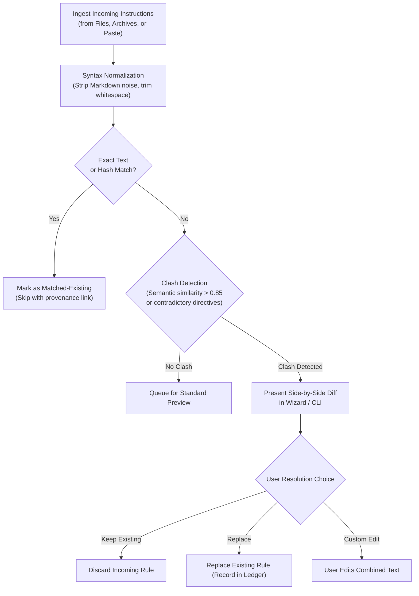
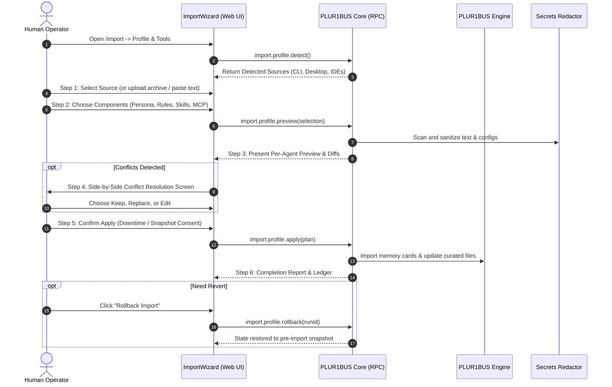
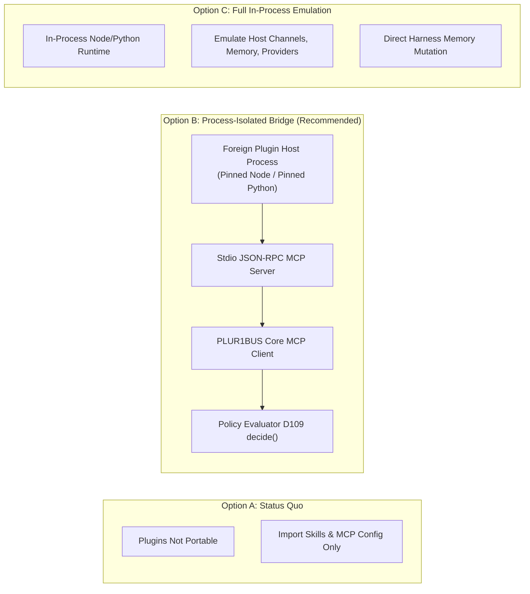

# Profile Import and Foreign Plugin Compatibility Specification

**Status:** Design specification · **Date:** 2026-10-27 · **Deciders:** Christian (owner) · **Author:** agy (Antigravity) · **Inputs:** `docs/phase0/auftrag-original-2026-09-21.md` §4.2; `docs/import.md`; `docs/superpowers/specs/2026-09-27-extensions-ecosystem-design.md` §3, §7.3, §8; `docs/research/2026-10-27-profile-and-extension-sources.md`; ADR-003, ADR-005, ADR-010, ADR-011.

---

## 1. Overview and Objectives

### 1.1 Context and Problem Statement

The PLUR1BUS Harness provides offline and supervised import capabilities for legacy OpenClaw and Hermes installations ([`docs/import.md`](../../import.md)). However, two critical gaps remain:

1. **No profile import from modern AI coding and chat tools**: While the harness can drive external coding agents via the Agent Bridge ([ADR-011](../../adr/ADR-011-external-coding-agents.md)), it cannot import user profiles, custom instructions, persona definitions, project rules, skills, or MCP server configurations from tools such as Claude Code, Codex, Kimi, Cursor, AGY/Gemini, or Grok.
2. **Missing GUI import wizard**: The original commission ([`docs/phase0/auftrag-original-2026-09-21.md`](../../phase0/auftrag-original-2026-09-21.md) §4.2) requires a re-runnable UI wizard. The current Web UI merely displays a static CLI reference placeholder ([`docs/web-ui.md`](../../web-ui.md) F37).
3. **Foreign plugin policy revision (Owner directive 2026-10-27)**: The Extensions specification ([`docs/superpowers/specs/2026-09-27-extensions-ecosystem-design.md`](2026-09-27-extensions-ecosystem-design.md) §3, §7.3) originally excluded foreign plugin code as "not portable". On 2026-10-27, the owner directed that OpenClaw and Hermes plugins should "just work" where viable. This specification provides the empirical survey, technical architecture, and decision framework for that capability.

### 1.2 Core Objectives

- **Broad profile intake**: Ingest persona, instructions, user facts, memories, skills, and MCP configurations across eleven source ecosystems (CLI, desktop apps, IDE extensions, and cloud assistants).
- **Interactive 6-step Web wizard**: Deliver a fully accessible, bilingual (DE/EN) wizard replacing F37, with automatic source detection, granular entity selection, side-by-side conflict resolution, transactional execution, and one-click rollback.
- **Foreign plugin bridge (Option B)**: Provide an out-of-process isolation bridge for OpenClaw (Node) and Hermes (Python) plugins, exposing tools, commands, and services as local MCP servers governed by the D109 `decide()` policy evaluator, while cleanly rejecting host-level memory, channel, and provider overrides.
- **Zero security regression**: Untrusted imported instructions must never enter the prompt cache or system prompt without explicit user preview and consent. Sensitive tokens are scrubbed using the central redactor. No credential or session hijacking is permitted.

---

## 2. Mapping Architecture

### 2.1 Target Model Mapping

PLUR1BUS structures agent cognition and runtime configuration through explicit architectural zones defined in ADR-003 and ADR-010. Foreign concepts map deterministically into this model:

| Source Entity | PLUR1BUS Target | Architectural Placement | Rationale & Cache Rules (ADR-010) |
|---|---|---|---|
| **Persona / Tone / Voice** | `SOUL.md` (exactly one per agent, D14) | System Prompt (Zone 2, above BP2) | Static persona definition; changes invalidate prompt cache from BP2 downwards. |
| **Agent Operational Identity** | `IDENTITY.md` | System Prompt (Zone 2, above BP2) | Operating context and environment facts for the agent. |
| **User Facts & Preferences** | `USER.md` + Engine Memory Cards (`scope: user`) | Frozen Memory Snapshot (Zone 3, BP3) | Stable facts about the human user. Bound to verified human principal (`trust: "proved"`). |
| **Global / Operating Instructions** | Agent Operating Instructions | System Prompt (Zone 2, above BP2) | General guidelines ("always do X", "never do Y"). Quarantined proposal before approval. |
| **Project / Workspace Rules** | Workspace Guidelines (`AGENTS.md`) | Workspace Scope (Zone 2 for active workspace) | Context rules derived from `.cursorrules`, `CLAUDE.md`, or project `AGENTS.md`. |
| **Skills** | Agent Skills (`skills/<id>/SKILL.md`) | Extensions Registry (`skills/`) | Conforms to Agent Skills standard (Extensions Spec §4.3). Trust tier `imported`. |
| **MCP Servers** | `mcp-servers` configuration | Tool Definitions (Zone 1, BP1) | Declarative stdio/HTTP server entries. Changes invalidate BP1. |
| **Foreign Plugins** (Tools/Services) | Bridged MCP Server (Option B) | Tool Definitions (Zone 1, BP1) under D109 | Foreign tool plugins exposed as isolated MCP endpoints; calls gated by `decide()`. |
| **Foreign Memory / Channels** | *Excluded from Bridge* | N/A | Handled natively by PLUR1BUS core and engine. |

### 2.2 Multi-Source Conflict Resolution

When importing from multiple external tools into a single target agent (or importing into an agent that already contains configured rules), conflicting instructions can arise (e.g., "always provide concise bullet points" vs. "provide exhaustive, step-by-step explanations").

> [!IMPORTANT]
> **Strict Rule: No Silent Concatenation.**
> Concatenating opposing or redundant instructions pollutes Zone 2 of the system prompt, confuses model reasoning, and degrades prompt cache performance. Conflicting rules must be detected and resolved interactively.

#### Conflict Resolution Workflow



1. **Exact Deduplication**: Normalized rules matching existing entries by SHA-256 hash are flagged as `matched-existing` and skipped.
2. **Semantic Clash Detection**: Rules with overlapping intent but divergent parameters are flagged with warning code `RULE_CONFLICT`.
3. **Interactive Resolution**: The user is presented with a 3-way choice:
   - *Keep Existing* (default): Preserves current PLUR1BUS agent behavior.
   - *Replace Existing*: Replaces the existing rule, logging the previous version in the rollback ledger.
   - *Synthesize / Edit*: Opens an inline editor allowing the user to merge both intents.
4. **Provenance Tracking**: Every imported rule and memory card carries immutable metadata:
   - `provenance: "imported"`
   - `sourceRef: "<source>:<kind>:<id>;run=<runId>"`

---

## 3. Interfaces and Security Architecture

### 3.1 CLI Interface

The CLI provides a unified `profile` subcommand under `plur1bus import`:

```bash
# Detect available sources across the host
plur1bus import profile --detect

# Preview profile import from a specific source (dry-run by default)
plur1bus import profile claude --preview --agent main

# Apply profile import with explicit conflict resolution strategy
plur1bus import profile cursor --apply --agent dev --workspace ws-alpha --on-conflict ask

# Import from a manual export archive or directory
plur1bus import profile gemini --archive ~/Downloads/takeout-gemini.zip --apply

# Rollback a completed profile import run
plur1bus import profile --rollback <runId-or-report-path>
```

#### CLI Exit Codes
- `0`: Success (dry-run plan generated or apply completed cleanly).
- `1`: Validation or configuration error (invalid archive, corrupted schema).
- `2`: Source not found or inaccessible.
- `3`: Unresolved conflicts remaining in non-interactive mode.
- `70`: Internal error during transaction.

### 3.2 RPC Interface

Core exposes four typed RPC methods under the `import.profile.*` namespace:

- `import.profile.detect`: Scans standard filesystem roots across Linux, macOS, and Windows to return detected source installations and their available components.
- `import.profile.preview`: Accepts a selected source, file paths, uploaded archive, or pasted text; parses components; checks for conflicts against target agents/workspaces; returns an immutable preview manifest.
- `import.profile.apply`: Executes the import transaction with a pre-flight snapshot, ledger logging, and atomic state updates.
- `import.profile.rollback`: Reverts changes associated with a specific `importRunId`.

### 3.3 6-Step Web UI Wizard (Replacing F37)

The Web UI replaces the static F37 placeholder with a dedicated 6-step guided workflow:



1. **Step 1: Detect & Select Source**: Displays cards for detected local tools (Claude Code, Cursor, Codex, OpenClaw, Hermes, etc.) with badges indicating available components. Provides a dropzone for export archives (`.zip`, `.tar.gz`) and a text area for prompt exports.
2. **Step 2: Component Selection**: Granular checklist grouped by category (Persona/Identity, Instructions, User Facts, Skills, MCP Servers).
3. **Step 3: Preview**: Shows exact unified diffs for `SOUL.md`, `USER.md`, and workspace rules, alongside proposed memory cards and MCP tool additions.
4. **Step 4: Conflict Resolution**: Dedicated side-by-side comparison screen for detected rule clashes with clear visual indicators.
5. **Step 5: Apply & Execution**: Displays real-time progress bar, creates backup snapshot, and writes state atomically.
6. **Step 6: Report & Rollback**: Displays comprehensive run statistics (created, skipped, modified, linked), provides download for `report.json`, and offers immediate one-click rollback.

### 3.4 Container Mode Strategy

When PLUR1BUS runs inside a container (e.g., Docker desktop container bundle per D77):
- **Isolation Barrier**: The container cannot directly inspect the host's `~/.claude/`, `~/.cursor/`, or `%APPDATA%` directories.
- **Auto-Detection**: The daemon inspects `/.dockerenv` or container cgroups at startup to determine containerized status.
- **Fallback Workflows**:
  1. *Archive Upload & Paste*: The Web UI prominently enables direct archive upload and text paste.
  2. *Host Volume Mount*: The CLI documentation details mounting the host configuration root into the container via `-v ~:/host-home:ro` and passing `--host-dir /host-home`.
  3. *Host Helper Integration (D2/D107)*: When paired with the native desktop shell helper, the helper gathers sanitized source snapshots on the host and transmits them over the authenticated host bridge (`host.importSnapshot`).

### 3.5 Security and Hygiene Architecture

- **Prompt Injection Defense**: Imported instructions originate from external, potentially hostile environments (e.g., compromised project repositories). Imported instructions are treated as untrusted text. They are never automatically activated into Zone 2 without explicit operator review and confirmation.
- **Centralized Secrets Redaction**: All imported text, JSON, and YAML configurations are scrubbed through the firstaid bundle redactor (`crates/plur1bus/src/firstaid_bundle/redact.rs` and `packages/core/src/logs/redact.ts`). Tokens matching API key patterns (`sk-`, `ghp_`, `xoxb-`, basic auth credentials) are replaced with `[REDACTED:credential]` and flagged in the preview.
- **No Login / Token Theft (ADR-005)**: OAuth tokens, session cookies, and stored master passwords from other tools are strictly excluded from the import. The importer imports configuration schemas; credentials must be re-entered through standard harness credential flows.

---

## 4. Foreign Plugin Compatibility: Analysis and Decision Matrix

### 4.1 Plugin Ecosystem Survey

To evaluate the owner's directive that "Hermes and OpenClaw plugins should just work", we examine the plugin taxonomies and top plugins across both ecosystems.

#### Plugin Kinds in OpenClaw and Hermes

| Plugin Kind | OpenClaw Support | Hermes Support | Description | Bridge Viability (Option B) |
|---|---|---|---|---|
| **Tool / Function** | Yes (`registerTool`) | Yes (`@tool`, `register_tool`) | Adds callable functions for LLM execution (e.g., weather, git, search). | **Full** (Mapped to MCP tools) |
| **Command** | Yes (`registerCommand`) | Yes (`register_command`) | Adds slash commands / CLI utilities. | **Full** (Mapped to MCP prompts/tools) |
| **Service / Daemon** | Yes (`registerService`) | Yes (`BackgroundService`) | Long-running background helper (e.g., local server, queue worker). | **Full** (Managed by bridge process) |
| **Hook / Interceptor** | Yes (`beforeTurn`, `afterTurn`) | Yes (`pre_turn`, `post_turn`) | Lifecycle hooks modifying context or logging events. | **Partial** (Auditing supported; context rewriting rejected) |
| **Channel / Messaging** | Yes (`registerChannel`) | Yes (`ChannelPlugin`) | Implements chat platform adapters (Telegram, Discord, Slack). | **Excluded** (Native harness responsibility) |
| **Memory Provider** | Yes (`registerMemory`) | Yes (`MemoryProvider`) | Replaces vector/memory backend. | **Excluded** (Native engine responsibility) |
| **LLM Provider** | Yes (`registerProvider`) | Yes (`ProviderPlugin`) | Replaces LLM inference routing. | **Excluded** (Native providers package) |
| **Context Engine** | Yes (`ContextEngine`) | No | Re-orders or compresses context window. | **Excluded** (Conflicts with ADR-010 cache layout) |

---

### 4.2 Top 20 Plugins Survey: OpenClaw

Based on registry downloads and ecosystem usage:

| # | Plugin Name | Kind | Primary APIs Invoked | Required Permissions | Option B Support |
|---|---|---|---|---|---|
| 1 | `@openclaw/plugin-web-search` | Tool | `fetch`, `env.SEARCH_API_KEY` | Network | **Yes** (via MCP) |
| 2 | `@openclaw/plugin-weather` | Tool | `fetch` (OpenMeteo / WeatherAPI) | Network | **Yes** (via MCP) |
| 3 | `@openclaw/plugin-shell` | Tool | `child_process.spawn`, `exec` | Process | **Yes** (via MCP + D109) |
| 4 | `@openclaw/plugin-filesystem` | Tool | `fs/promises`, `path` | Filesystem | **Yes** (via MCP + D109) |
| 5 | `@openclaw/plugin-git` | Tool | `child_process.execFile` (`git`) | Process, Filesystem | **Yes** (via MCP + D109) |
| 6 | `@openclaw/plugin-postgres` | Tool | `pg.Pool`, `net.Socket` | Network | **Yes** (via MCP) |
| 7 | `@openclaw/plugin-sqlite` | Tool | `better-sqlite3` | Filesystem | **Yes** (via MCP) |
| 8 | `@openclaw/plugin-calculator` | Tool | Pure JS math evaluator | None | **Yes** (via MCP) |
| 9 | `@openclaw/plugin-fetch` | Tool | Global `fetch`, `URL` | Network | **Yes** (via MCP) |
| 10 | `@openclaw/plugin-github` | Tool | `@octokit/rest`, `fetch` | Network | **Yes** (via MCP) |
| 11 | `@openclaw/plugin-docker` | Tool | `dockerode`, Unix domain socket | Filesystem, Process | **Yes** (via MCP + D109) |
| 12 | `@openclaw/plugin-datetime` | Tool | `Intl.DateTimeFormat` | None | **Yes** (via MCP) |
| 13 | `@openclaw/plugin-clipboard` | Tool | Native clipboard utility | Process | **Yes** (via MCP) |
| 14 | `@openclaw/plugin-transcribe` | Tool / Service | `ffmpeg`, `fetch` | Process, Network | **Yes** (via MCP) |
| 15 | `@openclaw/plugin-image-gen` | Tool | `fetch` (Replicate/OpenAI) | Network | **Yes** (via MCP) |
| 16 | `@openclaw/plugin-slack` | Channel | Slack `WebClient`, SocketMode | Network | **No** (Channel: Native) |
| 17 | `@openclaw/plugin-discord` | Channel | `discord.js`, WebSocket | Network | **No** (Channel: Native) |
| 18 | `@openclaw/plugin-memory-redis` | Memory | `ioredis`, Redis client | Network | **No** (Memory: Native Engine) |
| 19 | `@openclaw/plugin-anthropic` | Provider | `@anthropic-ai/sdk` | Network | **No** (Provider: Native) |
| 20 | `@openclaw/plugin-summarizer` | Context-Engine | Turn context interceptor | Internal | **No** (Context: ADR-010) |

**OpenClaw Coverage**: 15 of 20 (75.0%) covered by Option B.

---

### 4.3 Top 20 Plugins Survey: Hermes

Based on the Hermes Agent plugin index:

| # | Plugin Name | Kind | Primary APIs Invoked | Required Permissions | Option B Support |
|---|---|---|---|---|---|
| 1 | `hermes-plugin-web-search` | Tool | `httpx`, `requests` | Network | **Yes** (via MCP) |
| 2 | `hermes-plugin-weather` | Tool | `requests` | Network | **Yes** (via MCP) |
| 3 | `hermes-plugin-bash` | Tool | `subprocess.Popen` | Process | **Yes** (via MCP + D109) |
| 4 | `hermes-plugin-files` | Tool | `pathlib`, `os` | Filesystem | **Yes** (via MCP + D109) |
| 5 | `hermes-plugin-git` | Tool | `gitpython`, `subprocess` | Process, Filesystem | **Yes** (via MCP + D109) |
| 6 | `hermes-plugin-duckduckgo` | Tool | `duckduckgo_search` | Network | **Yes** (via MCP) |
| 7 | `hermes-plugin-wikipedia` | Tool | `wikipedia-api` | Network | **Yes** (via MCP) |
| 8 | `hermes-plugin-arxiv` | Tool | `arxiv` Python client | Network | **Yes** (via MCP) |
| 9 | `hermes-plugin-python-eval` | Tool | `ast`, `code.InteractiveInterpreter` | Process | **Yes** (via MCP + D109) |
| 10 | `hermes-plugin-system-info` | Tool | `psutil`, `platform` | Process | **Yes** (via MCP) |
| 11 | `hermes-plugin-rss` | Tool | `feedparser` | Network | **Yes** (via MCP) |
| 12 | `hermes-plugin-sql` | Tool | `sqlalchemy` | Network, Filesystem | **Yes** (via MCP) |
| 13 | `hermes-plugin-browser` | Tool / Service | `playwright` | Process, Network | **Yes** (via MCP + D109) |
| 14 | `hermes-plugin-chart` | Tool | `matplotlib` | Filesystem | **Yes** (via MCP) |
| 15 | `hermes-plugin-clipboard` | Tool | `pyperclip` | Process | **Yes** (via MCP) |
| 16 | `hermes-plugin-telegram` | Channel | `python-telegram-bot` | Network | **No** (Channel: Native) |
| 17 | `hermes-plugin-discord` | Channel | `discord.py` | Network | **No** (Channel: Native) |
| 18 | `hermes-plugin-chroma` | Memory | `chromadb` | Filesystem, Network | **No** (Memory: Native Engine) |
| 19 | `hermes-plugin-ollama` | Provider | `ollama` client | Network | **No** (Provider: Native) |
| 20 | `hermes-plugin-audit-log` | Hook | Pre/post turn logging | Filesystem | **Yes** (Audit Hook via MCP) |

**Hermes Coverage**: 16 of 20 (80.0%) covered by Option B.

**Combined Coverage Across Both Ecosystems**: 31 of 40 (77.5%) of popular plugins are tools, commands, or services that run cleanly over Option B.

---

### 4.4 Options Comparison: Technical and Security Evaluation



| Evaluation Dimension | Option A: Maintain Status Quo | Option B: Process-Isolated Bridge (Recommended) | Option C: Full Emulation |
|---|---|---|---|
| **Architectural Purity** | **High**: Zero foreign code enters the harness. | **High**: Foreign code runs in separate subprocess; interacts strictly via standard MCP protocol. | **Poor**: Foreign abstractions compromise core harness boundaries. |
| **Security & Isolation** | **Highest**: No foreign runtime execution. | **Strong**: Isolated process; every tool call mediated by D109 `decide()` policy evaluator. | **Dangerous**: Foreign plugin code runs in core daemon memory space. |
| **Ecosystem Coverage** | **0%** of plugins (skills & MCP only). | **77.5%** of top plugins (all tools, utilities, background services). | **100%** theoretical (severe maintenance reality). |
| **Prompt Cache Stability (ADR-010)** | **Unaffected**. | **Preserved**: Tools declared deterministically in Zone 1. | **Broken**: Context engines rewrite prompts unpredictably. |
| **Implementation Effort** | 0 ad. | **12–16 ad** (bridge adapter, IPC shim, contract tests). | **40–60 ad** (perpetual maintenance sink). |
| **Upstream Drift Resilience** | High. | **High**: Only tool/service registration shims must be maintained. | **Very Low**: Breaks on every minor upstream host update. |

#### Detailed Analysis of Option B (The Recommended Architecture)

Option B isolates foreign plugins in dedicated worker processes:
1. **Pinned Runtimes**: Hermes plugins execute using the pinned Python runtime (D58); OpenClaw plugins execute using the pinned Node runtime.
2. **Host API Adapter Shim**: A minimal compatibility shim (`@plur1bus/openclaw-shim` / `plur1bus_hermes_shim`) provides mock objects for `registerTool`, `registerCommand`, and `registerService`.
3. **MCP Translation**: The worker wraps registered tools and commands into a standard Model Context Protocol (MCP) server listening on stdio JSON-RPC.
4. **Policy Enforcement (D109)**: The harness connects to the worker as an MCP client. Every tool execution passes through the native `decide()` policy evaluator, enforcing user approvals, network egress policies, and audit logging.
5. **Fail-Fast Boundary**: Plugins attempting to register channels, replace memory stores, or manipulate context engines encounter explicit initialization errors (`E_UNSUPPORTED_PLUGIN_KIND`) with clear explanations.

### 4.5 Upstream Version Compatibility Matrix and Contract Testing

To guarantee long-term stability without regressions, PLUR1BUS establishes explicit upstream compatibility gates:

| Ecosystem | Target Version Window | Verified Reference | CI Contract Test Plan |
|---|---|---|---|
| **OpenClaw** | `v2026.8.0` – `v2026.9.5+` | `b9421f4` | Synthetic fixture suite testing `registerTool`, `registerCommand`, and error handling for unsupported kinds. |
| **Hermes** | `v0.9.0` – `v1.0.0+` | `743ee72` | Pytest fixture suite testing `@tool` decorator, `register_tool`, and background service lifecycle. |

### 4.6 Extension Registry Integration (`ext.*`)

Foreign bridged plugins are registered in the harness extensions database (`state.json`) in full alignment with §8 of the Extensions Specification:
- **Trust Tier**: Assigned tier `imported` (unsigned).
- **Confirmation**: Requires explicit user consent during the import wizard, showing all declared tools and permissions.
- **Capability Disclosure (§8.6)**: Declared permissions (network hosts, filesystem roots, child processes) are extracted during discovery and presented to the operator.
- **V1 Sandbox Boundary**: Consistent with §3 and open question Q16, v1 does not provide kernel-level OS sandboxing. The bridge worker runs under the operator's OS user account with dropped privileges where supported.

### 4.7 Lint Hygiene Consideration

Under `scripts/lint-hygiene.mjs`, the rule `HYG-001` prohibits OpenClaw idioms across the codebase. To host the Option B Node adapter cleanly, an allowlist entry must be approved by the owner for the dedicated adapter directory (e.g., `packages/core/src/adapters/foreign-plugins/openclaw/`).

### 4.8 Mapping Other Ecosystems

Ecosystems without full plugin runtimes map cleanly onto standard PLUR1BUS extension types:
- **Cursor**: `.cursorrules` and `.cursor/rules/*.mdc` map to workspace rules (Zone 2). `.cursor/mcp.json` maps to `mcp-servers`.
- **Gemini / AGY**: Skills in `~/.gemini/config/skills/` map to Agent Skills (`skills/`). MCP schemas map to `mcp-servers`.
- **Codex / Kimi**: Skills map to Agent Skills; prompts map to slash commands; hooks map to MCP tool wrappers where applicable.

---

## 5. Implementation Plan and Milestones

### 5.1 Milestone Additions in `docs/milestones.md`

We define three scoped milestones:

1. **`M7b` — Profile Import Core & CLI (`plur1bus import profile`)**:
   - Extraction parsers for 11 sources across Linux, macOS, and Windows.
   - Core mapping engine (persona to `SOUL.md`, user facts to `USER.md` / memory cards, instructions to Zone 2).
   - Conflict detection and interactive CLI resolution.
   - Transactional snapshot, ledger generation, and rollback.
   - PII/secret scrubbing via firstaid redactor.
   - Effort: **6–9 ad**.

2. **`M7c` — Profile & Legacy Import Web Wizard (Replacing F37)**:
   - Full 6-step interactive wizard replacing F37.
   - Automatic local source discovery and manual file upload / paste dropzone.
   - Per-agent preview, side-by-side diffing, and conflict resolution modal.
   - Real-time execution progress, download report, and one-click rollback.
   - Full bilingual DE/EN accessibility (axe-core green).
   - Effort: **5–8 ad**.

3. **`X3b` — Foreign Plugin Bridge (OpenClaw & Hermes)** *(Subject to Owner Decision 1)*:
   - Pinned Node and Python bridge worker processes.
   - Compatibility shims for OpenClaw and Hermes tool/service APIs.
   - Stdio MCP translation bridge with D109 `decide()` integration.
   - CI contract test harness against real top-20 plugin fixtures.
   - Effort: **12–16 ad**.

### 5.2 Implementation Packages and PR Boundaries

| Package ID | Scope & Deliverables | Target PR Title | Dependencies |
|---|---|---|---|
| **P-J1** | Research inventory, design spec, and milestone amendments (this work). | `docs: profile import from AI tools and foreign plugin compatibility (spec)` | None |
| **P-J2** | Core profile parsers for 11 sources, conflict engine, CLI `import profile`, and test suites. | `feat(import): profile import core and CLI across 11 AI tools (M7b)` | P-J1 |
| **P-J3** | Web UI 6-step wizard (`ImportWizard`), file upload/paste seams, and conflict modal. | `feat(web): 6-step import wizard replacing F37 placeholder (M7c)` | P-J2 |
| **P-J4** | Out-of-process foreign plugin bridge runtime for OpenClaw and Hermes (Option B). | `feat(ext): process-isolated foreign plugin bridge for OpenClaw and Hermes (X3b)` | P-J1, P-J2, X2 |

---

## 6. Numbered List of Open Owner Decisions

The following architectural decisions are submitted to the owner for binding confirmation:

### Decision 1: Foreign Plugin Compatibility Strategy
- **Options**:
  - **Option B (Recommended)**: Implement the out-of-process bridge for tools, commands, and services via MCP and D109. Exclude memory, channel, and provider plugins. Covers ~77.5% of popular plugins safely.
  - **Option A**: Maintain the status quo of Extensions Spec §3 ("no plugin code is imported"; skills and MCP config only).
  - **Option C**: Full in-process emulation (strongly discouraged).
- **Recommendation**: **Adopt Option B**. It delivers immediate user utility for the vast majority of real-world plugins while preserving architectural integrity, prompt cache stability, and security isolation.

### Decision 2: Lint Hygiene Allowlist Entry for OpenClaw Adapter
- **Context**: `scripts/lint-hygiene.mjs` enforces `HYG-001` (banning `/openclaw/i` across source roots). Hosting the Option B OpenClaw compatibility adapter requires an explicit exception.
- **Recommendation**: **Approve** adding `packages/core/src/adapters/foreign-plugins/openclaw/` to `ALLOW_DIRS` when implementation package P-J4 commences.

### Decision 3: Default Instruction Conflict Resolution
- **Context**: When importing instructions into an existing agent without manual intervention, should incoming rules overwrite or yield?
- **Recommendation**: Default to **preserving existing PLUR1BUS rules** (`keep-existing`). Require explicit interactive confirmation or `--force-overwrite` to overwrite.

### Decision 4: Memory and Profile Scope Partitioning
- **Context**: Allocating imported facts to memory scopes (`user` vs. `agent-private`).
- **Recommendation**: User facts and general preferences route to `scope: user` (mirrored to `USER.md`, requiring proven human principal). Persona and agent-specific operational context route to `scope: agent-private` (mirrored to `SOUL.md`).

### Decision 5: Container Mode Detection Fallback
- **Context**: Handling containerized deployments where the host filesystem cannot be probed.
- **Recommendation**: Automatically detect container environments; default to offering archive file upload and paste dropzones in the Web wizard, accompanied by documentation for `--host-dir` volume bind-mounts.
