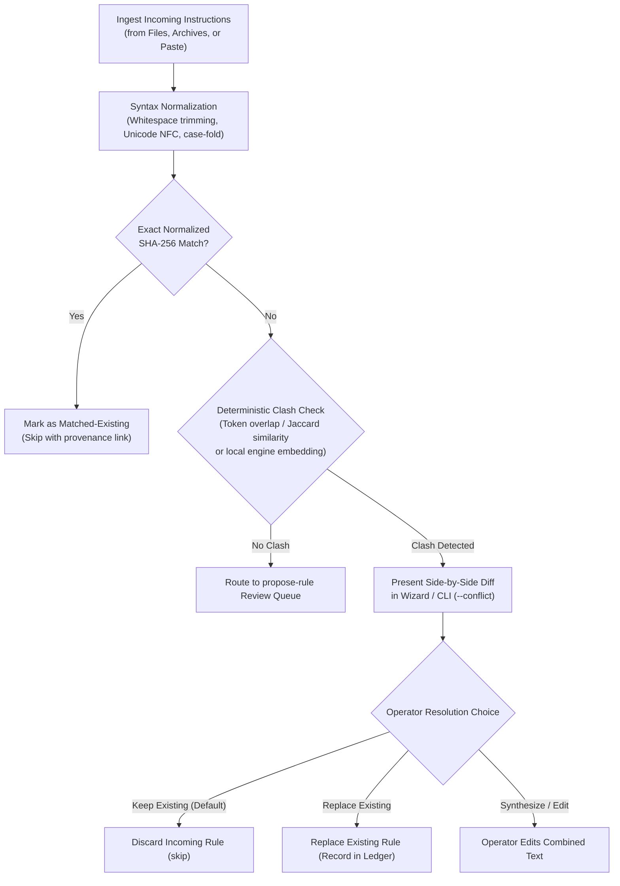
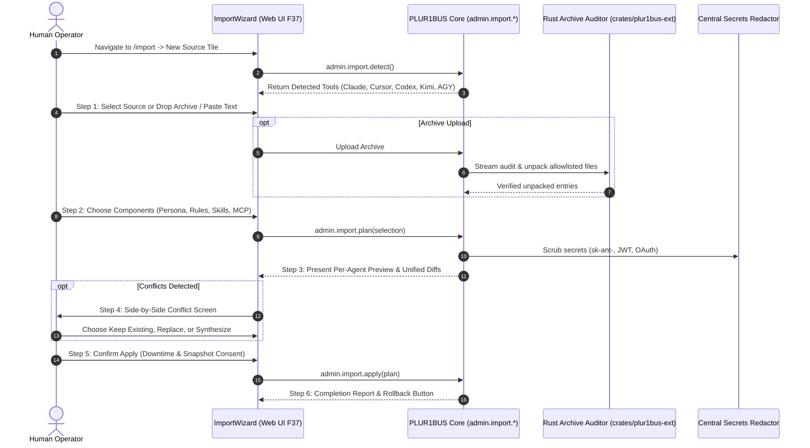
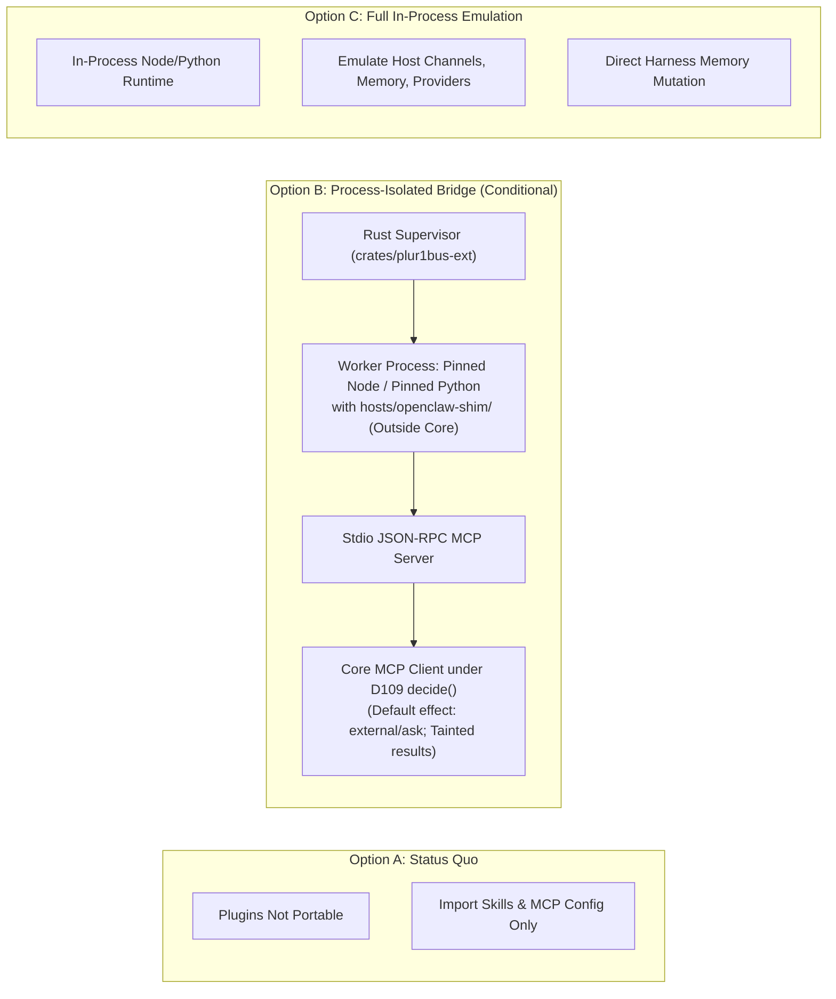

# Profile Import and Foreign Plugin Compatibility Specification

**Status:** Design specification · **Date:** 2026-10-27 (revised 2026-10-31) · **Deciders:** Christian (owner) · **Author:** agy (Antigravity) · **Inputs:** `docs/phase0/auftrag-original-2026-09-21.md` §4.2; `docs/import.md`; `docs/superpowers/specs/2026-09-27-extensions-ecosystem-design.md` §3, §7.3, §8; `docs/research/2026-10-27-profile-and-extension-sources.md`; [`docs/superpowers/plans/2026-10-31-profile-import-and-plugin-compat.md`](../plans/2026-10-31-profile-import-and-plugin-compat.md); ADR-003, ADR-005, ADR-010, ADR-011, ADR-019 / D120; Proposed Register Entry **D121** (sub-ids D121-J1 to D121-J6).

---

## 1. Overview and Objectives

### 1.1 Context and Problem Statement

The PLUR1BUS Harness provides offline and supervised import capabilities for legacy OpenClaw and Hermes installations ([`docs/import.md`](../../import.md) §10–§13). However, two critical gaps remain:

1. **No profile import from modern AI coding and chat tools**: While the harness can drive external coding agents via the Agent Bridge ([ADR-011](../../adr/ADR-011-external-coding-agents.md)), it cannot import user profiles, custom instructions, persona definitions, project rules, skills, or MCP server configurations from tools such as Claude Code, OpenAI Codex, Cursor, Kimi, AGY/Gemini, or Grok. Note that legacy OpenClaw, Hermes, HM1, and HM2 remain fully covered by their existing dedicated M v2 importers (`docs/import.md` §13); the profile importer focuses strictly on the 7 new tool sources.
2. **Web UI Import wizard extension**: The original commission ([`docs/phase0/auftrag-original-2026-09-21.md`](../../phase0/auftrag-original-2026-09-21.md) §4.2) requires a re-runnable UI wizard. On main, F37 already describes the built `ImportWizard` ([`docs/web-ui.md`](../../web-ui.md) F37, `packages/web/src/pages/import/*`), and Paket O ([#838](https://github.com/Cyb3rb1ade/PLUR1BUS-Harness/pull/838)) adds prompt import. Milestone M7c extends `ImportWizard` (F37) with new tiles for the 7 new sources, granular component selection, side-by-side instruction conflict resolution, archive dropzone, and atomic rollback.
3. **Foreign plugin policy revision (Owner directive 2026-10-27)**: The Extensions specification ([`docs/superpowers/specs/2026-09-27-extensions-ecosystem-design.md`](2026-09-27-extensions-ecosystem-design.md) §3, §7.3) originally excluded foreign plugin code as "not portable". On 2026-10-27, the owner directed that OpenClaw and Hermes plugins should "just work" where viable. This specification provides the empirical survey, technical architecture, and decision framework for that capability, addressing D9 explicitly and defining strict isolation boundaries.

### 1.2 Core Objectives

- **Scoped profile intake**: Ingest persona, instructions, user facts, memories, skills, and MCP configurations across 7 new AI tool sources (Claude Code, OpenAI Codex, Cursor, Kimi, AGY/Gemini, Grok via paste, and Grokbot [dropped/unsupported]).
- **Extended Web wizard (extending F37 `ImportWizard`)**: Deliver a fully accessible, bilingual (DE/EN) wizard extension with automatic source detection, granular entity selection, side-by-side conflict resolution, transactional execution, and one-click rollback.
- **Process-isolated foreign plugin bridge (Option B, conditional)**: Provide an out-of-process isolation bridge for OpenClaw (Node) and Hermes (Python) plugins, exposing tools as local MCP servers governed by the D109 `decide()` policy evaluator, while cleanly rejecting host-level memory, channel, provider, and context-engine overrides. V1 is strictly limited to tools only; services and turn hooks are excluded. Full kernel sandboxing (Q16) is a formal precondition for production activation.
- **Strict security & zero credential migration (ADR-005, ADR-011)**: Untrusted imported instructions never enter the prompt cache or system prompt without explicit user preview and quarantine in `propose-rule`. Sensitive tokens are scrubbed using the central redactor. Zero credential or session hijacking is permitted; no code path reads credential files (`auth.json`, `.credentials.json`).

---

## 2. Mapping Architecture

### 2.1 Target Model Mapping

PLUR1BUS structures agent cognition and runtime configuration through explicit architectural zones defined in ADR-003 and ADR-010. Foreign concepts map deterministically into this model:

| Source Entity | PLUR1BUS Target | Architectural Placement | Rationale & Cache Rules (ADR-010) |
|---|---|---|---|
| **Persona / Tone / Voice** | `SOUL.md` (exactly one per agent, D14) | System Prompt (Zone 2, above BP2) | Static persona definition; changes invalidate prompt cache from BP2 downwards. |
| **Agent Operational Identity** | `IDENTITY.md` | System Prompt (Zone 2, above BP2) | Operating context and environment facts for the agent. |
| **User Facts & Preferences** | `USER.md` + Engine Memory Cards (`scope: user`) | Frozen Memory Snapshot (Zone 3, BP3) | Stable facts about the human user. Bound to verified human principal (`trust: "proved"`). Without proved user, rejected with `unresolved-user-scope`. Default confidentiality is `vertraulich` (D116 (6)), never `teilbar`. |
| **Global / Operating Instructions** | Agent Operating Instructions | System Prompt (Zone 2, above BP2) | General guidelines ("always do X", "never do Y"). Quarantined in `propose-rule` review queue before operator approval. |
| **Project / Workspace Rules** | Workspace Guidelines (`AGENTS.md`) | Workspace Scope (Zone 2 for active workspace) | Context rules derived from `.cursorrules`, `CLAUDE.md`, or project `AGENTS.md`. Quarantined in `propose-rule`. |
| **Skills** | Agent Skills (`skills/<id>/SKILL.md`) | Extensions Registry (`skills/`) | Conforms to Agent Skills standard (Extensions Spec §4.3). Trust tier `imported`. |
| **MCP Servers** | `mcp-servers` configuration | Tool Definitions (Zone 1, BP1) | Declarative stdio/HTTP server entries. Conforms to `import.mcp-candidate/1`: slot names preserved, arguments and env values scrubbed, disabled by default. Changes invalidate BP1. |
| **Foreign Plugins** (Tools only) | Bridged MCP Server (Option B) | Tool Definitions (Zone 1, BP1) under D109 | Foreign tool plugins exposed as isolated MCP endpoints; calls gated by `decide()`. Default effect `external`/ask; results marked tainted. |
| **Foreign Memory / Channels / Providers** | *Excluded from Bridge* | N/A | Handled natively by PLUR1BUS core and engine. Rejected fast with `E_UNSUPPORTED_PLUGIN_KIND`. |

#### Confidentiality & Principal Constraints (D116, ADR-007)
- **Confidentiality Level:** In accordance with D116 (6), all imported memories default to `vertraulich`. They are never imported as `teilbar` without explicit per-item promotion by the operator.
- **User Scope vs. Agent-Private:** As decided in ADR-007 Q4 and Paket O, `scope: user` memory cards require an unambiguous human principal authenticated with `trust: "proved"`. The CLI cannot mint a proved human principal; unauthenticated CLI profile imports assign facts to agent-private scope or fail with `unresolved-user-scope`.
- **Prompt Cache (ADR-010) Impact:** Zone 2 instructions sit between Breakpoint 1 (tools) and Breakpoint 2 (conversation history). Any addition or edit to instructions forces a re-computation of the prompt cache from BP2 downwards. To prevent accidental cache invalidation and reasoning instability, incoming instructions must pass through the `propose-rule` review queue and require operator confirmation before touching Zone 2 files (`SOUL.md`, `IDENTITY.md`, `AGENTS.md`).

---

### 2.2 Multi-Source Conflict Resolution

When importing instructions into an agent that already contains configured guidelines, conflicting rules can arise (e.g., "always provide concise bullet points" vs. "provide exhaustive explanations").

> [!IMPORTANT]
> **Strict Rule: No Silent Concatenation.**
> Concatenating opposing instructions pollutes Zone 2 of the system prompt, confuses model reasoning, and degrades prompt cache performance. Conflicting rules must be detected and resolved deterministically without external cloud LLM dependencies.

#### Conflict Resolution Workflow



1. **Exact Deduplication**: Normalized rules matching existing entries by SHA-256 hash are flagged as `matched-existing` and skipped.
2. **Deterministic Clash Detection**: Rules with overlapping intent but divergent parameters are detected locally via normalized token overlap and Jaccard similarity, optionally supplemented by the local Rust engine embedding if available offline. **Zero cloud LLM inference is permitted** for conflict detection to respect `privacy.localOnly` and prevent data leaks.
3. **Interactive Resolution (`--conflict`)**:
   - *Keep Existing* (default, mapped to `--conflict skip`): Preserves current PLUR1BUS agent behavior.
   - *Replace Existing* (mapped to `--conflict overwrite`): Replaces the existing rule, logging the previous version in the rollback ledger.
   - *Synthesize / Edit*: Opens an inline editor allowing the operator to combine both intents.
4. **Plan Hash and Byte Invariance**: The preview displayed in the CLI or Web UI must exactly equal the applied bytes (plan hash). Preprocessing and normalization must not strip content (such as HTML comments or bidirectional Unicode characters) in preview while leaving them in apply.
5. **Per-Entry Bounds**: Following Paket O standards, individual imported instruction entries are capped at 512 KiB and 4 000 characters.
6. **Provenance Tracking**: Every imported rule and memory card carries immutable metadata:
   - `provenance: "imported"`
   - `sourceRef: "<source>:<kind>:<id>;run=<runId>"`

---

## 3. Interfaces and Security Architecture

### 3.1 CLI Interface

Profile import integrates into the existing `plur1bus import` command structure, strictly scoped to the 7 new sources:

```bash
# Detect available profile sources across the host
plur1bus import profile --detect

# Preview profile import from a specific source (dry-run by default)
plur1bus import profile claude --preview --agent main

# Apply profile import with explicit conflict resolution strategy (default: skip)
plur1bus import profile cursor --apply --agent dev --workspace ws-alpha --conflict skip

# Import from a manual export archive (.zip or .tar.gz)
plur1bus import profile gemini --archive ~/Downloads/takeout-gemini.zip --apply

# Rollback a completed profile import run
plur1bus import profile --rollback <runId-or-report-path>
```

#### CLI Exit Codes (Aligned with `docs/errors.md`)
- `0`: Success (dry-run plan generated or apply completed cleanly).
- `1`: General or validation error (invalid archive, corrupted schema, internal error).
- `2`: Usage error or refused before work (missing required arguments, source inaccessible).
- `3`: `E_LOCKED` (concurrent lock held).

#### Source Delegation
Legacy OpenClaw, Hermes, HM1, and HM2 sources are handled by the existing dedicated importers (`plur1bus import openclaw` and `plur1bus import hermes`, `docs/import.md` §13). Invoking `plur1bus import profile openclaw` delegates to `plur1bus import openclaw` with a diagnostic notice.

---

### 3.2 RPC Interface

Profile import extends the existing administrative import namespace (`admin.import.*`, `docs/import.md` §13.1) rather than creating a parallel API surface. All methods are Owner/Admin only, require authenticated sessions, and are assigned the next free RPC minor version (**1.13.0**, following 1.10.0 in #837, 1.11.0 in #838, and 1.12.0 in #820):

- `admin.import.detect`: Extended to return detected profile sources alongside existing OpenClaw/Hermes installations.
- `admin.import.plan`: Generates an immutable preview manifest for a profile source, archive, or prompt text, checking for instruction conflicts against target agents.
- `admin.import.apply`: Requires fresh preflight and downtime consent; takes import locks, journals intent, snapshots mutated state, applies memory cards and curated files atomically, and writes `report.json` (0600).
- `admin.import.rollback`: Reverts changes associated with a specific `importRunId` using the cold recovery snapshot.

Agents and WebMCP receive no import methods (`docs/import.md` §13.1).

---

### 3.3 Web UI Wizard (Extending F37 `ImportWizard`)

The Web UI extends the existing `ImportWizard` ([`docs/web-ui.md`](../../web-ui.md) F37, `packages/web/src/pages/import/*`):



1. **Step 1: Detect & Select Source**: Adds tiles for the 7 new tools alongside existing OpenClaw, Hermes, and Prompt Import tiles. Provides an archive dropzone (`.zip`, `.tar.gz`) and prompt paste box.
2. **Step 2: Component Selection**: Granular checklist grouped by category (Persona/Identity, Instructions, User Facts, Skills, MCP Servers).
3. **Step 3: Preview**: Unified diffs for `SOUL.md`, `IDENTITY.md`, `USER.md`, and `AGENTS.md`, alongside proposed memory cards and MCP tool additions.
4. **Step 4: Conflict Resolution**: Side-by-side comparison screen for detected rule clashes with Keep / Replace / Synthesize options.
5. **Step 5: Apply & Execution**: Displays progress bar, takes pre-flight snapshot, and writes state atomically.
6. **Step 6: Report & Rollback**: Comprehensive run statistics, download for `report.json`, and one-click rollback.

---

### 3.4 Container Mode Strategy

When PLUR1BUS runs inside a container (e.g., Docker desktop bundle per D77):
- **No Insecure Host Mounts**: Blindly mounting the host home directory (`-v ~:/host-home:ro`) is strictly prohibited, as it exposes sensitive directories (`~/.ssh`, `~/.aws`, browser profiles, crypto wallets) and violates the snapshot-producer design (D91/D107).
- **No Unauthenticated Probing**: `/.dockerenv` sniffing is avoided. In accordance with F37, only authenticated container deployment metadata may propose host endpoints (`host.docker.internal`).
- **Supported Workflows in Containers**:
  1. *Archive Upload & Text Paste*: The Web UI enables direct drag-and-drop of export archives and copy-pasted exports.
  2. *Authenticated Desktop Helper (D107)*: When paired with the native desktop shell helper, the helper gathers sanitized source snapshots on the host and transmits them over the authenticated host bridge (`host.importSnapshot`).

---

### 3.5 Security and Hygiene Architecture

- **Prompt Injection Defense**: All imported instructions originate from external environments and are treated as untrusted text. They are never automatically activated into Zone 2; they must be previewed and routed to the `propose-rule` review queue.
- **Strict Key-Allowlist Parsers**: Parsers only extract explicitly documented configuration keys. Unknown, unparsed, or executable fields are discarded.
- **Zero Credential Migration (ADR-005, ADR-011)**:
  - Credential files (`~/.codex/auth.json`, `~/.claude/.credentials.json`, tokens in Cursor `state.vscdb`) are prohibited from being read or parsed.
  - An automated spike-11 test asserts that no code path attempts to open or read credential files.
  - `secret-file-names.ts` and leak-sweep fixtures are extended to prevent reading credential stores.
  - Imported MCP server configs reuse `import.mcp-candidate/1` (`mcp-config.ts`): command arguments and environment variables are scrubbed, slot names are preserved, servers are set to disabled by default, and unsupported configurations route to manual setup.
- **Enhanced Centralized Redaction**: The central redactor (`crates/plur1bus/src/firstaid_bundle/redact.rs` and `packages/core/src/logs/redact.ts`) is extended to match Anthropic keys (`sk-ant-`), JSON Web Tokens (JWT), OAuth refresh tokens, and private key blocks.
- **Safe Filesystem Traversal**: File reading uses `SourceReader` / `readSourceFileSafe` with `O_NOFOLLOW` and the `@plur1bus/remote-fs` read-only port to guarantee that symlinked files (e.g., a `.cursorrules` pointing to `~/.ssh/id_rsa`) are rejected.
- **Hardened Archive Extraction**: Archive intake enforces stream selection of named entries, a 10 MiB limit per decompressed file, a 10:1 maximum decompression ratio, and rejects symlinks, hardlinks, and directory traversal (`..`). The implementation reuses the strict Rust ZIP/tar audit from `crates/plur1bus-ext`.

---

## 4. Foreign Plugin Compatibility: Analysis and Decision Matrix

### 4.1 Real Plugin Ecosystem Survey and Taxonomy

To evaluate the owner's directive that "Hermes and OpenClaw plugins should just work", we examine the actual host contracts and plugin taxonomies across both ecosystems based on pinned repository evidence (`host-contract.md`, `openclaw` `b9421f4`, `hermes` `743ee72`).

#### Real Plugin Kinds in OpenClaw and Hermes

| Plugin Kind | Real Host API (OpenClaw) | Real Host API (Hermes) | Description | V1 Bridge Viability (Option B) |
|---|---|---|---|---|
| **Tool / Function** | `api.registerTool` | `register_tool`, `@tool` | Adds callable functions for LLM execution. | **Full** (Mapped to stdio MCP tools) |
| **Command** | `api.registerCommand` | `register_command`, `register_cli_command` | Adds slash commands / CLI utilities. | **Excluded in v1** (OpenClaw commands short-circuit turns [`host-contract.md:118`]; HYG-003 bans slash command emulation; MCP prompts only ingest content via `tool_result`) |
| **Service / Daemon** | `api.registerService` | `BackgroundService` | Long-running background helper processes. | **Excluded in v1** (Requires supervised service manager; deferred) |
| **Hook / Interceptor** | `before_prompt_build`, `before_agent_reply`, `before_dispatch`, `before_tool_call` | `register_hook`, `register_middleware` | Lifecycle hooks modifying prompts or context. | **Excluded** (Rewriting prompts breaks ADR-010 cache layout; MCP has no turn lifecycle events) |
| **Channel / Messaging** | `api.registerGatewayMethod`, `api.registerHttpRoute` | `register_platform`, `ChannelPlugin` | Implements chat platform adapters. | **Excluded** (Native harness responsibility) |
| **Memory Provider** | `api.registerMemoryPromptSupplement` | `MemoryProvider` | Replaces memory/vector backend. | **Excluded** (Native engine responsibility) |
| **LLM Provider** | Custom provider adapters | `ProviderPlugin` | Replaces LLM inference routing. | **Excluded** (Native providers package) |

---

### 4.2 Top 20 Plugins Survey: OpenClaw

Evaluated against the real OpenClaw host contract:

| # | Plugin Name | Real Kind | Real APIs Invoked | Required Permissions | Option B Support (V1 Tools Only) |
|---|---|---|---|---|---|
| 1 | `@openclaw/plugin-web-search` | Tool | `api.registerTool`, `fetch` | Network | **Yes** (via MCP tool) |
| 2 | `@openclaw/plugin-weather` | Tool | `api.registerTool`, `fetch` | Network | **Yes** (via MCP tool) |
| 3 | `@openclaw/plugin-shell` | Tool | `api.registerTool`, `child_process.spawn` | Process | **Denied by D106** (Duplicates native exec tool) |
| 4 | `@openclaw/plugin-filesystem` | Tool | `api.registerTool`, `fs/promises` | Filesystem | **Denied by D106** (Duplicates native fs tool) |
| 5 | `@openclaw/plugin-git` | Tool | `api.registerTool`, `execFile('git')` | Process, Filesystem | **Denied by D106** (Duplicates native git tool) |
| 6 | `@openclaw/plugin-postgres` | Tool | `api.registerTool`, `pg.Pool` | Network | **Yes** (via MCP tool) |
| 7 | `@openclaw/plugin-sqlite` | Tool | `api.registerTool`, `better-sqlite3` | Filesystem | **Yes** (via MCP tool) |
| 8 | `@openclaw/plugin-calculator` | Tool | `api.registerTool`, pure JS math | None | **Yes** (via MCP tool) |
| 9 | `@openclaw/plugin-fetch` | Tool | `api.registerTool`, `fetch` | Network | **Yes** (via MCP tool) |
| 10 | `@openclaw/plugin-github` | Tool | `api.registerTool`, `@octokit/rest` | Network | **Yes** (via MCP tool) |
| 11 | `@openclaw/plugin-docker` | Tool | `api.registerTool`, `dockerode` | Process, Socket | **Denied by D106** (Process execution) |
| 12 | `@openclaw/plugin-datetime` | Tool | `api.registerTool`, `Intl` | None | **Yes** (via MCP tool) |
| 13 | `@openclaw/plugin-clipboard` | Tool | `api.registerTool`, clipboard | Process | **Yes** (via MCP tool) |
| 14 | `@openclaw/plugin-transcribe` | Tool / Service | `api.registerTool`, `ffmpeg` | Process, Network | **Yes** (Tool leg only via MCP) |
| 15 | `@openclaw/plugin-image-gen` | Tool | `api.registerTool`, `fetch` | Network | **Yes** (via MCP tool) |
| 16 | `@openclaw/plugin-slack` | Channel | `api.registerGatewayMethod` | Network | **No** (Channel: Native harness) |
| 17 | `@openclaw/plugin-discord` | Channel | `api.registerGatewayMethod` | Network | **No** (Channel: Native harness) |
| 18 | `@openclaw/plugin-memory-redis` | Memory | `api.registerMemoryPromptSupplement` | Network | **No** (Memory: Native engine) |
| 19 | `@openclaw/plugin-anthropic` | Provider | Provider adapter | Network | **No** (Provider: Native providers) |
| 20 | `@openclaw/plugin-summarizer` | Hook | `before_prompt_build` | Internal | **No** (Hook: ADR-010 cache violation) |

**OpenClaw V1 Viability**: 15 of 20 (75.0%) are tools; 4 duplicate native tools and are denied under D106, leaving 11 distinct tools running cleanly over Option B.

---

### 4.3 Top 20 Plugins Survey: Hermes

Evaluated against the real Hermes host contract (`register(ctx)`):

| # | Plugin Name | Real Kind | Real APIs Invoked | Required Permissions | Option B Support (V1 Tools Only) |
|---|---|---|---|---|---|
| 1 | `hermes-plugin-web-search` | Tool | `register_tool`, `httpx` | Network | **Yes** (via MCP tool) |
| 2 | `hermes-plugin-weather` | Tool | `register_tool`, `requests` | Network | **Yes** (via MCP tool) |
| 3 | `hermes-plugin-bash` | Tool | `register_tool`, `subprocess` | Process | **Denied by D106** (Duplicates native exec tool) |
| 4 | `hermes-plugin-files` | Tool | `register_tool`, `pathlib` | Filesystem | **Denied by D106** (Duplicates native fs tool) |
| 5 | `hermes-plugin-git` | Tool | `register_tool`, `gitpython` | Process, Filesystem | **Denied by D106** (Duplicates native git tool) |
| 6 | `hermes-plugin-duckduckgo` | Tool | `register_tool`, `duckduckgo_search` | Network | **Yes** (via MCP tool) |
| 7 | `hermes-plugin-wikipedia` | Tool | `register_tool`, `wikipedia-api` | Network | **Yes** (via MCP tool) |
| 8 | `hermes-plugin-arxiv` | Tool | `register_tool`, `arxiv` | Network | **Yes** (via MCP tool) |
| 9 | `hermes-plugin-python-eval` | Tool | `register_tool`, `code.Interactive` | Process | **Denied by D106** (Arbitrary process eval) |
| 10 | `hermes-plugin-system-info` | Tool | `register_tool`, `psutil` | Process | **Yes** (via MCP tool) |
| 11 | `hermes-plugin-rss` | Tool | `register_tool`, `feedparser` | Network | **Yes** (via MCP tool) |
| 12 | `hermes-plugin-sql` | Tool | `register_tool`, `sqlalchemy` | Network, Filesystem | **Yes** (via MCP tool) |
| 13 | `hermes-plugin-browser` | Tool / Service | `register_tool`, `playwright` | Process, Network | **Yes** (Tool leg only via MCP) |
| 14 | `hermes-plugin-chart` | Tool | `register_tool`, `matplotlib` | Filesystem | **Yes** (via MCP tool) |
| 15 | `hermes-plugin-clipboard` | Tool | `register_tool`, `pyperclip` | Process | **Yes** (via MCP tool) |
| 16 | `hermes-plugin-telegram` | Channel | `register_platform` | Network | **No** (Channel: Native harness) |
| 17 | `hermes-plugin-discord` | Channel | `register_platform` | Network | **No** (Channel: Native harness) |
| 18 | `hermes-plugin-chroma` | Memory | `MemoryProvider` | Filesystem, Network | **No** (Memory: Native engine) |
| 19 | `hermes-plugin-ollama` | Provider | `ProviderPlugin` | Network | **No** (Provider: Native providers) |
| 20 | `hermes-plugin-audit-log` | Hook | `register_hook` | Filesystem | **No** (Hook: MCP has no turn events) |

**Hermes V1 Viability**: 15 of 20 (75.0%) are tools; 4 duplicate native tools and are denied under D106, leaving 11 distinct tools running cleanly over Option B.

**Combined Viability**: 30 of 40 (75.0%) across both ecosystems are tools. Exactly 10 plugins are non-tool kinds (channels, memory providers, LLM providers, turn hooks) that cannot run over MCP.

---

### 4.4 Options Comparison: Technical and Security Evaluation



| Evaluation Dimension | Option A: Maintain Status Quo | Option B: Process-Isolated Bridge (Conditional) | Option C: Full Emulation |
|---|---|---|---|
| **Architectural Purity** | **High**: Zero foreign code enters the harness. | **High**: Foreign code runs in separate subprocess; interacts strictly via standard MCP protocol. | **Poor**: Foreign abstractions compromise core harness boundaries. |
| **Security & Isolation** | **Highest**: No foreign runtime execution. | **Restated Honestly**: Process separation + per-call invocation approval; **NO OS kernel sandbox in v1**. Scrubbed env; tainted results; denied native duplicates (D106). Q16 kernel sandbox is a precondition for production activation. | **Dangerous**: Foreign plugin code runs in core daemon memory space. |
| **D9 Boundary Compliance** | **Full**: No OpenClaw emulation. | **Addressed**: Reopens D9 strictly for tool-kind plugins. Shim lives in `hosts/openclaw-shim/` completely outside `packages/core`. | **Violated**: Massive OpenClaw emulation layer inside core. |
| **Ecosystem Coverage** | **0%** of plugins (skills & MCP only). | **75.0%** of top plugins (tools only; channels, memory, providers, hooks excluded). | **100%** theoretical (severe maintenance reality). |
| **Prompt Cache Stability (ADR-010)** | **Unaffected**. | **Preserved**: Tools declared deterministically in Zone 1. Context engines and hooks rejected. | **Broken**: Context engines rewrite prompts unpredictably. |
| **Implementation Effort** | 0 ad. | **16–23 ad** (split into J4a: OpenClaw/Node 8–11 ad; J4b: Hermes/Python 8–12 ad). | **40–60 ad** (perpetual maintenance sink). |
| **Upstream Drift Resilience** | High. | **Moderate**: Minimal tool registration shim; upstream drift in hooks or channels has zero impact. | **Very Low**: Breaks on every minor upstream host update. |

---

### 4.5 Addressing Decision D9 and Codebase Hygiene

Decision D9 (`docs/superpowers/specs/2026-09-27-core-architecture-spec.md` line 23) states:
> *"No OpenClaw idiom crosses the boundary. We build PLUR1BUS, not an OpenClaw emulation layer."*

Option B requires hosting a compatibility shim (`api.registerTool`) so foreign plugins can initialize. To reconcile this with D9 and codebase hygiene (`HYG-001` in `scripts/lint-hygiene.mjs`):
1. **Reopening D9:** Owner Decision D121-J1 explicitly quotes D9 and reopens it **strictly for tool-kind plugins running out-of-process**.
2. **Package Isolation Outside Core:** The shim code must never live in `packages/core/`. It is placed in a dedicated, isolated package under `hosts/openclaw-shim/`.
3. **Hygiene Rule Enforcement:** `packages/core` remains strictly subject to `HYG-001` (zero OpenClaw idioms permitted). Only the isolated package `hosts/openclaw-shim/` is added to `ALLOW_DIRS` for `HYG-001`.

---

### 4.6 Detailed Bridge Architecture (Option B)

1. **Rust Supervisor (`crates/plur1bus-ext`):** Implemented in Rust by a Claude agent per D120 / ADR-019. Manages child process lifecycle, process limits, restarts, and stdio pipes.
2. **Pinned Runtimes:** OpenClaw plugins execute using the pinned Node 24 runtime. Hermes plugins execute using the pinned Python runtime (D58; blocked behind the Python runtime producer and audit).
3. **Tool-Only Shims:** `hosts/openclaw-shim/index.js` provides mock objects for `api.registerTool`. Attempts to call `registerChannel`, `registerMemoryPromptSupplement`, or lifecycle hooks fail fast with `E_UNSUPPORTED_PLUGIN_KIND`.
4. **MCP Translation:** The shim wraps registered tools into a standard Model Context Protocol (MCP) server listening on stdio JSON-RPC.
5. **Gating via D109 `decide()`:** The harness connects to the worker as an MCP client. Every tool execution passes through the native `decide()` policy evaluator:
   - Default effect is `external`/ask. Annotations may only raise the requirement, never lower it.
   - All results from foreign tools are tagged as **tainted** (D109).
   - Duplicate tools that replicate native exec, fs, or git are denied (D106).
6. **Execution Integrity:** The bridge process runs with a scrubbed environment (`PATH`, `HOME`, minimal temp dir). Plugin trees are pinned by SHA-256 and re-verified on start (Extensions Spec §8.7). If `extensions.allowUnsigned=false`, the bridge is disabled.
7. **Precondition Q16:** Full kernel OS sandboxing (bubblewrap on Linux, sandbox-exec on macOS, AppContainer on Windows per Q16) is a prerequisite for production activation. Until Q16 lands, the bridge is restricted to manual per-call interactive operator approval.

---

### 4.7 Mapping Other Ecosystems

Ecosystems without full plugin runtimes map onto standard PLUR1BUS extension types:
- **Cursor**: `.cursorrules` and `.cursor/rules/*.mdc` map to workspace rules (Zone 2, via `propose-rule`). `.cursor/mcp.json` maps to `mcp-servers`.
- **Gemini / AGY**: Skills in `~/.gemini/config/skills/` map to Agent Skills (`skills/`). MCP schemas map to `mcp-servers`.
- **Codex / Kimi**: Skills map to Agent Skills (`skills/`). Prompts map to slash commands. Hooks containing arbitrary shell commands (e.g., in Codex `hooks.json` or Kimi `config.toml` `[[hooks]]`) are **skipped and reported as skipped** in accordance with Extensions Spec §3 and §7.3.

---

## 5. Implementation Plan and Milestones

Implementation details, work package breakdowns, assignees, and verification gates are specified in [`docs/superpowers/plans/2026-10-31-profile-import-and-plugin-compat.md`](../plans/2026-10-31-profile-import-and-plugin-compat.md).

### 5.1 Scoped Milestones in `docs/milestones.md`

All three milestones sit outside the v0.1.0 total; X3b is scheduled strictly post-v0.1.0:

1. **`M7b` — Profile Import Core & CLI (`plur1bus import profile`)**:
   - Extraction parsers for 7 new AI tools across Linux, macOS, and Windows.
   - Rust archive intake & security audit in `crates/plur1bus-ext` (P-J2a).
   - Deterministic conflict detection engine, `admin.import.*` RPC extensions (1.13.0), and Rust CLI `plur1bus import profile`.
   - PII/secret scrubbing, leak-sweep fixtures, and spike-11 credential ban test.
   - Total effort: **10–15 ad**.
2. **`M7c` — Profile Import Web Wizard (Extending F37 `ImportWizard`)**:
   - Extends existing `ImportWizard` (F37) with tiles for the 7 new tools, component checklist, side-by-side conflict resolution screen, archive dropzone, and atomic rollback.
   - Full bilingual DE/EN accessibility (axe-core green).
   - Total effort: **3–5 ad**.
3. **`X3b` — Foreign Plugin Bridge (Split into X3b-a and X3b-b)**:
   - **`X3b-a` (OpenClaw / Node)**: Rust bridge supervisor (`crates/plur1bus-ext`), Node shim in `hosts/openclaw-shim/`, tools-only MCP bridge, D109 `decide()` gating. Effort: **8–11 ad**.
   - **`X3b-b` (Hermes / Python)**: Python shim in `hosts/hermes-shim/`, deferred behind Python runtime producer and audit. Effort: **8–12 ad**.

---

## 6. Decision Register D121 (Owner Questions and Recommendations)

The following architectural decisions are submitted to the owner for binding confirmation under register entry **D121**:

| ID | Decision Question | Context & Constraints | Options | Recommendation | Decided | Notes |
|---|---|---|---|---|---|---|
| **D121-J1** | Foreign Plugin Compatibility Strategy | Owner directed that OpenClaw and Hermes plugins should work. D9 forbids OpenClaw emulation. 75.0% (30/40) of top plugins are tools; channels, memory, providers, and hooks cannot run over MCP. | **Option B (Recommended)**: Out-of-process MCP bridge, tools only, no services in v1, D109 `decide()` gating, tainted results, scrubbed env, Q16 sandbox as precondition, D9 explicitly reopened.<br>**Option A**: Status quo (skills and MCP config only, no plugin code).<br>**Option C**: In-process emulation (rejected: violates security & D9). | **Adopt Option B conditionally**: Tools only, OpenClaw/Node first (X3b-a), no services in v1. Hermes/Python (X3b-b) deferred behind Python runtime producer and audit. Deny native duplicate tools (D106). Reopen D9 explicitly for tool-kind plugins. | Pending Owner | Prerequisite: Q16 sandbox. |
| **D121-J2** | Lint Hygiene Allowlist & Shim Package Location | `scripts/lint-hygiene.mjs` enforces `HYG-001` (banning OpenClaw idioms). D9 requires keeping harness core clean of foreign idioms. | **Option A (Recommended)**: Place shim completely outside `packages/core` under `hosts/openclaw-shim/`. Allowlist only that host package. Zero OpenClaw idioms in `packages/core`.<br>**Option B**: Place adapter in `packages/core/src/adapters/` (rejected: violates D9 and HYG-001). | **Adopt Option A**: Dedicated package `hosts/openclaw-shim/`. No foreign idioms in `packages/core`. | Pending Owner | Preserves D9 integrity. |
| **D121-J3** | Default Instruction Conflict Resolution | When importing instructions into an agent with existing guidelines, how should unreviewed conflicts resolve? | **Option A (Recommended)**: Default to `keep-existing` (`--conflict skip`). Instructions always route through `propose-rule` review queue, never auto-activated.<br>**Option B**: Overwrite existing rules (`--conflict overwrite`).<br>**Option C**: Concatenate (rejected: pollutes Zone 2 and breaks cache). | **Adopt Option A**: Default `skip`. Operator preview in `propose-rule` mandatory before touching Zone 2. | Pending Owner | Aligned with Paket O and ADR-010. |
| **D121-J4** | Confidentiality and Memory Scope Defaults | Ingesting facts and memories into engine stores under D116 and ADR-007. | **Option A (Recommended)**: Default D116 confidentiality level is `vertraulich` (never `teilbar`). `scope: user` requires proved human principal; CLI defaults to agent-private scope if unauthenticated.<br>**Option B**: Import as `teilbar` (rejected: potential data leak). | **Adopt Option A**: Default `vertraulich`. Strict adherence to ADR-007 Q4 and Paket O. | Pending Owner | Follows D116 (6). |
| **D121-J5** | Source Scope Partitioning | Multiple overlapping import paths exist in the harness (M v2, Paket O, profile import). | **Option A (Recommended)**: Scope `plur1bus import profile` strictly to the 7 new sources (Claude, Codex, Cursor, Kimi, AGY/Gemini, Grok paste, Grokbot dropped). Existing OpenClaw, Hermes, HM1, HM2 remain with existing M v2 importers.<br>**Option B**: Re-implement OpenClaw/Hermes in profile importer (rejected: code duplication). | **Adopt Option A**: Strict scope boundary. Sources 8–11 delegate to existing M v2 importers. | Pending Owner | Prevents parallel API surfaces. |
| **D121-J6** | Milestone Boundaries & ADR-019 / D120 Compliance | Sequencing and technology choice for implementation. | **Option A (Recommended)**: M7b, M7c, and X3b sit outside v0.1.0 total; X3b is post-v0.1.0. All new components are Rust implemented by Claude agents; Node/Python shims in `hosts/` are explicit foreign-runtime exceptions.<br>**Option B**: Implement bridge supervisor in TypeScript (rejected: violates D120 / ADR-019). | **Adopt Option A**: Rust components assigned to Claude agents. Milestones scheduled outside v0.1.0. | Pending Owner | Complies with ADR-019. |
